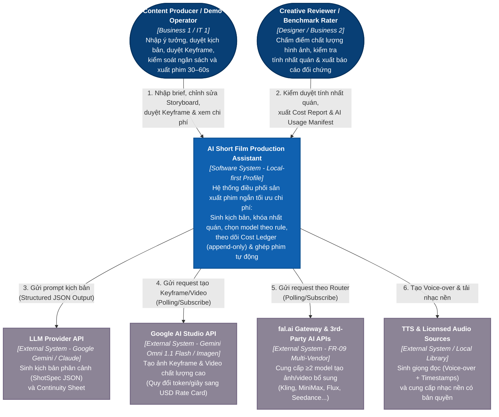
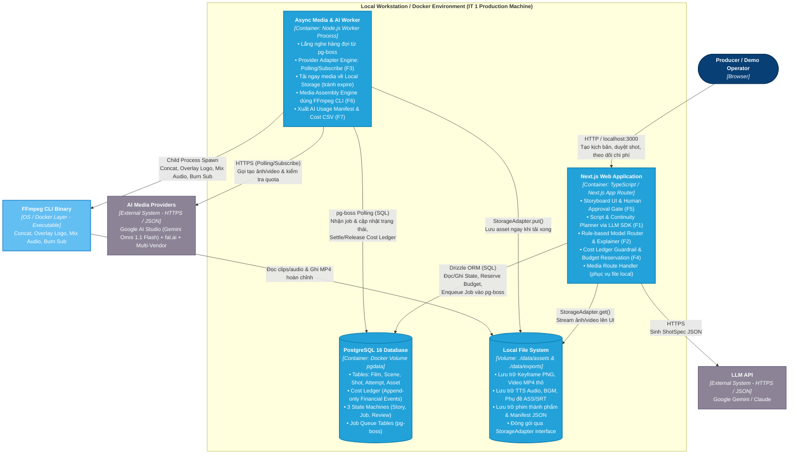

# C4 Model Architecture — Level 1 & Level 2

## FC-001 deployment clarification [DECIDED, 2026-11-20]

Source: [FC-001 v1.1.1](../../specs/film-creation/spec.md).
The existing Web container runs Next.js App Router and mounts the Hono app in
Node.js route handlers. Hono is not a fourth API service. Browser accesses only
http://127.0.0.1:3000; db/worker ports remain private. Migration is a one-off
startup command before web/worker, not a new runtime domain service.
Film create/read does not depend on worker readiness or dispatch jobs.
FC-001 adds opaque operator sessions in PostgreSQL and browser-safe shared
contracts; financial/generation/media components in the diagrams remain future
capabilities, not evidence that those components are implemented.

**System:** AI-Powered Cost-Efficient Short Film Production Assistant  
**Status:** [PROPOSED] (Aligned with DEC-Q01 to DEC-Q04 Local-first Profile)  
**Owners:** IT 1 (Lead Backend & AI Engine) & IT 2 (Frontend & Media Pipeline)  
**Date:** 2026-11-18  
**Editable Draw.io:** [`c4_model_architecture.drawio`](./c4_model_architecture.drawio)

---

## 1. C4 Level 1 — System Context Diagram

Sơ đồ ngữ cảnh hệ thống mô tả cách hệ thống tương tác với người dùng nội bộ (team sản xuất/demo) và các hệ thống AI/Media bên ngoài thông qua các ranh giới Adapter chuẩn hóa.

---

## 2. C4 Level 2 — Container Diagram (Local-first Modular Monolith)

Sơ đồ Container chi tiết hóa các thành phần chạy bên trong máy trạm Local (Next.js App, Background Worker, Docker PostgreSQL 16 và Local File System) cùng luồng dữ liệu tài chính/media.

---

## 3. Bảng Phân rã Trách nhiệm Kỹ thuật theo Container

| Container | Công nghệ cốt lõi | Trách nhiệm & Bất biến kỹ thuật (Invariants) | Owner |
| :--- | :--- | :--- | :--- |
| **Next.js Web Application** | Next.js (App Router), TypeScript, Tailwind, shadcn/ui, Drizzle ORM | • Quản lý 3 state machine độc lập: Story State, Generation Job State, và Asset Review State. • Thực hiện Budget Reservation trong DB trước khi đẩy job vào hàng đợi. • Không xử lý render video nặng trực tiếp trên HTTP request để tránh timeout. | IT 2 (UI) & IT 1 (API/Router) |
| **Async Media & AI Worker** | Node.js, pg-boss, Provider SDKs, StorageAdapter | • Chạy tách biệt khỏi web server; tự động retry khi gặp lỗi mạng tạm thời. • Bắt buộc tải file kết quả từ URL của provider về `./data/assets` ngay khi job thành công (tránh link hết hạn). • Mọi lượt gọi thất bại đều ghi nhận sự kiện chốt chi phí/lỗi vào Cost Ledger. | IT 1 |
| **PostgreSQL 16 Database** | Docker `postgres:16` | • Lưu trữ dữ liệu quan hệ (Film -> Scene -> Shot -> Attempt -> Asset) và hàng đợi `pg-boss`. • Bảng `cost_ledger_events` thiết kế dạng append-only, quy đổi mọi đơn vị (token, giây, credit) về USD theo bảng giá niêm yết (Rate Card). | IT 1 |
| **Local File System & FFmpeg** | Local Disk (`./data`), FFmpeg CLI | • Đóng gói sau interface `StorageAdapter` để có thể chuyển sang Cloudflare R2 ở giai đoạn sau mà không sửa logic nghiệp vụ. • FFmpeg chịu trách nhiệm ghép clip, chèn logo/text tĩnh, trộn giọng đọc + nhạc nền và đốt phụ đề (ASS/SRT). | IT 2 |
