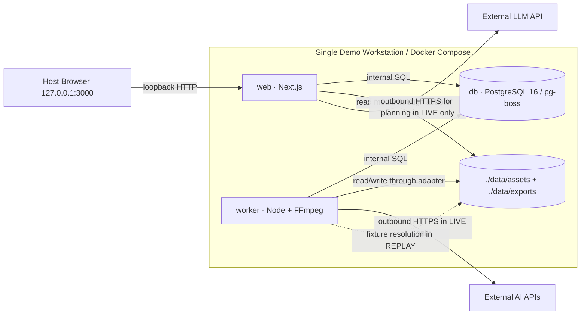
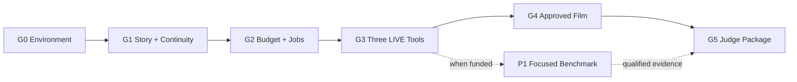
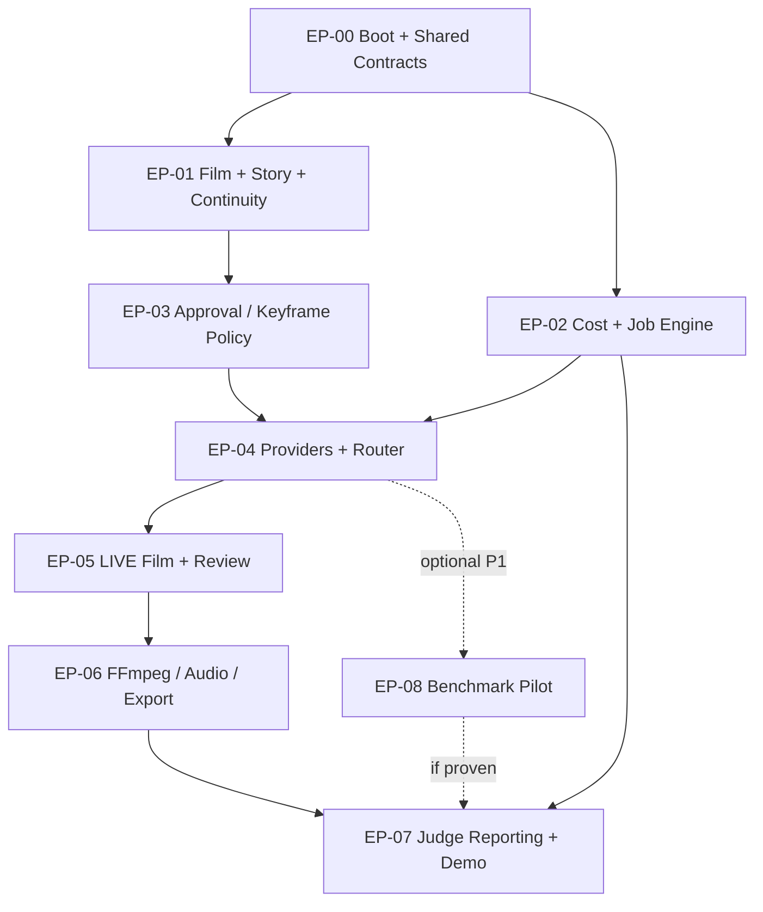

# Product Requirements Document (PRD)
## AI-Powered Cost-Efficient Short Film Production Assistant

**Version:** 1.0 — DEC-P01 through DEC-P09 Approved (Demo-first Vertical Slice)  
**Date:** 2026-11-18  
**Status:** PRODUCT-SCOPE BASELINE — DEC-P01 through DEC-P09 approved at product-policy level; execution/funding/providers and actual acceptance evidence unverified  
**Primary focus:** IT MVP and judgeable technical deliverables  
**Source of truth:** `GIC 2026_Challenge 4.xlsx` (Challenge Briefs; Tasks by Discipline), `C4_MODEL_ARCHITECTURE.md` (proposed C4 L1/L2 architecture)  

> **Convention:** `[REQ]` = explicitly supported by challenge; `[BASELINE]` = proposed architecture; `[PROPOSAL]` = implementation default or assumption, not separately ratified; `[TBD]` = unresolved.

## 1. Executive Summary

Build a local-first AI-assisted production workstation that turns a brief into an approved script, shot plan, multi-vendor generated assets, and an exported 30–60 second short film. Optimize total realized cost (including failed and regenerated attempts), visual quality, narrative coherence, character/style consistency, and production time. Unlike an opaque all-in-one generation workflow, each shot's tool selection and cost history must be explainable and auditable.

## 2. Problem, Users, Jobs-to-be-Done

### Problem [REQ]
Image/video models have heterogeneous strengths and costs. Repeated generation incurs unpredictable costs; consistent recurring characters across shots are difficult. Producers need one workflow for planning, generating, reviewing, assembling, and documenting cost.

### Primary users
- **Producer / Demo Operator:** submits brief; controls budget; approves script, storyboard, and generated assets; produces final film. [BASELINE]
- **Creative Reviewer / Benchmark Rater:** evaluates visual continuity, quality and cost report; compares with baseline. [BASELINE]

### Core job-to-be-done [PROPOSAL]
“When I need a 30–60s branded short film under a budget, help me plan, choose generation models, preview/approve outputs, retry precisely the problematic shots, and export the finished film together with a defensible cost report.”

## 3. Goals & Non-goals

### MVP Goals
1. [REQ] Generate structured script and scene/shot breakdown from a brief.
2. [REQ] Recommend a model/tool per scene/shot with an explanation grounded in shot type and budget.
3. [REQ] Integrate **at least three image/video generation tools**, directly or through an aggregator.
4. [REQ] Generate visual assets while addressing character/style consistency.
5. [REQ] Assemble a completed film with voice-over, background music and subtitles.
6. [REQ] Record every generation attempt's cost and aggregate per-shot/per-film expenditure.
7. [REQ] Deliver a functioning demo, a self-produced 30–60s film, itemized cost breakdown and all-in-one baseline comparison.
8. [DEC-P01 APPROVED] Separate approval gates before expensive generations and permit shot-level regeneration.

### Non-goals [PROPOSAL]
- Collaborative multi-tenant SaaS, user billing, subscription management.
- Knowledge Graph, vector DB, embedding-based retrieval for a small 6–10 shot project.
- Fully autonomous publish-to-social workflows.
- Cloud deployment, mobile application and distributed microservices.
- Real-time timeline editor matching a professional NLE.

## 4. Experience and End-to-End Workflow

1. **Create Film**: input title, concept/brief, aspect ratio, target duration, target audience/style, max budget. [PROPOSAL]
2. **Plan Story**: LLM returns validated Story Bible, scene list, ShotSpec JSON and initial continuity sheets. User edits/approves story. [BASELINE + PROPOSAL]
3. **Plan Cost**: model router provides candidate models, reasons, estimates; budget guardrail warns/block according to selected policy. [BASELINE]
4. **Generate Keyframes**: generate character/style reference and shot-level keyframes; review/edit/regenerate until approved. [BASELINE]
5. **Generate Video**: submit approved shot specs/keyframes to selected model; worker tracks external job and stores assets locally. [BASELINE]
6. **Review Continuity**: inspect each result; flag visual/semantic inconsistencies; accept/reject/regenerate individual shots. [BASELINE + PROPOSAL]
7. **Assemble**: FFmpeg joins accepted clips, adds VO/BGM/subtitles/branding, exports MP4. [BASELINE]
8. **Report**: exports per-attempt and per-shot costs, selected tool names, rate-card references, AI usage manifest and comparison report. [BASELINE + REQ]

## 5. Functional Requirements & Acceptance Criteria

| ID | Priority | Requirement | MVP Acceptance Criteria | Provenance |
|---|---|---|---|---|
| FR-01 | P0 | Create film from brief and constraints | User creates film and can persist draft & budget | REQ / PROPOSAL |
| FR-02 | P0 | Structured script/storyboard planning | Returns schema-valid ShotSpec for each shot; editable before approval | REQ / BASELINE |
| FR-03 | P0 | Story Bible & continuity planning | Stable character/style IDs and per-shot continuity sheet with start/end states | REQ / PROPOSAL |
| FR-04 | P0 | Explainable model routing | Each shot shows chosen model, rationale, estimated cost and constraints | REQ |
| FR-05 | P0 | ≥3 AI tool integrations | Three distinct image/video generation tool integrations demonstrable through successful real requests | REQ |
| FR-06 | P0 | Generate/review keyframes | Persist image attempt; user can approve, reject or regenerate | BASELINE |
| FR-07 | P0 | Async video generation | Job persisted, states visible, result downloaded to local storage, retries bounded | BASELINE |
| FR-08 | P0 | Shot-level regeneration | Regenerate one shot without losing accepted assets from other shots; all attempts retained | REQ / PROPOSAL |
| FR-09 | P0 | Cost ledger & budget guardrail | Reserve before launch; immutable financial events settle/release; report includes failed attempts when charged | REQ / BASELINE |
| FR-10 | P0 | Automated assembly | FFmpeg creates playable MP4 from accepted clips with VO, licensed BGM, subtitles | REQ |
| FR-11 | P0 | Review gates and lifecycle state | Story, job, asset-review states distinct; unapproved assets cannot silently enter final export | BASELINE |
| FR-12 | P0 | Compliance and AI attribution | Provider list per scene, licensed audio evidence and usage manifest exported | REQ / BASELINE |
| FR-13 | P0 | Benchmark report | Same film compared against named all-in-one baseline using disclosed costing assumptions | REQ |
| FR-14 | P1 | Continuity validator | Rule/LLM consistency findings available before expensive video generation | PROPOSAL |
| FR-15 | P1 | Cost/quality A-B evaluation | Can compare 4 reference strategies with shared evaluation rubric | PROJECT BASELINE / PROPOSAL |

### Proposed core object schema (conceptual)

- `Film`: id, title, brief, status, budget_usd, duration_target_s, aspect_ratio, style_bible_version.
- `Character`: id, film_id, physical_traits, clothing, reference_asset_ids.
- `Shot`: id, film_id, order, scene_id, duration_s, prompt, shot_type, characters, location, lighting, camera_motion, selected_model, continuity_in, continuity_out, review_status.
- `Attempt`: id, shot_id, kind (`image|video|tts|assembly`), provider, model, prompt_version, provider_job_id, status, estimated_cost_usd, final_cost_usd, started_at, completed_at, error.
- `Asset`: id, attempt_id, type, local_path, mime_type, duration_s, hash, approved_at, license_provenance.
- `CostLedgerEvent`: id, attempt_id, type (`reserve|settle|release|adjustment`), amount_usd, unit, usage_quantity, rate_card_snapshot_id, timestamp, idempotency_key.

These are **proposed fields**, not a finalized physical database schema.

## 6. Critical Business Rules & Invariants

1. **Cost of a film is not only the cost of final accepted clips**: include chargeable failed/rejected/retried attempts. Never silently overwrite monetary history.
2. **Budget reservation is atomic with enqueue intent**: prevent concurrent workers from exceeding available budget; avoid duplicate charge settlement with idempotency keys.
3. **Estimates vs actuals remain separate**: reserve estimate, settle actual according to provider billing evidence, release unused reservation; surface unknown actual charges as pending rather than zero.
4. **Review is explicit**: editable storyboard and accepted keyframes/videos retain provenance; versions remain traceable.
5. **Continuity is P0**: stable identities for characters, appearance, wardrobe, props, locations and temporal state; compare adjacent shots for unintended changes.
6. **Provider URL is temporary**: download and verify content immediately on completion; keep a local durable URI.
7. **Only permitted commercial-use inputs/providers**: voice/music rights and AI disclosure are release gates, not optional notes.
8. **Final assembly uses approved assets**: deterministic order and explicit mapping from shot ID to selected asset ID.

## 7. Model Router Specification (v0.1)

Inputs: shot type (static, dynamic, dialogue), motion, visual complexity, target duration, required consistency references, available models, budget remaining, historical observed outcomes. [PROPOSAL]

Hard filters: commercial permission, supported modality, duration/resolution constraints, keyframe/reference support when essential, sufficient remaining budget. [PROPOSAL]

Rank options by: predicted cost, capability fit for motion/dialogue, consistency support, expected retry risk; return top pick + alternatives + readable rationale. [PROPOSAL]

**Important:** a cheap per-second model may be more expensive end-to-end if regeneration rates are high. Compare realized cost and acceptable-output rate, not list price alone.

## 8. Architecture Baseline & Responsibility

| Component | Stack | Primary responsibility |
|---|---|---|
| Web Application | Next.js App Router, TypeScript, Tailwind, shadcn/ui, Drizzle | Film/storyboard UI, review gates, planner, router, budget reservation, APIs |
| Background Worker | Node.js, pg-boss | Provider adapters, polling, media download, retries, render jobs, exports |
| Database | PostgreSQL 16 | Film/Scene/Shot/Attempt/Asset, state machines, ledger, queue |
| Storage | Local FS behind StorageAdapter | Intermediate media, final renders, manifests |
| Assembly | FFmpeg CLI | Concatenation, overlays, audio mixing, subtitles |

**Suggested ownership aligned with architecture:** IT 1 leads backend, provider adapters, worker, database and ledger; IT 2 leads storyboard UX, asset review, FFmpeg/media pipeline. Shared contract ownership for ShotSpec, state transitions and error flows.

## 9. Non-functional Requirements (Targets proposed; TBD confirmation)

- **Reliability:** recover processing status after web restart; worker restarts must not create duplicate billable jobs when avoidable.
- **Data integrity:** use DB transaction, unique idempotency keys and append-only financial event access patterns.
- **Performance:** UI remains responsive during video processing; generation runs asynchronously; live status updates/polling.
- **Observability:** logs correlated by film ID, shot ID and attempt ID; provider error category logged.
- **Security:** API keys on server only; never put credentials in client or export; validate remote asset downloads.
- **Portability:** Docker PostgreSQL and reproducible local startup; StorageAdapter avoids coupling business logic to filesystem.
- **Export:** one playable MP4 plus cost breakdown CSV/JSON and AI Usage Manifest JSON.

## 10. Evaluation and Metrics

### Challenge-driven success metrics [REQ]
- End-to-end time from brief to approved complete film.
- Total film cost including all regeneration attempts vs all-in-one baseline.
- Narrative clarity and character consistency evaluated by reviewers.

### Proposed measurement protocol [PROPOSAL]
- Freeze **one canonical storyboard** and durations for cross-strategy benchmark.
- Record prices, usage and actuals at attempt level, including unsuccessful outputs.
- Compare the proposed router with: (A) all-in-one provider, (B) cheapest model-only strategy, (C) highest-quality or fixed-model strategy, (D) proposed mixed-model strategy. Exact providers and feasibility TBD.
- Review quality blind where practical, with a fixed rubric: narrative clarity, identity/wardrobe consistency, motion realism, visual quality, acceptable-output rate.
- Define an explicit cost-saving target **only after** validating baseline pricing and comparable quality.

## 11. Demo & Acceptance Plan

**Demo must prove:** one idea enters; structured editable storyboard appears; per-shot routing rationale is visible; at least three tools are demonstrably integrated; keyframe approval and shot retry are possible; true attempts appear in ledger; approved clips assemble into 30–60s MP4 with VO/BGM/subtitles; exported cost report shows baseline comparison and AI attribution.

**Suggested test cases:** invalid ShotSpec; provider timeout; provider success but asset URL expires; duplicate webhook/poll completion; insufficient budget; rejected keyframe; regeneration with unchanged adjacent shots; worker crash/restart; missing audio license; stale rate card; partial assembly failure.

## 12. Scope, Prioritization and Delivery Slices

### P0 — Demo-critical vertical slices
1. **Foundation:** DB schema, state machine contracts, asset storage, event/logging.
2. **Planning:** brief → script → structured shots → editable story/continuity.
3. **Routing & Cost:** provider registry, explainable router, rate card, reservation/ledger.
4. **Generation & Review:** three integrations, async worker, local assets, approval/regeneration.
5. **Assembly & Evidence:** FFmpeg output, licensed audio/subtitles, cost/manifest exports and benchmark.

### P1 — Quality and resilience
Continuity-validator suggestions, better scene-level diagnostic UX, more sophisticated selection/expected-retry model, benchmark automation.

### P2 — Post-demo
Cloud object storage, multi-user roles, collaboration, hosted deployment, scheduling and payment integrations.

## 13. Risks & Mitigations

| Risk | Consequence | Mitigation |
|---|---|---|
| Provider pricing/capability changes | Invalid model choices and cost comparisons | Versioned rate cards; verify before demo |
| Inconsistent character across models | Reviewer quality failure | Identity references, locked visual bible, approval gates, per-shot checks |
| Retry costs snowball | Budget blowout | Budget reservation, max attempts and escalation to manual approval |
| Async provider transient errors | Lost or duplicated operations | Persistent job IDs, idempotency strategy, bounded retries |
| Temporary result URLs expire | Missing clips | Immediate local download and checksums |
| Unlicensed sound or disallowed inputs | Noncompliance | Commercial-use allowlist and licensing checklist |
| Benchmark not comparable | Unsupported cost-saving claim | Same storyboard/duration; clear assumptions and evidence |

## 14. Open Product Decisions — Brainstorming Queue

| Decision | Options / framing | Suggested default | Status |
|---|---|---|---|
| DEC-P01: UX modality | Fully automatic vs approval-driven co-pilot | **AI Co-Pilot with explicit approvals** | **APPROVED (2026-11-18)** |
| DEC-P02: Budget enforcement | Hard stop vs warning vs hybrid | **Hybrid Guardrail: reservation-based admission + controlled budget changes** | **APPROVED (2026-11-18)** |
| DEC-P03: Keyframe workflow | Universal vs risk-based vs video-first | **Risk-based Keyframe: required for high-risk, optional for low-risk, auditable override** | **APPROVED (2026-11-18)** |
| DEC-P04: Editing granularity | Scene-level vs shot-level vs hybrid hierarchy | **Hybrid Scene → Shot; shot-scoped attempts and approvals** | **APPROVED (2026-11-18)** |
| DEC-P05: Demo topology | Single-machine localhost vs shared remote demo | **Single-machine localhost + explicit Live/Replay modes** | **APPROVED (2026-11-18)** |
| DEC-P06: Provider shortlist | Actual three tools, feature availability, licensing | Verify API access before freezing | **NEXT — OPEN** |
| DEC-P07: Duration/style (historical label) | Canonical duration/style is still a separate open scope item; DEC-P07 now denotes benchmark governance | See DEC-P08 | RE-SCOPED |
| DEC-P08: Export sound | TTS vendor, BGM rights/license provenance | Licensed local BGM + TTS adapter | OPEN |
| DEC-P09: Comparative proof | All-in-one baseline definition; quality parity | Document identical shot plan and reproducible cost methods | OPEN |
| DEC-P10: Deadline/capacity | Team velocity, milestones, demo date | TBD | OPEN |

## 15. Definition of Done for PRD v1.0

- Open decisions DEC-P01–P10 resolved or consciously deferred.
- FRs have exact user-visible behavior, edge cases and tests.
- ShotSpec/Continuity JSON schemas and state transitions approved.
- Provider list/licensing/rate-card snapshot verified.
- Cost metric and benchmark protocol reproducible.
- IT 1 / IT 2 backlog and owner assignments confirmed.

---

## 16. DEC-P01 — AI Co-Pilot Operating Model (APPROVED, 2026-11-18)

**Decision:** MVP defaults to approval-driven **AI Co-Pilot**. AI proposes the script, structured ShotSpecs, continuity sheets, candidate providers, model routing rationale, and expected cost; the producer retains authority to edit and approve story, required keyframes, generated videos, and final export. Fully autonomous production and professional timeline editing are out of scope for MVP.

### 16.1 User journey and approval gates

| Step | System behavior | Human interaction | Billing / gating |
|---|---|---|---|
| 1. Create film | Persist brief, budget, target duration, format | Enter and save constraints | No media jobs |
| 2. Plan | Generate Story Bible, ShotSpecs, continuity sheets | Inspect and edit | LLM usage recorded if billable |
| 3. Story review | Validate schema, versions and continuity constraints | Explicit **Approve Story** | Video generation blocked until story approved |
| 4. Keyframes | Explain model choice, estimate/reserve cost, queue image attempt | Approve/reject/regenerate keyframe | Reserve before billable attempt; required keyframe policy enforced |
| 5. Video | Queue per-shot video attempt, poll, download durable asset | Approve/reject/regenerate shot | Per-attempt ledger; no overwrite |
| 6. Assemble | Validate selected asset per shot; compose via FFmpeg | Request preview/export | Approved compatible assets only |
| 7. Report | Generate MP4, cost CSV/JSON, AI usage manifest | Review and export | Failed/charged attempts included in total cost |

Approval is **not** a passive view: user action must be persisted with `actor`, `timestamp`, `asset_id` or `story_revision_id`, and decision. Keyframe requirement is per-shot and pending DEC-P03. Manual model override is possible only subject to budget/eligibility policies (pending DEC-P02).

### 16.2 UI IA / screens (P0)

1. **Film Dashboard:** film drafts, progress by stage, budget estimate/spent/reserved and entry to workspace.
2. **Brief Editor:** objective, target audience, duration, visual style, aspect ratio, budget.
3. **Storyboard Workspace:** ordered shot list, editable ShotSpec, continuity in/out, model recommendation/rationale; story approval action.
4. **Keyframe Review:** previews and versions/attempts, reference image, approve/reject/retry, cost-to-date.
5. **Video Production:** job status, provider/model, attempt timeline, footage preview, failure reason, retry/approve/reject; no global blocking spinner.
6. **Final Review & Export:** approved clip selection, order, voice/music/subtitles, validation, preview and export.
7. **Cost & Audit:** ledger event details, per-attempt and per-shot aggregation, pending actuals, exports and AI manifest.

Primary navigation should expose **Plan → Keyframes → Video → Export**, with persistent context for `budget remaining`, `pending approvals`, and job status. Cost & Audit is accessible from every production stage.

### 16.3 Three distinct state machines

**Story State (film/story revision):** `DRAFT → PLANNED → IN_REVIEW → APPROVED`; revisions after approval create a new `DRAFT` revision (do not erase prior approval). Invalid planning output keeps revision in `DRAFT` with validation errors. Approval is of a specific immutable revision.

**Generation Job State (attempt):** `QUEUED → SUBMITTED → RUNNING → SUCCEEDED | FAILED | CANCELED`; provider-specific intermediate states mapped via adapter; `TIMED_OUT` may be recorded as a terminal operational condition **without presuming provider charge is zero**. A failed attempt is terminal; a new creative regeneration starts a new attempt. Technical retries use stable idempotency/provider job identifiers where available, and must reconcile remote status before resubmitting billable work.

**Asset Review State (asset/revision association):** `PENDING_REVIEW → APPROVED | REJECTED`. An accepted asset can remain historically approved even if a later attempt is created, but it is export-eligible only when tied to the active approved ShotSpec revision and continuity policy. An explicitly superseded/stale approval may be represented by `INVALIDATED` (requires reason and audit trail) rather than deleting it.

**Derived film-level progress** is computed from story approvals, required keyframe approvals, video approvals, and export results. Do not encode all three dimensions in one `status` field.

### 16.4 Transition contract and invariants

| Event / command | Preconditions | Transactional effects | Result |
|---|---|---|---|
| `approve_story(revision_id)` | Valid story, ShotSpec and reviewer authorization | Persist approval tied to version | Story revision APPROVED |
| `generate_keyframe(shot_id, revision_id)` | Approved active story, eligible provider, budget policy passed | Reserve budget + enqueue intent atomically | New image Attempt QUEUED |
| `approve_keyframe(asset_id)` | Download verified, active compatible shot revision | Record explicit review decision | Asset APPROVED |
| `generate_video(shot_id, revision_id)` | Approved story; if shot requires keyframe, approved compatible keyframe; budget policy passed | Reserve budget + queue intent | New video Attempt QUEUED |
| `regenerate_shot(shot_id)` | Authorized retry, eligible budget and provider | Create new attempt, preserve prior attempts/assets/reviews | Previous approved candidate preserved |
| `approve_video(asset_id)` | Verified video, compatible approved revision | Persist review outcome and selection | Eligible final clip |
| `export_film(film_id)` | Every required shot has one explicitly selected, compatible approved video; sound licensing and export settings valid | Create assembly job; snapshot selections | Export job queued |
| `edit_approved_shot(shot_id)` | Existing approved revision | Create revision, mark dependent selections stale for review; no destructive overwrite | Approval gating reactivated |

**Cost events:** estimate → reserve → settle/release/adjustment (append-only). If exact provider charge is unknown, mark unresolved; do not interpret unknown as zero. Concurrency controls and idempotency keys are required to keep reserve and enqueue operations consistent.

**Priority adjustment:** continuity validation is a P0 **gate** at story approval and before submitting dependent media jobs (minimal rules initially). Enhanced LLM-suggested diagnostics may stay P1. This does not require a graph DB or embeddings.

### 16.5 MVP acceptance tests added by DEC-P01

- AT-P01-01: Story draft cannot start video production until `approve_story` succeeds for its current revision.
- AT-P01-02: Required keyframe must be approved before video generation; optional-keyframe shots must comply with shot policy.
- AT-P01-03: Reject/regenerate shot 3 leaves approved assets and selected footage for shots 1, 2 and 4 intact.
- AT-P01-04: Cost ledger preserves all attempts and reconciles reservation vs actual on success/failure; late unknown provider charges remain pending.
- AT-P01-05: Editing an approved ShotSpec creates a new revision and blocks stale selections from final export until revalidated.
- AT-P01-06: Final export fails with a clear list of missing/ineligible shot approvals rather than silently auto-selecting clips.
- AT-P01-07: Worker restart or repeated polling/webhook does not create duplicate settlement or automatic second billable job.
- AT-P01-08: User can monitor async jobs, review another shot and inspect cost without blocking UI.

### 16.6 Engineering ownership and sequence

- **IT 1:** versioned Story/Shot contracts, commands and transition guards, backend validation, attempts/jobs, budget reservation, ledger reconciliation, provider adapters, concurrency and idempotency.
- **IT 2:** storyboard editor, review queues, attempt/asset history, per-shot controls, async progress, FFmpeg export UI/integration.
- **Shared:** typed API contracts, continuity sheet schema, UX error states and vertical-slice e2e tests.
- **Recommended slice:** Brief → approved story → one keyframe → approved video → one clip export, then extend to multi-shot and multi-provider.

### 16.7 DEC-P02 — Decision background (RESOLVED in §17)

**Option A: Hard cap.** New paid attempts are blocked when `actual_spent + outstanding_reservations + new_estimate > budget`. Advantages: predictable spending. Risk: stale/underestimated estimates and already-running provider jobs may still cause final billed total to exceed cap; a strict cap cannot be guaranteed without provider-side spending limits.

**Option B: Warning only.** Always allow generation after displaying estimated impact. Advantages: iteration freedom. Risk: poor cost-control evidence and overspending.

**Option C: Hybrid guardrail (recommended for discussion).** Enforce hard pre-dispatch admission for all billable attempts, show warning at threshold (e.g. 80%, threshold TBD), provide controlled manual increase of film budget with audit log. Never bypass provider eligibility or rate-card sanity checks. Uncertain charges and in-flight liabilities count against available budget until reconciled. Budget increase changes limit, not ledger history.

**Open details for DEC-P02:** Is increasing the budget allowed after film creation? Is an operator confirmation required per job or only for threshold/cap violations? What cost buffer to reserve when provider usage is variable or billed in credits? How should provider-side overspend be represented in UI and reporting?

---

**Notes on provenance:** challenge requirements are sourced from the uploaded 2026 GIC Challenge 4 workbook; architecture design is from the uploaded `C4_MODEL_ARCHITECTURE.md`. All proposed thresholds, fields, router scores and scope exclusions are working hypotheses, not externally verified facts. No live provider pricing or commercial-license status has been verified in this draft.


## 17. DEC-P02 — Hybrid Budget Guardrail (APPROVED, 2026-11-18)

**Decision record:** The producer selected Option C — **Hybrid Guardrail**. Billable attempt admission is blocked unless a budget reservation can be committed atomically; approaching the limit produces a warning; an authorized producer may explicitly increase the film budget with reason and audit trail. **Increasing the budget is the only MVP override of the numeric cap; no per-job “ignore cap” bypass.** This is a project policy, not a provider-side spending guarantee. The thresholds and reserve buffer below are **implementation defaults proposed for MVP**, not claims from the challenge or independently approved user choices.

### 17.1 Scope, definitions, and policy defaults

- **Coverage:** every billable outbound operation attributable to the film, including LLM planning, image/keyframe, video, TTS and chargeable external post-processing. Local FFmpeg activity is recorded as operational cost only if a transparent costing method is configured; do not silently imply local compute was billed by a provider.
- **Currency:** all film policy amounts and ledger events are integer `amount_usd_micros` (1 USD = 1,000,000 micros) to avoid floating-point arithmetic; original provider charge, currency, credits/tokens/seconds and conversion/rate-card snapshot are preserved for audit.
- **`actual_spent` / `S`:** net posted provider charges and legitimate corrections, including failed or rejected attempts where billed. Negative actual cost requires a linked reversal/correction, never deletion.
- **`reserved_open` / `R`:** sum of remaining open financial liability commitments across active and unresolved attempts. Unknown final charge remains covered by its reservation; missing evidence does not imply zero cost.
- **`next_reservation` / `N`:** conservative upper estimate for a new attempt, including configured contingency for uncertain metering; round **up** to micros. Do not use a stale, missing or non-reproducible rate card to admit a billable job.
- **`budget_limit` / `B`:** current, auditable, film-specific spending limit. `available = max(0, B - S - R)`. Financial headroom may be negative after unexpected provider overage; preserve that truth in reporting even though *available for new jobs* is clamped to zero.
- **Admission invariant:** `S + R + N <= B` **at the committed decision point**. When not satisfied, return `BUDGET_EXCEEDED` and do not enqueue or dispatch new billable work. Equality is allowed.
- **Warning default [PROPOSAL]:** show contextual warning when utilization `(S+R)/B >= 80%`, and also when the requested reservation would cross that threshold; warning is informational, not an override. `B=0` prohibits billable jobs.
- **Estimate defaults [PROPOSAL]:** use provider's maximum quoted charge when available. For usage-variable providers, use `ceil(estimated_charge * 1.20)` or documented provider-specific maximum, whichever is higher. If no defensible cap/estimate exists, block with `COST_ESTIMATE_UNAVAILABLE` pending operator review/provider policy; manual increase alone does not fix missing estimation.
- **Budget increase [APPROVED behavior, implementation detail proposed]:** only explicit operator action with `new_limit > current_limit`, non-empty reason, and `expected_budget_version`; record actor/timestamp/old/new values. A decrease may be supported only if new limit `>= S+R` and cannot invalidate in-flight commitments. For local demo, “authorized operator” is the trusted local producer identity; future RBAC is out of MVP.
- **Budget visibility:** UI always separates *Spent (confirmed)*, *Reserved (at risk)*, *Pending reconciliation*, *Available*, *Limit* and *Forecast*; do not equate forecast with charges already incurred. A budget increase never changes the historical spend.
- **Costs outside provider control:** a provider's bill may exceed reserved estimate or arrive later. Record the true liability even when `S+R > B`, show **OVER_BUDGET** state and block new dispatch until the film is funded or charges corrected. Never truncate actual costs to the reservation.
- **No retroactive billing claim:** external provider payment enforcement, refunds, FX settlement, regulatory accounting and absolute spending guarantees are outside scope.

### 17.2 Business rules (BR-P02)

| ID | Rule | Enforcement / UI impact |
|---|---|---|
| BR-01 | Reserve-before-dispatch | No worker can make a paid request unless a live reserved attempt exists and worker verifies eligibility |
| BR-02 | Ledger includes failed/rejected/regenerated attempts | Attempt history and report sum all confirmed external charges regardless of asset acceptance |
| BR-03 | Atomic budget admission | Two concurrent requests cannot both reserve the same remaining headroom |
| BR-04 | Estimates never rewrite actuals | Reservation and actual charge are separate typed events, tied by attempt ID |
| BR-05 | Unknown or delayed provider charge is not zero | Keep liability pending; reconcile via polling/provider billing evidence, with manual review path |
| BR-06 | Explicit budget change | Versioned `BUDGET_LIMIT_CHANGED` event, actor, reason, before/after; cannot bypass with “Continue anyway” |
| BR-07 | Idempotent command and settlement | Duplicate UI submit, queue delivery, webhook and poll events do not create duplicated financial events or new billable jobs |
| BR-08 | Failed-before-provider-acceptance | When evidence confirms provider never accepted/charged job, release full reservation; otherwise leave pending until reconciled |
| BR-09 | Manual creative retry ≠ network retry | New creative request gets new Attempt/reservation; technical retry of existing accepted job must reuse provider job ID or reconcile |
| BR-10 | No negative silent balance masking | Overspend visible as negative headroom, with blocked admission and clear remediation |
| BR-11 | Estimate provenance | Store provider/model, pricing units, snapshot, conversion assumptions, estimated usage, buffer and estimated upper bound |
| BR-12 | Version and expiry guard | Recheck selected model, approved revision, rate-card validity and budget when admitting; provider dispatch checks cancellation/revision eligibility |

### 17.3 Cost Ledger event model (append-only)

**Design choice:** Ledger is an immutable business-event journal, **not a double-entry general ledger**. Signed deltas in separate reserve and actual columns make financial projections deterministic. A separate immutable `budget_limit_events` stream tracks edits to the budget, not costs.

| Event type | `actual_delta` | `reserved_delta` | Semantics / idempotency |
|---|---:|---:|---|
| `RESERVATION_CREATED` | 0 | `+N` | Once per admitted attempt; unique `attempt_id + reserve` |
| `CHARGE_POSTED` | `+A` | `-min(A, remaining_reservation)` | Post supported charge evidence; can exceed reservation, remainder becomes overrun; unique external charge reference or canonical reconciliation key |
| `RESERVATION_RELEASED` | 0 | `-remaining_reservation` | Only for documented unconsumed liability after terminal billing outcome; once for a finalized reservation |
| `CHARGE_CORRECTED` | signed delta | 0 | Difference-only correction referencing prior charge and evidence; no destructive update |
| `RESERVATION_ADJUSTED` | 0 | signed delta | Authorized change to remaining liability while unresolved (e.g. conservative increase); must never silently allow extra paid provider request; positive adjustments can create overspend and trigger block |

**Critical sequence example (USD):** `B=10; RESERVATION_CREATED +3; CHARGE_POSTED actual +2.4, reservation -2.4; RESERVATION_RELEASED -0.6`. End state `S=2.4, R=0, available=7.6`. If actual is `3.5` instead, `S=3.5, R=0`, and an overage `0.5` is reflected transparently.

**Recommended event fields:** `id` UUID; `film_id`, `attempt_id` nullable for budget-independent operational events; `event_type`, `actual_delta_usd_micros`, `reserved_delta_usd_micros`; `source_event_id`/provider invoice reference; `idempotency_key` unique; `provider`, `model`, `provider_job_id`; `original_quantity`, `original_unit`, `original_currency`, `original_amount`, `fx_rate_snapshot`, `rate_card_snapshot_id`; `evidence_uri`/hash; `reason`, `actor_id`, `occurred_at`, `recorded_at`, `correction_of_event_id`; `metadata_json`. For `CHARGE_POSTED` the delta calculations must execute under the same per-film lock used by admission.

**Additional tables / projections:**
- `film_budget_accounts(film_id PK, budget_limit_usd_micros, actual_spent_usd_micros, reserved_open_usd_micros, version, updated_at)` is a **transactionally maintained projection**, never the immutable source of truth. Recompute/replay to audit.
- `attempt_financial_state(attempt_id PK, reserved_open_usd_micros, posted_actual_usd_micros, reconciliation_status [PENDING|PARTIAL|FINAL|DISPUTED], latest_evidence_ref, version)` is likewise a projection.
- `budget_limit_events(id, film_id, old_limit, new_limit, actor, reason, expected_version, recorded_at, idempotency_key)` append-only.
- `rate_card_snapshots(id, provider, model, unit, price, currency, effective_at, retrieved_at, source, confidence, conversion_assumptions)` immutable after use.
- `api_command_dedup(command_key, command_type, request_hash, response_ref, created_at)` prevents reuse of a key with different payload.
- `outbound_dispatches(attempt_id UNIQUE, provider_idempotency_key, provider_job_id, status, last_reconciliation_at)` supports crash reconciliation.

**Accounting boundary / limitation:** Provider billing data may report different units/currencies from estimated model prices; store original evidence and a frozen conversion for reproducible USD presentation. For true-up, show `ESTIMATED / CONFIRMED / DISPUTED` source quality; never label estimates “actual.”

### 17.4 Transaction invariants and crash-safe orchestration

**Invariant I1 — budget admission:** For every newly admitted billable attempt, the film-account row is locked (`SELECT ... FOR UPDATE`) within a PostgreSQL transaction. Snapshot validation, financial reservation, attempt creation and **durable queue intent** must either all commit or all roll back. Preferred implementation: insert into a DB outbox in the same transaction, then deliver to `pg-boss` at least once with unique `attempt_id`; alternative direct pg-boss transaction is allowed only if verified to participate in the **same** SQL transaction. Never assume two independent DB calls are atomic.

**Invariant I2 — no double admission:** `(film_id, client idempotency key)` unique and payload-hashed; repeated identical request returns the original attempt and reservation, while same key/different payload returns `409 IDEMPOTENCY_CONFLICT`.

**Invariant I3 — at-most-one externally billed submission where feasible:** Worker claims the dispatch record; sends provider idempotency key if supported. If crash happens after external acceptance but before local `provider_job_id` persisted, transition to `SUBMISSION_UNCERTAIN`, reconcile with provider before retrying. For providers without idempotency or lookup support, automatic resubmission is **disabled** and manual investigation is required. It is impossible to promise exactly-once external side effects without provider cooperation.

**Invariant I4 — immutable financial history:** no update/delete of cost events; signed compensation/correction events only, unique charge references where available. Projected balances and event sums must match by invariant check.

**Invariant I5 — settle/release only on reliable evidence:** no cost reset to 0 on generic timeout, cancellation or `FAILED` status. Cancel stops future submission if possible, but does not automatically refund an already accepted provider job.

**Invariant I6 — reconciliation remains possible:** `PENDING` and `DISPUTED` attempts retain reservation and appear in operations queue; explicit rate-card/billing evidence is required for final resolution.

**Invariant I7 — spend can exceed the configured limit after admission:** post full actual charge, emit overspend alert and block new jobs; don't reject accounting transactions on the basis of limit after a job has already been accepted.

**Invariant I8 — multi-dimensional states:** financial reconciliation state is orthogonal to `GenerationJobState` and `AssetReviewState`: e.g. `SUCCEEDED + APPROVED + PENDING_BILLING` is valid. Do not couple billing finality to asset approval.

**Admission pseudocode (normative):**

```text
BEGIN TRANSACTION
  dedup = find_command_key_for_update(film, key)
  if dedup exists: assert_request_hash_equal_or_conflict(); return_existing()
  account = SELECT film_budget_accounts WHERE film_id=? FOR UPDATE
  assert active approved ShotSpec + permitted provider + valid rate card
  reservation = conservative_estimate_usd_micros(request)
  if account.actual_spent + account.reserved_open + reservation > account.budget_limit:
     ROLLBACK; return BUDGET_EXCEEDED
  INSERT attempt (new immutable attempt_id, ...)
  INSERT cost_ledger_event (RESERVATION_CREATED, reserved_delta=+reservation, ...)
  UPDATE film_budget_accounts SET reserved_open=reserved_open+reservation, version=version+1
  INSERT outbox_job(attempt_id, kind='DISPATCH', unique attempt_id)
  INSERT api_command_dedup(key, request_hash, response_ref=attempt_id)
COMMIT
return 202 Accepted with attempt_id and reservation
```

The outbox relay retries until `pg-boss` acknowledges delivery; worker deduplicates by `attempt_id` and never treats an at-least-once queue delivery as permission to submit a second paid job.

### 17.5 API contracts (proposed REST JSON; amounts in USD micros)

All mutating endpoints require `Idempotency-Key` and authenticated local-operator identity; `If-Match`/version is used for conflict-sensitive changes. Error envelope: `{ "error": { "code", "message", "details", "requestId" } }`. Rate-card IDs and estimate/allowlist status are server-owned; frontend displays, not trusts, estimates supplied by browser.

| Method / endpoint | Main request | Success | Key errors |
|---|---|---|---|
| `GET /api/films/:filmId/budget` | none | `200 {limitMicros, spentMicros, reservedMicros, availableMicros, unresolvedMicros, utilization, version, warningThreshold}` | `404` |
| `POST /api/films/:filmId/budget/estimate` | `{shotId, revisionId, kind, provider, model, parameters}` | `200 {estimatedMicros, bufferMicros, reservationMicros, rateCardSnapshotId, estimationBasis, admissible, warnings}`; **nonbinding quote** | `422 COST_ESTIMATE_UNAVAILABLE`, `422 PROVIDER_INELIGIBLE` |
| `PATCH /api/films/:filmId/budget` | `{newLimitMicros, reason, expectedVersion}` | `200 {oldLimitMicros,newLimitMicros,version,eventId}` | `409 VERSION_CONFLICT`, `422 LIMIT_BELOW_COMMITMENTS`, `403 FORBIDDEN` |
| `POST /api/films/:filmId/attempts` | `{shotId, revisionId, kind, modelSelection, parameters}` plus idempotency header | `202 {attemptId,jobState:'QUEUED',reservedMicros,budgetVersion}` | `409 BUDGET_EXCEEDED`, `409 IDEMPOTENCY_CONFLICT`, `422 RATE_CARD_EXPIRED`, `422 APPROVAL_REQUIRED` |
| `GET /api/films/:filmId/costs/ledger` | pagination / filters | `200 {items:[immutable events],nextCursor}` | `404` |
| `GET /api/films/:filmId/costs/summary` | none | `200 {spentMicros,reservedMicros,unresolvedMicros,byShot,byModel,overBudgetMicros,asOf}` | `404` |
| `GET /api/attempts/:attemptId/financials` | none | `200 {reservationOpenMicros, postedActualMicros, status, evidence, rateCardSnapshotId}` | `404` |
| `POST /api/attempts/:attemptId/reconcile` | `{providerChargeRef?, observedCharge?, evidenceRef?, resolutionReason?}`; operator-only for manual cases | `202/200 {reconciliationStatus, ledgerEventIds}` | `409 DUPLICATE_CHARGE`, `422 EVIDENCE_REQUIRED` |

**Example (admission blocked):**

```json
{
  "error": {
    "code": "BUDGET_EXCEEDED",
    "message": "Not enough uncommitted film budget for this attempt.",
    "details": {
      "limitMicros": 10000000,
      "spentMicros": 6000000,
      "reservedMicros": 2000000,
      "requestedReservationMicros": 3000000,
      "shortfallMicros": 1000000,
      "actions": ["REDUCE_ESTIMATED_COST", "INCREASE_BUDGET"]
    },
    "requestId": "req_example"
  }
}
```

**Note:** Quotes are advisory, and can expire; actual admission always recomputes under lock. Budget updates never silently requeue rejected requests: producer explicitly retries the original action with its own idempotency key policy.

### 17.6 Acceptance tests — DEC-P02 (Given / When / Then)

| ID | Scenario | Expected outcome |
|---|---|---|
| AT-P02-01 | `B=10, S=6, R=2, N=2` | Admit; create one reservation and one queue intent (boundary equality) |
| AT-P02-02 | `B=10, S=6, R=2, N=3` | Block with `BUDGET_EXCEEDED`; no attempt, reservation, outbox job or provider call |
| AT-P02-03 | Two concurrent `N=2` requests and `available=2` | Exactly one is admitted under DB row lock; second blocked |
| AT-P02-04 | Same idempotency key and identical payload submitted twice | Same attempt/receipt returned; only one reservation and one dispatch intent |
| AT-P02-05 | Same key but changed payload | `409 IDEMPOTENCY_CONFLICT`; unchanged financial/queue state |
| AT-P02-06 | Paid generation succeeds, `N=3`, actual `A=2.4` | Ledger: reserve +3, charge +2.4/-2.4, release -0.6; projected spent 2.4 and reserved 0 |
| AT-P02-07 | Provider charges `A=3.5` despite `N=3` | Full actual 3.5 recorded; 0.5 overrun displayed; new jobs blocked when limit exceeded |
| AT-P02-08 | Job fails after provider accepts request but charge unknown | Billing `PENDING`; reservation not silently released or cost set to 0 |
| AT-P02-09 | Provider confirms non-acceptance/no charge | Full reservation released once, failed attempt retained |
| AT-P02-10 | Duplicate completion webhook and polling update | One canonical charge posting; no duplicate settlement |
| AT-P02-11 | Crash after provider accepted but before provider job ID saved | Mark submission uncertain, reconcile; do not automatically resubmit paid request absent provider idempotency |
| AT-P02-12 | Operator increases `B=10→15` with reason and correct version | Append budget event and update account; prior ledger events untouched; previously blocked job **not auto-launched** |
| AT-P02-13 | Concurrent / stale budget update | `409 VERSION_CONFLICT`; only accepted edit reflected in audit history |
| AT-P02-14 | Attempt to reduce limit below `S+R` | `422 LIMIT_BELOW_COMMITMENTS`; no update |
| AT-P02-15 | Utilization crosses warning threshold while within hard cap | UI warns; still admits eligible jobs within limit |
| AT-P02-16 | Missing/stale price or unsupported billing unit | No dispatch; clear estimate/rate-card validation error |
| AT-P02-17 | Later invoice adjusts reported charge | `CHARGE_CORRECTED` linked to original event; projections/report recomputed, prior event immutable |
| AT-P02-18 | Rejected keyframe/video nevertheless billed | Charge is included in final film total and benchmark export |
| AT-P02-19 | Manual creative retry after rejected media | New attempt + new reservation; previous attempt/charge preserved |
| AT-P02-20 | Queue redelivery or worker restart | Same attempt, at most one remotely chargeable submission where provider supports idempotency; otherwise blocked uncertain state |

### 17.7 UI requirements and engineering tasks

**Cost UI:** pinned budget status on all Plan/Keyframes/Video/Export screens; usage segments `Spent / Reserved / Available`; explicit `Pending billing` indicator; `Estimated cost per attempt` preview; non-blocking 80% warning; blocking dialog with `Shortfall`, `Reduce cost` and `Increase budget` actions; budget change form with delta, reason and preview; audit log and CSV export. When cost overrun occurs, show actual overspend separately, without rewriting the accepted job history.

**IT 1 (Backend/AI Engine):** immutable migrations, per-film budget row locking, deterministic integer-micros arithmetic, versioned rate cards, quote engine, atomic admission/outbox, dispatch idempotency, lifecycle reconciliation, financial projections/replay, API contracts, 20 automated acceptance tests.

**IT 2 (Frontend/Media Pipeline):** budget overview + request estimate, inline cost next to model/shot, blocked/threshold/unknown-charge screens, budget version-conflict handling, audit history visualizations, export columns for each attempt and provider charge provenance.

**Delivery order:** (1) ledger and admission under concurrency; (2) fake provider worker with failures and delayed billing; (3) real provider integrations with idempotency capability registry; (4) reconciliation and audit UI; (5) benchmark-export verification.

### 17.8 Open implementation details (not product-decision blockers)

1. Final per-provider buffer/metering upper bounds and expiration window require empirical validation against selected providers (DEC-P06).
2. Confirm whether selected provider APIs expose charge IDs, usage tokens, cancel/refund semantics, idempotent creation and job search; implement uncertainty state accordingly.
3. If rate-card snapshots reflect published list pricing rather than invoices, mark as **estimated/derived actual** and explain measurement limitations in cost report.
4. For multi-currency provider billing, decide snapshot FX evidence/source before reporting cross-currency USD figures; do not claim FX live accuracy.
5. Warning at 80% and 20% usage buffer are **MVP defaults**, configurable after test; these specific numeric values were not selected by the user.

---

## 18. DEC-P03 — Keyframe Gate Policy (APPROVED, 2026-11-18)

**Question:** Should *every* shot require an approved keyframe before billable video generation, or should some shots bypass this gate?

| Option | Behavior | Benefit | Trade-off |
|---|---|---|---|
| A — Universal approval | Every video shot requires a producer-approved keyframe | Simple invariant; strongest early control | More image spending/review, possible unnecessary work for simple B-roll |
| B — Risk-based approval (**recommended**) | `keyframe_policy=REQUIRED` for character/brand-critical/high-continuity shots, `OPTIONAL` for low-risk establishing/B-roll; policy is visible and explicitly overridable by producer before video dispatch | Fits objective of consistency and cost efficiency | Requires rule-based classification, policy explanation and override auditing |
| C — Video-first | Keyframe is optional for all shots | Fastest minimal workflow | High risk of expensive poor outputs and continuity misses |

**Proposed DEC-P03 rules if Option B chosen:** classify based on `recurring_character`, `wardrobe/prop continuity`, `hero product/brand identity`, `reference-based animation requirement`, `provider reference support`. Default REQUIRED when uncertainty or multiple significant identity constraints exist; ensure optional shots still require video approval. Changing optional↔required on approved story creates an auditable policy revision; generation is blocked only when current active policy says REQUIRED and no compatible approved keyframe exists. Allow exceptions only with explicit producer decision and reason; keyframe attempt charges are tracked by DEC-P02.

**Decision outcome:** Option B selected. Normative product contract is specified in §19. Original option comparison is retained for decision provenance.


---

## 19. DEC-P03 — Risk-based Keyframe: Normative Product Contract (APPROVED)

### 19.1 Decision, goals and boundaries

**Approved decision:** Automatically classify keyframe requirement on each versioned ShotSpec using a deterministic, explainable rule set. Character/identity/wardrobe/prop/hero-brand and continuity-dependent shots require an approved compatible keyframe before *video dispatch*. Low-risk establishing and B-roll shots may omit keyframes, but must still pass continuity validation and video review. Producer may override the proposed classification with a reason and audit record, subject to hard capability and consistency constraints. Keyframe **generation** itself is not mandatory for optional shots.

**Provenance:** `[APPROVED]` covers selecting option B. Exact field names, thresholds, API surface, rule precedence and UX copy below are `[IMPLEMENTATION PROPOSAL]` for review, not separately approved by the user. This decision does not assert that keyframes by themselves guarantee identical character appearance across AI models.

**Priority update:** FR-14 (minimum deterministic continuity validation) is **P0** for story approval / video admission, as already required by §16.4. Advanced LLM diagnosis and automated image similarity remain P1. FR-06 now uses per-shot `REQUIRED|OPTIONAL` gate, rather than universal keyframe approval.

### 19.2 Business rules (BR-P03)

| ID | Normative rule |
|---|---|
| BR-P03-01 | Every active ShotSpec revision stores `keyframePolicy` with `systemRecommendation`, `effectiveRequirement`, `riskFlags`, `ruleSetVersion`, and any producer override provenance. No ambiguous inherited `null` requirement at dispatch. |
| BR-P03-02 | Default `REQUIRED` if shot contains recurring/on-screen named character, continuity-critical wardrobe/prop, visually constrained logo/hero product, explicit reference-frame animation, or dependency on an adjacent approved image/shot. When material data is missing or classification fails, choose `REQUIRED` and surface reason `UNKNOWN_RISK`. |
| BR-P03-03 | Default `OPTIONAL` only when no required trigger is present and shot is classified `ESTABLISHING|BROLL|INSERT` with no material continuity risk. All other shots default to `REQUIRED` until reviewed. |
| BR-P03-04 | Rules are *hard triggers*, not a probabilistic 'AI score'. An optional numeric risk score may be displayed later but must not silently override deterministic triggers. Store all matched rules for explainability. |
| BR-P03-05 | Producer may select `OPTIONAL→REQUIRED` freely (audited). `REQUIRED→OPTIONAL` requires explicit reason and `riskAcknowledged=true`; if a hard provider/format requirement exists, override is refused with `PROVIDER_REQUIRES_REFERENCE`. |
| BR-P03-06 | A policy override does **not** disable identity or temporal continuity validation. A flagged unresolved hard continuity contradiction must be fixed or explicitly waived through a separate documented continuity exception with actor/reason, if that rule is waivable. |
| BR-P03-07 | For REQUIRED shots, dispatch requires an APPROVED, locally verified image asset compatible with **current** `shotRevisionId` and image/reference constraints of selected video model. Existing historic approval remains in history but is not automatically compatible. |
| BR-P03-08 | An OPTIONAL shot can proceed with `keyframeAssetId=null`, only when the selected model supports text-to-video without a reference and the user explicitly submits video generation. If an optional keyframe is provided as input, it must be APPROVED and compatible. |
| BR-P03-09 | Every video asset must be approved by Producer before selection for final export, independent of keyframe policy. |
| BR-P03-10 | Keyframe, video, and regeneration are separate billable attempts. Always apply DEC-P02 reservation, ledger and idempotency before calling provider. Bypassing keyframe avoids image cost only; it never bypasses video budget admission. |
| BR-P03-11 | Changing an already-approved shot's text, visual identity constraints, reference binding, policy, or required continuity fields creates a new immutable ShotSpec revision; active-story/story-approval scope and impacted downstream selections must be explicitly revalidated. |
| BR-P03-12 | Concurrent edits/approvals use optimistic `expectedRevision` or `If-Match`; a stale client cannot approve a keyframe or dispatch video against an old effective policy. |
| BR-P03-13 | Required keyframe failures/rejections are non-terminal for the shot as a whole: producer may regenerate, select another compatible approved image, or edit/reapprove the shot revision; historic attempts remain. |
| BR-P03-14 | Provider capability/rights/allowed references are enforced separately from risk classification; router must filter models that cannot honor REQUIRED reference inputs, or return a clear no-eligible-model result. |

### 19.3 Risk classification (deterministic MVP rule engine)

**Inputs:** ShotSpec + referenced Story Bible, adjacent continuity sheets, and target model capabilities. Compute on each ShotSpec revision or on material dependency changes, and save `ruleSetVersion` for reproducibility.

1. Validate schema and resolve stable IDs. Unknown or missing data with material risk ⇒ `REQUIRED / UNKNOWN_RISK`.
2. Check hard triggers: `RECURRING_CHARACTER`, `IDENTITY_CRITICAL`, `WARDROBE_PROP_CRITICAL`, `BRAND_HERO_CRITICAL`, `REFERENCE_ANIMATION`, `ADJACENT_VISUAL_DEPENDENCY` ⇒ `REQUIRED`.
3. Else if type ∈ `{ESTABLISHING, BROLL, INSERT}` and **no** continuity-dependent identity references ⇒ `OPTIONAL`.
4. Else ⇒ `REQUIRED / CONSERVATIVE_DEFAULT`.
5. Apply recorded, authorized override unless blocked by a provider hard requirement. Re-run continuity guard and selected-provider capability check **at dispatch**, not just at planning.

**Example:** `SHOT-02` recurring hero in red jacket ⇒ REQUIRED. `SHOT-03` landscape without characters/brand/linked prop ⇒ OPTIONAL. `SHOT-04` macro shot of brand logo ⇒ REQUIRED. `SHOT-05` landscape with a recurring identifiable vehicle ⇒ REQUIRED, even if labeled BROLL.

### 19.4 ShotSpec JSON contract (logical schema proposal)

**Canonical identities:** `filmId`, `sceneId`, `shotId` are stable; `shotRevisionId` is immutable per edit; `storyRevisionId` identifies the approved plan snapshot. UI sends IDs and revisions, not trusted computed policy.

```json
{
  "schemaVersion": "0.4",
  "filmId": "film_01",
  "storyRevisionId": "story_r3",
  "sceneId": "scene_02",
  "shotId": "shot_04",
  "shotRevisionId": "shot_04_r2",
  "sequence": 4,
  "shotType": "CHARACTER",
  "durationSeconds": 5,
  "prompt": "Medium shot of the protagonist turning toward the window",
  "negativePrompt": "different jacket, altered face",
  "camera": {"framing": "MEDIUM", "movement": "SLOW_PAN"},
  "styleRefId": "style_01_v2",
  "subjectIds": ["char_hero"],
  "locationId": "loc_apartment",
  "continuity": {
    "start": {
      "characterStates": [{"characterId": "char_hero", "wardrobeId": "outfit_red_v1", "pose": "standing", "heldPropIds": []}],
      "locationId": "loc_apartment",
      "lighting": "late_afternoon",
      "propIds": []
    },
    "end": {
      "characterStates": [{"characterId": "char_hero", "wardrobeId": "outfit_red_v1", "pose": "looking_out_window", "heldPropIds": []}],
      "locationId": "loc_apartment",
      "lighting": "late_afternoon",
      "propIds": []
    },
    "intendedTransitions": ["POSE_CHANGE"]
  },
  "keyframePolicy": {
    "systemRecommendation": "REQUIRED",
    "effectiveRequirement": "REQUIRED",
    "riskFlags": ["RECURRING_CHARACTER", "WARDROBE_PROP_CRITICAL"],
    "ruleSetVersion": "risk-rules-v1",
    "override": null
  },
  "referenceBindings": {
    "characterReferenceAssetIds": ["asset_char_ref_1"],
    "approvedKeyframeAssetId": null
  },
  "modelRouting": {
    "preferredCapability": "IMAGE_TO_VIDEO",
    "selectedProvider": null,
    "selectedModel": null
  }
}
```

**Field semantics:**

| Field | Required | Validation |
|---|---|---|
| `schemaVersion` / IDs / revisions | Yes | Immutable IDs, nonempty; all foreign references belong to film/story; requested revision is active + approved when generating |
| `shotType` | Yes | `CHARACTER|ACTION|DIALOGUE|ESTABLISHING|BROLL|INSERT|PRODUCT|OTHER` |
| `durationSeconds`, `prompt` | Yes | Positive duration; text nonempty; provider length constraints validated at routing |
| `subjectIds`, `locationId`, `styleRefId` | Contextual | Resolve against versioned Story Bible; required for referenced entities |
| `continuity.start/end` | Yes | JSON object; required identity-related attributes present for referenced subjects; `intendedTransitions` allow explicit changes |
| `keyframePolicy.systemRecommendation` | Yes (server derived) | `REQUIRED|OPTIONAL`; not client-authoritative |
| `keyframePolicy.effectiveRequirement` | Yes | `REQUIRED|OPTIONAL`, resolved after valid override |
| `riskFlags`, `ruleSetVersion` | Yes | Deterministic rule provenance, no omitted flags |
| `keyframePolicy.override` | Nullable | `{from,to,actorId,reason,riskAcknowledged,createdAt}`; server-generated audit; nonempty reason for relaxation |
| `referenceBindings.approvedKeyframeAssetId` | Nullable | If provided: asset review APPROVED, locally verified, correct revision + provider modality |
| `modelRouting` | Yes | Capability intent, selected provider/model stored as versioned selection; budget checked later by DEC-P02 |

Physical schema suggestion: `shot_revisions` stores validated immutable JSON + version hashes; `shot_policy_decisions` stores machine recommendation and effective override audit; `continuity_findings` stores validator result per revision/dependency hash; `asset_reviews` stores approval decisions without rewriting `assets`. Avoid storing private API credentials in ShotSpec. Exact SQL DDL pending DEC-P04.

### 19.5 Continuity validation: P0 and P1

**P0 deterministic validation, at Story Approval and Video Dispatch:**

- `SCHEMA_VALID`: all required fields and referenced `Story Bible` IDs exist, revision matches active approved story.
- `IDENTITY_LOCK`: same recurring character ID maps to same face/reference/style identity across dependent shots; explicit change must be documented.
- `WARDROBE_PROP`: adjacent dependent shots with same character/prop must have matching wardrobe/ownership unless `intendedTransitions` declares the change.
- `LOCATION_LIGHTING`: adjacency for a continuous scene requires location/time-light continuity or an explicit transition / scene break.
- `TEMPORAL_STATE`: previous dependent shot `continuity.end` is compatible with next dependent shot `continuity.start`; prevent teleport or contradictory held-item state.
- `POLICY_CAPABILITY`: effective REQUIRED has compatible provider reference support + approved verified keyframe; OPTIONAL video without reference allowed only for supported text-to-video model.

Validation output contract:

```json
{
  "scope": {"filmId":"film_01", "shotRevisionId":"shot_04_r2", "ruleSetVersion":"continuity-v1"},
  "status":"BLOCKED",
  "findings":[{
    "code":"WARDROBE_MISMATCH",
    "severity":"ERROR",
    "fromShotId":"shot_03", "toShotId":"shot_04",
    "fieldPath":"continuity.start.characterStates[0].wardrobeId",
    "expected":"outfit_red_v1", "actual":"outfit_blue_v1",
    "message":"Adjacent shots use incompatible wardrobe without a transition",
    "waivable":true
  }]
}
```

`ERROR` blocks story approval/dispatch until corrected or explicitly waived if `waivable=true`; `WARNING` is advisory but must be visible. Policy/provider capability mismatches and missing required approved keyframes are **non-waivable** for the corresponding dispatch. A documented wardrobe change may be a valid intentional transition; a waiver must contain actor, reason, finding fingerprint and compatible revision to avoid permanently suppressing future regressions. Stale validation results are invalid when any referenced revision/hash changes.

**P1:** optional LLM semantic findings (label as suggestions); reference image similarity/vision diagnostics; never treat an unverified LLM assessment as deterministic fact. No Knowledge Graph, graph DB or embedding infrastructure required for MVP.

### 19.6 UI workflow (IT 2)

1. **Storyboard Workspace:** show each shot's `Required keyframe` or `Optional keyframe` label with rule explanations (`Recurring character`, `Brand asset`, etc.). Display impacted adjacent shots and continuity warnings inline. Do not conceal conservatively classified `UNKNOWN_RISK`.
2. **Policy Inspector:** Producer changes optional to required, or required to optional with reason + risk acknowledgement; show read-only system recommendation and resulting effective policy; hard provider requirement cannot be waived.
3. **Approve Story:** show cross-shot errors and references; block approval on P0 errors, allow documented waivers only for waivable rules. Material post-approval edits fork a new revision and require reapproval/revalidation.
4. **Keyframe Review:** REQUIRED items enter approval queue; OPTIONAL items may be generated voluntarily. Display thumbnails, attempt history, prompt/model, per-attempt cost, compatibility, Approve/Reject/Regenerate. Rejection does not destroy historic assets.
5. **Video Production:** action availability derived server-side. If REQUIRED and no eligible keyframe: disable dispatch with `KEYFRAME_APPROVAL_REQUIRED` and link to review. If OPTIONAL: show `Generate without keyframe` plus model compatibility and estimated billable cost. Keep budget approval distinct from creative approval.
6. **Final Review / Export:** show video approvals for **all** shots; export cannot silently include unapproved output, even from optional-keyframe shot. Show policy and exception provenance in manifest.

**UI empty/error states:** missing reference, stale image after ShotSpec edit, required keyframe rejected, no provider supporting image-to-video, continuity error, policy version conflict, and insufficient budget. Avoid single global loading state while jobs are running.

### 19.7 State transitions and atomic checks

**Policy decision substate (not a fourth lifecycle machine):** recommendation + effective requirement + optional override on immutable ShotSpec revision. There is no independent long-running `KEYFRAME_STATUS`; it is derived from asset reviews compatible with revision.

| Command / transition | Guards | Persisted effect / observable result |
|---|---|---|
| `plan_shot` → `classify_keyframe_policy` | Valid ShotSpec/Story Bible | Deterministic recommendation + flags + rule-set version stored |
| `override_policy` | Valid active revision, operator authorized, reason if relaxing, no provider hard constraint | New ShotSpec revision/policy audit; old approvals retained historically; re-evaluate dependent validity |
| `approve_story` | All ShotSpec schemas and hard P0 continuity findings resolved/waived; active story revision | Story state `IN_REVIEW→APPROVED` with immutable version snapshot |
| `generate_keyframe` | Active approved shot, eligible image model, DEC-P02 admission | New IMAGE attempt QUEUED; no automatic review approval |
| `image job SUCCEEDED` | Local durable asset verified | IMAGE asset PENDING_REVIEW; billing independent |
| `approve_keyframe` | Asset belongs to compatible current revision, verified and reviewable | IMAGE asset APPROVED; shot now eligible for video when REQUIRED |
| `generate_video` | Approved story/current revision; validation current; REQUIRED ⇒ approved compatible keyframe; OPTIONAL ⇒ approved keyframe if referenced; model supports selected mode; budget admission | Atomic create VIDEO attempt, reservation + outbox intent; no paid dispatch without all guards |
| `reject_video` / `regenerate_video` | Current asset/attempt selected, user authorized | Review REJECTED or new VIDEO attempt; prior attempts and costs unchanged |
| `edit_shot` after approval | User authorized | New shot/story revision; revalidate impacted dependencies, invalidate **eligibility** of stale linked assets, not historical approval events |
| `export_film` | Each active shot has current compatible APPROVED video selected | Snapshot assets/revisions and queue FFmpeg assembly |

**Guard evaluation:** policy, continuity/version eligibility, provider capability and budget must be rechecked **server-side in the admission transaction**. No dispatch is permitted based solely on a UI button being enabled. Avoid holding budget row locks during expensive LLM/remote validation: precompute bounded findings, then validate version/hash under lock.

### 19.8 REST contracts / error handling (proposal)

| Endpoint | Request / response highlights | Error codes |
|---|---|---|
| `GET /api/films/:filmId/shots/:shotId/policy` | Recommendation, flags, effective policy, override history, matching revision | `404` |
| `PATCH /api/films/:filmId/shots/:shotId/policy` | `{expectedShotRevisionId, effectiveRequirement, reason?, riskAcknowledged?}` → new revision, policy audit; may require story reapproval | `409 VERSION_CONFLICT`, `422 OVERRIDE_REASON_REQUIRED`, `422 PROVIDER_REQUIRES_REFERENCE` |
| `POST /api/films/:filmId/continuity/validate` | `{storyRevisionId, shotIds?}` → findings, dependency hash, rule-set version | `409 STALE_REVISION`, `422 INVALID_SHOT_SPEC` |
| `POST /api/assets/:assetId/reviews` | `{decision:'APPROVED'|'REJECTED', expectedShotRevisionId, reason?}` | `409 STALE_ASSET`, `422 ASSET_NOT_VERIFIED` |
| `POST /api/films/:filmId/attempts` | Existing DEC-P02 endpoint; server evaluates active shot policy and mode before atomic admission | `422 KEYFRAME_APPROVAL_REQUIRED`, `422 REFERENCE_INCOMPATIBLE`, `422 CONTINUITY_BLOCKED`, `422 PROVIDER_MODE_UNSUPPORTED`, `409 STALE_REVISION`, `409 BUDGET_EXCEEDED` |

All mutations use `Idempotency-Key`, operator actor context and revision concurrency checks as defined by DEC-P02. `modelSelection` is validated against registry capabilities server-side. Any external provider submission happens asynchronously after the committed local admission/outbox event.

### 19.9 Acceptance tests DEC-P03 (Given / When / Then)

| Test | Given / When | Then |
|---|---|---|
| AT-P03-01 | Recurring character shot is planned | REQUIRED, contains `RECURRING_CHARACTER`, rule version persisted |
| AT-P03-02 | Empty landscape establishing shot without continuity links | OPTIONAL; rule explanation visible |
| AT-P03-03 | B-roll includes branded product/identifiable prop | REQUIRED despite BROLL classification |
| AT-P03-04 | Missing essential identity data | Conservative REQUIRED with `UNKNOWN_RISK` explanation |
| AT-P03-05 | Producer upgrades OPTIONAL→REQUIRED | Audited revision; video now gated on approved compatible keyframe |
| AT-P03-06 | Producer downgrades REQUIRED→OPTIONAL without reason/ack | 422; prior active policy unchanged |
| AT-P03-07 | Producer downgrades REQUIRED with reason and acknowledgement; provider allows text-to-video | New revision/audit; continuity checks still enforced |
| AT-P03-08 | Provider requires image reference; user tries bypass | `PROVIDER_REQUIRES_REFERENCE`; no attempt, reservation or provider call |
| AT-P03-09 | REQUIRED shot has no approved current keyframe | `KEYFRAME_APPROVAL_REQUIRED`; video dispatch prevented |
| AT-P03-10 | REQUIRED shot has approved compatible current keyframe | Video attempt admissible subject to provider/budget rules |
| AT-P03-11 | Image succeeded but not reviewed | Video blocked; success of job does not imply asset approval |
| AT-P03-12 | Keyframe approved for an outdated ShotSpec revision | `STALE_ASSET`; cannot satisfy current REQUIRED gate |
| AT-P03-13 | OPTIONAL shot without keyframe, eligible text-to-video provider | Video attempt allowed after story/continuity/budget guards |
| AT-P03-14 | OPTIONAL shot uses a rejected image as reference | `REFERENCE_INCOMPATIBLE`; cannot send unapproved reference |
| AT-P03-15 | Adjacent shots have wardrobe mismatch without declared change | `WARDROBE_MISMATCH` P0 finding blocks story approval |
| AT-P03-16 | Explicit valid wardrobe transition across adjacent shots | P0 check passes, transition preserved in continuity record |
| AT-P03-17 | Waivable mismatch waived with actor/reason and revision hash | Gate may pass, waiver is visible and scoped to matching version |
| AT-P03-18 | Non-waivable provider/reference violation | Waiver denied; no dispatch |
| AT-P03-19 | Producer edits approved character outfit/policy | New revision; dependent stale eligibility rechecked; old review audit retained |
| AT-P03-20 | Concurrent policy override against stale revision | `409 VERSION_CONFLICT`; only one effective policy at active revision |
| AT-P03-21 | Required keyframe rejected and regenerated | New IMAGE attempt and DEC-P02 reservation; earlier cost and asset retained |
| AT-P03-22 | Optional-keyframe video completes without image | Video asset PENDING_REVIEW, never automatically approved |
| AT-P03-23 | Film export includes any shot with unapproved video | Export blocked with explicit missing approvals |
| AT-P03-24 | Provider lacks reference ingestion but shot REQUIRED | Router filters provider or reports no eligible model; does not silently remove reference |
| AT-P03-25 | Continuity dependency hash changes during queued video admission | Stale command rejected before provider dispatch or explicitly reconciled if already submitted |
| AT-P03-26 | Successful and rejected image/video attempts coexist | Cost report includes all chargeable attempts and policy/asset review provenance |

### 19.10 Implementation slices, ownership and risks

- **IT 1 (Backend & AI Engine):** ShotSpec revisions and Zod schema; deterministic classification, continuity validator; policy override audit; current-keyframe compatibility; admission guards; model capability registry; error contracts; integration/transaction tests.
- **IT 2 (Frontend & Media Pipeline):** Storyboard risk badges and explanations; policy inspector; continuity issue panel; keyframe review and attempt history; gating/empty states; final export eligibility and manifest visualizations.
- **Shared:** exact reference-asset compatibility semantics per provider, `ShotSpec` typed SDK contract, end-to-end regression tests for edited approved shots and concurrent policy updates.

**Recommended incremental demo:** `character shot REQUIRED → approved image → video` alongside `empty landscape OPTIONAL → video without image`; deliberately introduce wardrobe mismatch and show block/fix; then regenerate one shot and inspect the ledger.

**Known limitations:** Rule-based text/schema validation cannot prove pixel-level facial identity. Final production quality requires producer review. Provider capability requirements and costs must be verified under DEC-P06.

---

## 20. DEC-P04 — Editing and Generation Granularity (NEXT — OPEN)

**Decision question:** Should users primarily create, revise, generate and approve at the level of a **scene**, an individual **shot**, or a **hybrid** scene→shot hierarchy?

| Option | Workflow | Benefits | Trade-offs |
|---|---|---|---|
| **A — Scene-level first** | Edit/generate/approve each scene as one block; fewer independent review units | Simpler navigation and fewer UI controls | Cost attribution, selective retry and continuity within scene are harder; conflicts with shot-level P01/P02 assumptions |
| **B — Shot-level first** | Every shot independently editable, routed, approved and retried; scene is organizational metadata | Maximum auditability and provider routing control | Longer storyboard lists and more operator interactions |
| **C — Hybrid hierarchy (recommended)** | Scene groups narrative/context; **shot** is immutable generation/approval/attempt/cost unit; batch operations work on eligible shots | Preserves per-shot audit and enables scene-level ergonomics | Requires selection, bulk guard checks and derived scene status |

**Recommended constraints if C chosen:** `Film → Scene → Shot → ShotRevision → Attempt → Asset`, with separate Story Revision/Approval and ledger references. Scene never submits one opaque billable job across multiple shots in MVP. Scene summary status is derived, not independently authoritative. Batch generate is equivalent to N independently admitted attempt commands (partial admission allowed and reported explicitly; no hidden all-or-nothing budget reservation). Reordering shots changes continuity adjacency and triggers revalidation; it should not erase historic approvals or costs. Maintain immutable per-shot selected asset IDs for export snapshot.

**Question for next brainstorm:** Choose **A / B / C**. DEC-P04 will finalize hierarchy, scene/shot editing UX, DB relations, bulk job semantics, drag/drop reorder, and API contracts before PRD v0.5.


---

## 21. DEC-P04 — Hybrid Scene → Shot (APPROVED, 2026-11-18)

**Decision status:** APPROVED. **Chosen option:** C — Hybrid Scene → Shot. **Scope:** organization, revisioning, editing, orchestration, per-shot accounting and final export. This section supersedes the OPEN decision prompt in §20, which is retained for decision history. All field names / HTTP paths / DDL below are **implementation proposals**, not requirements quoted from the challenge.

### 21.1 Product contract and ownership

- `Film`: top-level brief, overarching Story Bible, target runtime, film-level **budget** and final delivery.
- `StoryRevision`: immutable snapshot of ordered scene/shot structure, used for story approval. `Film.active_story_revision_id` points to the working/approved revision. Approved snapshots remain immutable.
- `Scene`: narrative grouping, description, temporal context, Story Bible context override (if any), navigation and bulk selection. Scene **does not** own independently billed AI generation attempts or an authoritative approval status.
- `Shot`: stable logical identity (`shot_id`) and membership in precisely one scene at a time within the active story revision; user-operable unit for generation, review, rerun, cost accounting.
- `ShotRevision`: immutable validated ShotSpec, keyframe policy (DEC-P03), continuity start/end, prompt, model intent and content hash; a revision is referenced by attempts and approvals.
- `Attempt`: one requested billable generation action for one shot and revision (`IMAGE`/`VIDEO`) with provider job, idempotency, budget reservation and ledger chain; a scene batch is **not** an Attempt. Non-shot actions such as film-level TTS and assembly may have their own separate cost accounting scope and must not be falsely attached to a shot.
- `Asset`: immutable generated media for one attempt; `AssetReview`: append-only decision history; selected approved `video_asset_id` for current shot is an explicit revision-compatible export selection.
- `BulkOperation`: UX orchestration envelope. Stores request, scope, aggregate counters, and child per-shot results, **without** creating an opaque scene-level provider call or a shared reservation.

**Hierarchy:** `Film → StoryRevision → Scene(position) → Shot(position) → ShotRevision → Attempt → Asset → AssetReview`; `CostLedgerEvent → Attempt` and `ExportSnapshot → ordered shot/revision/asset mappings`. Stable identity is independent of order: reorder does not change `shot_id`.

**Invariant (film consistency):** Every scene / shot / revision / selected asset must belong to the same film. A Shot may be moved to a new Scene inside the film through a new StoryRevision, but cannot be silently moved across films. StoryRevision is the canonical source for sequence order; never infer order from creation time.

### 21.2 Proposed relational schema (PostgreSQL 16 / Drizzle mapping)

The following is a **logical physical-table contract**; refer to §17 for authoritative budget accounting fields/event semantics and §19 for ShotSpec/policy fields. It is intentionally designed to avoid duplicate mutable order values in several tables.

| Table | Representative columns, constraints and indexes | Notes |
|---|---|---|
| `films` | `id PK`, `title`, `active_story_revision_id NULL`, `budget_micros`, `budget_version`, timestamps | Budget invariant from DEC-P02; circular revision reference installed after both tables exist |
| `story_revisions` | `id PK`, `film_id FK`, `revision_no`, `state`, `created_by`, `created_at`, `approved_at`, `content_hash`, UNIQUE `(film_id, revision_no)` | Immutable structural snapshot after publication, approval refers to this ID |
| `scenes` | `id PK`, `film_id FK`, `created_at`; UNIQUE `(film_id,id)` | Stable identity; descriptive/ordered values live in scene snapshot |
| `story_revision_scenes` | `(story_revision_id, scene_id) PK`, `position`, `title`, `narrative_json`, UNIQUE `(story_revision_id, position)` | Reorder/rewrite scene descriptions via new StoryRevision |
| `shots` | `id PK`, `film_id FK`, `created_at`; UNIQUE `(film_id,id)` | Stable shot identity |
| `story_revision_shots` | `(story_revision_id, shot_id) PK`, `scene_id`, `position`, `shot_revision_id`, UNIQUE `(story_revision_id,scene_id,position)` | FK `(story_revision_id,scene_id)` to scene membership; referential check shot/revision same film in transaction or composite FK |
| `shot_revisions` | `id PK`, `shot_id FK`, `revision_no`, `spec_jsonb`, `spec_hash`, `policy_ruleset_version`, `created_at`, UNIQUE `(shot_id, revision_no)` | Append-only ShotSpec (DEC-P03); validated server side |
| `continuity_findings` | `id PK`, `story_revision_id`, `shot_revision_id`, `dependency_hash`, `severity`, `code`, `resolution`, `waiver_actor_id`, `created_at` | Only findings for current dependency hash count toward guards |
| `attempts` | `id PK`, `film_id`, `shot_id NULL`, `shot_revision_id NULL`, `kind`, `status`, `provider`, `model`, `provider_job_id`, `request_key`, timestamps | `shot_id` required for image/video; film-scoped jobs are modeled separately by `scope` or check constraints; UNIQUE `(film_id,request_key)`; persist provider request fingerprint |
| `assets` / `asset_reviews` | Asset hash/local path/provider lineage; review event links `asset_id`, actor, decision, revision, timestamp | Do not mutate history to invalidate older asset |
| `shot_asset_selections` | `story_revision_id`, `shot_id`, `shot_revision_id`, `asset_id`, `selected_by`, `selected_at`, composite unique `(story_revision_id,shot_id)` | Selection is valid only if current approval & reference compatibility pass; history retained separately as audit events |
| `bulk_operations` | `id PK`, `film_id`, `story_revision_id`, `kind`, `request_key`, `request_jsonb`, `requested_by`, `created_at`, UNIQUE `(film_id,request_key)` | Batch request snapshot; count states are derived or cached projections |
| `bulk_operation_items` | `(bulk_operation_id, shot_id) PK`, `shot_revision_id`, `admission_status`, `attempt_id NULL`, `reason_code`, `detail_jsonb` | `ADMITTED|BLOCKED|SKIPPED|FAILED_PRECHECK`; item-level outcome, not provider execution outcome |
| `export_snapshots` / `export_snapshot_items` | `export_id`, `film_id`, `story_revision_id`, `position`, `shot_id`, `shot_revision_id`, `asset_id`, `hash`, timestamps | Immutable film assembly inputs; enforce uniqueness for `(export_id,position)` and `(export_id,shot_id)` |
| `cost_ledger_events` | `id`, `film_id`, `attempt_id`, `event_type`, `actual_delta_micros`, `reserved_delta_micros`, `rate_card_snapshot_id`, `event_key` | DEC-P02 append-only ledger; UNIQUE `event_key` for deduplication |

**Foreign key caution:** When using two tables for `story_revision_scenes` and `story_revision_shots`, a composite FK from `(story_revision_id,scene_id)` ensures a shot cannot point at a scene omitted from that snapshot. Check `film_id` consistency using composite unique/FK chains and transactional domain validation. Never rely on client `filmId` or `sceneId` alone. `story_revision_shots.shot_revision_id` must resolve to the corresponding `shot_id` (composite FK or DB trigger).

**Proposed referential DDL fragments (not a full migration):**

```sql
CREATE TABLE story_revision_scenes (
  story_revision_id uuid NOT NULL REFERENCES story_revisions(id),
  scene_id uuid NOT NULL REFERENCES scenes(id),
  position integer NOT NULL CHECK (position >= 0),
  title text NOT NULL,
  narrative_json jsonb NOT NULL DEFAULT '{}'::jsonb,
  PRIMARY KEY (story_revision_id, scene_id),
  UNIQUE (story_revision_id, position)
);
CREATE TABLE story_revision_shots (
  story_revision_id uuid NOT NULL,
  shot_id uuid NOT NULL REFERENCES shots(id),
  scene_id uuid NOT NULL,
  position integer NOT NULL CHECK (position >= 0),
  shot_revision_id uuid NOT NULL REFERENCES shot_revisions(id),
  PRIMARY KEY (story_revision_id, shot_id),
  UNIQUE (story_revision_id, scene_id, position),
  FOREIGN KEY (story_revision_id, scene_id)
    REFERENCES story_revision_scenes(story_revision_id, scene_id)
);
CREATE TABLE bulk_operation_items (
  bulk_operation_id uuid NOT NULL REFERENCES bulk_operations(id),
  shot_id uuid NOT NULL REFERENCES shots(id),
  shot_revision_id uuid NOT NULL REFERENCES shot_revisions(id),
  admission_status text NOT NULL CHECK (
    admission_status IN ('ADMITTED','BLOCKED','SKIPPED','FAILED_PRECHECK')),
  attempt_id uuid NULL REFERENCES attempts(id),
  reason_code text NULL,
  PRIMARY KEY (bulk_operation_id, shot_id)
);
```

**Migration/operations note:** append-only snapshot tables may be larger than one mutable list, but a 6–10 shot MVP is small. Replace duplicate mutable status columns with derived projections; add indexes on `(film_id, created_at)` for attempts, `(shot_id, revision_no)` for shot revisions, and `(story_revision_id, scene_id, position)` for UI and export reads. Use a single PostgreSQL transaction for reorder/version writes and optimistic `expectedStoryRevisionId` checks.

### 21.3 Editing contract and narrative consistency

**Editing controls:** Producer can add / duplicate / remove / move scenes; add / duplicate / remove / move shots across scenes in the same film; edit shot prompt and continuity; review one or multiple selected shots. Duplicating a shot creates a **new shot ID** and a new initial ShotRevision; it may copy creative fields but cannot copy approval, attempt, assets, cost or selected output as though generated for the new identity.

**Draft changes:** Editing a shot spec always creates a new immutable ShotRevision. A storyboard structural edit (add/remove/move/reorder) creates a new StoryRevision with the complete ordered mapping. A combined action creates a consistent StoryRevision snapshot and ShotRevisions within one transaction. An approved story is not edited in place: it becomes a draft successor requiring reapproval per DEC-P01.

**Continuity invalidation:** On reorder, move, edit or removal, compute the old/new adjacency edges for affected shots. Revalidate each affected shot and its new previous/next neighbor (within a scene and across consecutive scene boundaries when story continuity applies). Cache findings by `shotRevisionId + storyRevisionId + dependency_hash + ruleSetVersion`. Mark prior findings stale if any input changes. No historic finding, review, attempt, cost or export file is deleted.

**Approval preservation versus eligibility:** Historical `AssetReview(APPROVED)` remains immutable. An earlier asset may be reused only when an explicit compatibility check proves it satisfies the *current* shot revision and all active reference constraints; otherwise a new approval/selection on a valid asset is required. A rearrangement without any shot-content change **may** preserve asset compatibility, but cannot bypass changed continuity guards or story reapproval.

**Delete semantics:** MVP “remove” means exclude from the new story snapshot; no hard delete of referenced shot/scene records. Cost/attempt history remains attributable even when no longer in active storyboard. Final cost report includes such attempts.

**Duration:** total planned runtime is computed by sum of active shot durations; signal deviation from the target duration. For MVP, scene duration is derived as sum of constituent shot durations; it is not an independently billed/generated clip.

### 21.4 Bulk generation semantics and budget admission

1. Request contains `storyRevisionId`, `shotIds[]` (nonempty, unique, bounded to e.g. 10 in MVP), kind `IMAGE|VIDEO`, selected provider/model strategy or per-shot server-side router selection, `Idempotency-Key` and `selectionSnapshotHash`.
2. Validate all identities and preconditions against current snapshot; return an explicit per-item precheck outcome for obsolete, removed, duplicate (deduplicated with annotation), already pending, previously approved, incompatible reference, or policy/continuity-blocked shots.
3. Create a durable `BulkOperation` and per-item intents transactionally. Child admission happens **individually**, using DEC-P02 atomic film-budget row locking, rate-card snapshot, attempt creation, ledger reservation and outbox insert; no network call inside transaction.
4. Process eligible shots in **stable story order** by default. Parallel worker execution can follow quota and bounded concurrency; admission order must be deterministic for predictable budget allocation. If budget runs out mid-batch, earlier admitted jobs remain accepted and later items return `BLOCKED/BUDGET_EXCEEDED`.
5. Response reports **partial success**, per-item `attemptId` (when admitted), reason and estimate, plus aggregate counters; no rollback of successful item reservations because another shot was blocked.
6. Each attempt independently transitions through queue/provider/review states. `BulkOperation` completion is a **derived summary** of child outcomes; a completed admission phase does **not** imply generated media completed or reviewed.
7. User-initiated regeneration creates fresh attempt and fresh admission/reservation for only selected shot(s); provider transport retry follows DEC-P02 idempotency and does not create another billable attempt unless billing semantics demand a documented new one.
8. Cancellation is best effort: cancel not-dispatched jobs and release safe reservations, but dispatched jobs remain billable until the actual charge is reconciled. Canceling one shot never cancels unrelated children by default.
9. Repeating identical batch `Idempotency-Key` with identical payload returns the existing operation; same key with different payload yields `409 IDEMPOTENCY_CONFLICT`. Item keys should deterministically derive from `bulk_operation_id + shot_id + kind`, not generated randomly on retry.
10. A shot/story revision change between precheck and admission must cause that item's admission to fail `STALE_REVISION`, not submit an old prompt. A new batch must be explicitly initiated against the new snapshot.

**Concurrency:** multiple overlapping batch operations serialize budget reservation on the film row. Enforce a business rule to prevent unintended concurrent same-kind attempts for an identical shot/revision, unless the user explicitly chooses a supported multi-candidate generation mode (out of MVP). Rate limits, worker quotas and provider crashes may delay or fail children but never convert an admitted attempt silently to another shot.

### 21.5 Scene and shot UI specification (IT 2)

**Storyboard workspace:** left sidebar nested, collapsible Scene cards; Scene header shows name, derived duration and `approved videos / total shots` plus continuity warning count. Inside are Shot cards with stable shot number (presentational sequence), type, duration, thumbnail, keyframe requirement (P03), policy flags, approved asset state, routed model, estimated/actual cost and blocking finding indicators. Right inspector shows selected Scene narrative or selected Shot's editable ShotSpec, continuity diff, keyframe references and revision history. Film-level budget progress (P02) stays visible.

**Scene bulk toolbar:** Select all eligible, Select subset, Generate keyframes, Generate videos, Revalidate continuity, Export selection preview (not full film export). Before paid bulk action, modal shows selected shots, per-shot estimated reservation, total estimate, current available budget and predicted blocked items; users can remove items. `Generate videos` disabled server-side if any item lacks required approval; eligibility is still evaluated **per item**, so other eligible shots can proceed.

**Batch progress drawer:** distinct columns `admission`, `generation`, `review`; each item displays `QUEUED/RUNNING/SUCCEEDED/FAILED` and `PENDING_REVIEW/APPROVED/REJECTED` only when applicable, with per-shot error and retry action. Scene progress never masquerades as an authoritative `scene.status`.

**Reorder UX:** drag/drop scenes or shots (including across scenes), optimistic preview with expected revision, confirm/save and continuity revalidation notices. Revert UI on `409 VERSION_CONFLICT`. A banner clearly distinguishes “Previous approval retained in history” from “Current revision requires approval/revalidation”. Empty scenes allowed in draft but not silently included in final export if prohibited by validation policy.

**Accessibility:** buttons are keyboard operable; drag/drop has move-up/down and move-to-scene alternatives. Display deterministic shot IDs in inspector or debug panel; ordinal labels update with reorder without changing IDs.

### 21.6 State invariants and derived status

| Invariant ID | Rule | Enforcement |
|---|---|---|
| INV-P04-01 | Shot ID stable across reorder/move; duplication yields new ID | DB identity + snapshot transactions |
| INV-P04-02 | Exactly one parent Scene per active Shot in given StoryRevision | `story_revision_shots` composite PK/FK |
| INV-P04-03 | Contiguous scene/shot positions in saved snapshot (0…N-1) | Domain validation within transaction; uniqueness indexes |
| INV-P04-04 | No Scene-level billable generation Attempt in MVP | API domain rule + attempt scope CHECK |
| INV-P04-05 | Attempt, Asset, Cost event retain immutable shot/revision provenance | DB FK and append-only audit |
| INV-P04-06 | Bulk request does not bypass any P01/P02/P03 guard | Per-shot admission transaction |
| INV-P04-07 | Budget oversubscription impossible under concurrent admitted estimates | Film-row lock + DEC-P02 ledger projection |
| INV-P04-08 | Current storyboard/story approval and continuity dependency are reevaluated before provider dispatch | Active story snapshot and guard hashes |
| INV-P04-09 | Final export includes only active, selected and compatible approved video assets in canonical story order | Transactional immutable export snapshot |
| INV-P04-10 | Scene progress/status is derived only; not independent fourth state machine | Query/projection design |
| INV-P04-11 | Out-of-snapshot shot history is retained in financial reports | Soft removal / snapshot membership |
| INV-P04-12 | Duplicate batch idempotency cannot spawn new children or charge | unique request key + child deduplication |

**Derived Scene progress (example):** `total_shots = count(active shots)`, `approved_video_shots = count(active shots with currently compatible approved selected video)`, `pending_generation_shots = count(with active pending jobs)`, `blocked_shots = count(with unresolved blockers)`. UI may show display labels such as `READY`, `IN_PROGRESS`, `NEEDS_ATTENTION`, `COMPLETE` derived from these counters; these are **not** persisted lifecycle states. Empty scenes show `0 shots` and `DRAFT_EMPTY` visual indicator, not `COMPLETE`.

**State-machine ownership:** Story State remains per approved story snapshot, Generation Job State per Attempt, Asset Review State per Asset. Bulk status is computed from child attempts/results; no fourth authoritative state machine is introduced.

### 21.7 API contracts (proposed REST + JSON)

All mutating endpoints require actor context, `Idempotency-Key` where relevant and optimistic revision token. All IDs are server validated. API examples use USD micros and structured per-item errors.

| Method & path | Input | Output / semantics | Errors |
|---|---|---|---|
| `GET /api/films/:filmId/storyboard` | `?storyRevisionId=` optional | Ordered scenes, shots, current revision, derived progress and eligibility | `404` |
| `POST /api/films/:filmId/scenes` | `{expectedStoryRevisionId, title, afterSceneId?}` | New Scene ID, successor StoryRevision | `409 VERSION_CONFLICT` |
| `PATCH /api/films/:filmId/scenes/:sceneId` | `{expectedStoryRevisionId, title?, narrative?}` | Successor StoryRevision | `409 VERSION_CONFLICT` |
| `POST /api/films/:filmId/shots` | `{expectedStoryRevisionId, sceneId, shotSpec, afterShotId?}` | New Shot ID, ShotRevision, StoryRevision | `422 INVALID_SHOT_SPEC` |
| `PATCH /api/films/:filmId/shots/:shotId` | `{expectedStoryRevisionId, expectedShotRevisionId, patch}` | New ShotRevision and StoryRevision with revalidation | `409 STALE_REVISION` |
| `POST /api/films/:filmId/storyboard/reorder` | `{expectedStoryRevisionId, scenes:[{sceneId,shotIds:[]}]}` | New StoryRevision + affected continuity revalidation status; full ordered snapshot | `409 VERSION_CONFLICT`, `422 INVALID_MEMBERSHIP` |
| `POST /api/films/:filmId/shots/:shotId/duplicate` | `{expectedStoryRevisionId, targetSceneId, position}` | New shot / revision, no asset/approval/cost cloning | `409 STALE_REVISION` |
| `DELETE /api/films/:filmId/shots/:shotId` | `{expectedStoryRevisionId}` | New snapshot excludes shot, history remains | `409 STALE_REVISION` |
| `POST /api/films/:filmId/bulk-generations` | `{storyRevisionId,shotIds,kind,routerPreference?,selectionSnapshotHash}` | `202` or `207` style itemized admission results; server returns `bulkOperationId` | `409 STALE_REVISION`, `409 IDEMPOTENCY_CONFLICT` |
| `GET /api/films/:filmId/bulk-generations/:opId` | none | Per-item admission, attempt, job and review outcomes; derived counters | `404` |
| `POST /api/films/:filmId/exports` | `{storyRevisionId, expectedSelectedAssetsHash, settings}` | Immutable export snapshot and assembly job ID | `422 ASSET_NOT_APPROVED`, `409 STALE_REVISION` |

**Batch response example (hypothetical amounts):**

```json
{
  "bulkOperationId": "bulk_01",
  "storyRevisionId": "story_r7",
  "admissionSummary": {"admitted": 1, "blocked": 1, "skipped": 0},
  "items": [
    {"shotId": "shot_01", "admission": "ADMITTED", "attemptId": "attempt_30", "reservedMicros": 1500000},
    {"shotId": "shot_02", "admission": "BLOCKED", "reasonCode": "KEYFRAME_APPROVAL_REQUIRED", "attemptId": null}
  ]
}
```

**Response conventions:** prefer `202 Accepted` with per-item results and `hasPartialAdmission` boolean rather than ambiguous HTTP 207 if client support is limited. No endpoint can return `SUCCEEDED` for provider execution simply because admission succeeded. The existing single-attempt API in §17 and §19 remains canonical for individual retries and reservations.

### 21.8 Acceptance tests DEC-P04 (Given / When / Then)

| Test ID | Given | When | Then |
|---|---|---|---|
| AT-P04-01 | Film contains two scenes and six shots | GET storyboard | Scene and shot order, IDs, duration and derived progress returned |
| AT-P04-02 | Approved story revision r1 | User edits a shot prompt | r2 ShotRevision + successor StoryRevision; r1 immutable |
| AT-P04-03 | Two shots in same scene | Drag shot to new position | Order updated; shot IDs unchanged; dependent continuity revalidated |
| AT-P04-04 | Shot moved between scenes | Save reorder | Exactly one parent scene in new snapshot, references still same film |
| AT-P04-05 | User duplicates approved shot | Duplicate command | New shot ID; no inherited approved asset, attempt or spend |
| AT-P04-06 | A shot has billed rejected attempts | Remove shot from active storyboard | Final export excludes it; ledger still includes its charges |
| AT-P04-07 | Two operators edit same storyboard revision | Second save arrives | 409 VERSION_CONFLICT; first successful snapshot retained |
| AT-P04-08 | Scene contains mixed keyframe policies | Bulk video generate | Required keyframe missing → blocked item; eligible siblings admitted |
| AT-P04-09 | Budget allows 2 of 3 attempts | Bulk generation ordered 3 | First 2 admitted, third BUDGET_EXCEEDED; no budget oversubscription |
| AT-P04-10 | Two overlapping bulk requests | Submit concurrently | Film budget row serializes reservations, no negative available admission |
| AT-P04-11 | Same Idempotency-Key and payload | Repeat batch request | Existing operation and attempt IDs returned; no duplicate charge |
| AT-P04-12 | Same key with different shot list | Resubmit | 409 IDEMPOTENCY_CONFLICT; no additional children |
| AT-P04-13 | Batch one shot failed precheck | Fetch batch details | Correct per-shot reason shown; other children unaffected |
| AT-P04-14 | Precheck passed for shot r2 | User changes shot to r3 before admission | Item STALE_REVISION; no obsolete provider dispatch |
| AT-P04-15 | Admission completed but worker not run | Fetch bulk | Admission counters populated; generation not misreported completed |
| AT-P04-16 | Worker loses network while submitting | Recover worker | No automatic duplicate billable submission without provider-safe retry |
| AT-P04-17 | Failed item in batch | Regenerate only that shot | New attempt+reserve on shot; siblings unchanged |
| AT-P04-18 | Shot approved under story r1 | Reorder to r2 affecting adjacent continuity | Findings revalidated; historical review retained; export compatibility checked |
| AT-P04-19 | Shot order changed but video remains compatible | Validate/reapprove story | Reuse allowed only after current guards pass; never silently exported |
| AT-P04-20 | Scene contains 3 shots, 2 approved videos | Open scene header | Shows `2/3 approved` derived, no authoritative `scene.status` needed |
| AT-P04-21 | Empty scene exists | Review scene | UI shows empty/draft indicator; not misleading COMPLETE |
| AT-P04-22 | Selected video references different shot revision | Request export | Reject `ASSET_NOT_APPROVED` or `REFERENCE_INCOMPATIBLE`; no silent assembly |
| AT-P04-23 | Multiple approved clips | Request export | Export snapshot fixes canonical order and chosen hashes; changes later do not mutate it |
| AT-P04-24 | Attempt already billed on a now removed shot | Export cost CSV | Attempt/charge included in film total and audit report |
| AT-P04-25 | Disabled drag UI / keyboard user | Reorder through menu | Order changes with same validation, no inaccessible-only feature |
| AT-P04-26 | Child generation dispatched and batch canceled | Cancel batch | Undispatched children canceled/released; in-flight costs remain pending reconciliation |
| AT-P04-27 | User selects shot from another film in bulk request | Submit | `INVALID_MEMBERSHIP`; no cross-film attempt created |
| AT-P04-28 | Two Scene snapshots have overlapping shot order values | Save full ordering | Positions validated per scene; no duplicate positions within scene |

**Definition of Done:** 28 cases automated at appropriate unit/integration/E2E layers; PostgreSQL integrity and concurrency tests run against real DB (not SQLite mock). Financial invariant tests reuse DEC-P02 fixtures. Story/spec compatibility tests reuse DEC-P03 validator fixtures. Include FFmpeg export input-order integration test with synthetic media fixtures.

### 21.9 IT implementation slices and dependencies

| Slice | IT 1 (Backend & AI) | IT 2 (UI & Media) | Exit check |
|---|---|---|---|
| S1 — Schema | Snapshots, composite FKs, migrations, revision writer | Typed DTOs, scene/shot tree | Read/write story snapshot correctly |
| S2 — Editing | Optimistic concurrency, update domain, continuity invalidation | Scene/shot editor, reorder, undo/error UX | AT-P04-01–07, 18–21 |
| S3 — Batch admission | `bulk_operations`, child intents, deterministic order, DEC-P02 integration | Selection toolbar, estimate/confirm, progress drawer | AT-P04-08–17, 26–28 |
| S4 — Export | Validated ordered export snapshot, asset lineage | Assembly queue adapter + FFmpeg, export status | AT-P04-22–24 |

**Scope control:** No scene-level AI clip generation, cross-film shot libraries, realtime concurrent collaborative editing, complex NLE timeline or automatic re-approval after edits in MVP.

### 21.10 Remaining engineering points (not new product choices)

- Exact database migration names, UUID version and enum implementation are engineering details; do not claim this document is an executed migration.
- Decide how provider-facing rate limits and max batch size are configured; default MVP batch cap of **10 unique shots per request** is a proposed guardrail, not a judged requirement.
- For reorder, decide whether to preserve logically compatible media via a strict `compatibility_hash`, or require explicit review of all affected outputs; MVP recommends conservative eligibility recheck.
- Confirm provider capabilities, licenses, prices and quotas in DEC-P06 before implementing live integrations; no source document verifies present-day price cards.

## 22. DEC-P05 — Demo Topology (APPROVED, 2026-11-18)

**Decision question:** Where will the judge-facing MVP actually run and how will the Producer/Reviewer connect to it?

| Option | Description | Advantages | Risks |
|---|---|---|---|
| **A — Single-machine Localhost** | Next.js, worker, PostgreSQL and media files run on one demo workstation; browser at localhost | Least operations and deployment complexity, aligns with C4 baseline | Hardware/network/device failure and no remote multi-user access |
| **B — Shared Remote Demo** | Host application, DB and media remotely with HTTPS for team and judges | Review from any device; easier collaboration | Hosting, secrets, persistent storage, latency and costs increase scope |
| **C — Local-first + Private LAN Demo** | One local host running services; other devices access its LAN IP via authenticated UI; no public deployment | Small operational increment, enables shared on-site review | LAN/firewall, authentication and network configuration add failure modes |

**Recommendation:** A for strict demo-critical MVP unless judging protocol explicitly requires multiple devices; C as a controlled stretch if shared access is necessary. Regardless of choice, use `StorageAdapter`, externalized configuration, secrets outside code, Docker volumes and repeatable startup scripts. The decision must also define **whether demo can rely on live paid provider calls**, or requires a deterministic recorded fallback for resilience. **Resolution:** Option A selected. Normative deployment and demo execution contract follows in §23.


## 23. DEC-P05 — Localhost Deployment & Demo Resilience (APPROVED, 2026-11-18)

### 23.1 Decision record and scope

- **Decision:** A — Single-machine Localhost. The Producer operates the Next.js UI in a browser on the same workstation at `http://127.0.0.1:3000`; no inbound public network access, SaaS tenancy or cloud hosting is required for MVP. Live inference still requires outbound connectivity to external AI provider APIs.
- **Topology:** one physical demo workstation, four logical runtime responsibilities: Next.js web, standalone Node worker, PostgreSQL 16 with pg-boss tables, host-mounted media data; FFmpeg executes in worker process. A single Docker Compose project is the recommended reproducible packaging. Browser runs on host.
- **Two distinctly labeled modes:** `LIVE` uses real provider adapters, actual metering and ledger; `REPLAY` uses pre-recorded, provenance-tagged demo fixtures and local media and **never asserts that a provider was invoked**. Mode cannot be silently switched mid-attempt.
- **No change to P01–P04:** approvals, per-shot attempts, risk-based keyframes, atomic reservation/outbox and immutable ledger remain normative. Replay execution is a separate `execution_mode` field and not billable.
- **Constraint:** this is a detailed implementation proposal approved as a product direction; exact Compose build context, Docker image digests, and host-specific sizing are to be verified against the actual repository, which is not supplied.

### 23.2 C4 L2 physical topology and network boundary



**Ingress/egress:** only `127.0.0.1:3000` published by default. PostgreSQL port **not published** to host; worker has no listening public port. Containers share a private Compose network. Make logs local and rotate them. Browser receives only opaque asset identifiers and safe asset endpoints; filesystem paths and secrets are not directly exposed. No remote access implied by `localhost`.

### 23.3 Docker Compose implementation reference (implementation proposal)

The following is a **reference skeleton**, not an executed or repo-tested Compose manifest. Build targets `web` and `worker`, worker CLI and migration command must map to the repository's actual `Dockerfile` and `package.json` before adoption.

```yaml
name: ai-short-film
services:
  db:
    image: postgres:16
    restart: unless-stopped
    environment:
      POSTGRES_USER: ${POSTGRES_USER:?required}
      POSTGRES_PASSWORD: ${POSTGRES_PASSWORD:?required}
      POSTGRES_DB: ${POSTGRES_DB:-shortfilm}
    volumes:
      - pgdata:/var/lib/postgresql/data
    healthcheck:
      test: ["CMD-SHELL", "pg_isready -U $$POSTGRES_USER -d $$POSTGRES_DB"]
      interval: 5s
      timeout: 3s
      retries: 20
    networks: [internal]

  web:
    build:
      context: .
      target: web
    restart: unless-stopped
    env_file: .env.local
    environment:
      DATABASE_URL: ${DATABASE_URL:?required}
      ASSET_ROOT: /data/assets
      EXPORT_ROOT: /data/exports
      HOSTNAME: 0.0.0.0
      PORT: 3000
    ports:
      - "127.0.0.1:3000:3000"
    volumes:
      - ./data/assets:/data/assets:ro
      - ./data/exports:/data/exports:ro
    depends_on:
      db: {condition: service_healthy}
    networks: [internal]
    healthcheck:
      test: ["CMD", "node", "-e", "fetch('http://127.0.0.1:3000/api/health/live').then(r=>process.exit(r.ok?0:1)).catch(()=>process.exit(1))"]
      interval: 10s
      timeout: 5s
      retries: 10

  worker:
    build:
      context: .
      target: worker
    restart: unless-stopped
    env_file: .env.local
    environment:
      DATABASE_URL: ${DATABASE_URL:?required}
      ASSET_ROOT: /data/assets
      EXPORT_ROOT: /data/exports
    volumes:
      - ./data/assets:/data/assets
      - ./data/exports:/data/exports
    depends_on:
      db: {condition: service_healthy}
    networks: [internal]

volumes:
  pgdata:
networks:
  internal:
    internal: false # needed if containers must reach HTTPS provider endpoints
```

**Important build/runtime caveats:** A private network with outbound internet should not be marked `internal: true` if providers must be reached. Bind mount paths are relative to Compose project directory. `env_file` supplies container runtime environment but `${VARIABLE}` interpolation occurs from the invoking shell / Compose `.env` or `--env-file`; put required non-secret Compose interpolation values there or pass them from the shell. `DATABASE_URL` must use Compose DNS hostname `db`, never `localhost` inside containers. Password must be URL-encoded if interpolated in a PostgreSQL URL. Do not put public credentials in the manifest. Migrations are an explicit preflight step, not an uncontrolled race between `web` and `worker` startup. Install FFmpeg/ffprobe and required subtitle codecs/filters in worker image; verify `ffmpeg -filters` and `ffprobe -version` at build/preflight time.

### 23.4 Environment, secrets and configuration contract

| Key | Purpose | MVP handling |
|---|---|---|
| `DATABASE_URL` | Web/worker PostgreSQL connection | Required server-only; host `db` in Compose |
| `POSTGRES_USER`, `POSTGRES_PASSWORD`, `POSTGRES_DB` | DB initialization and health | Required except optional DB name; secret for password |
| `APP_EXECUTION_MODE` | `LIVE` or `REPLAY` | Startup default = `REPLAY` is **proposed safer demo default**, explicit Live opt-in required |
| `PROVIDER_*_API_KEY` | External provider authentication | Server/worker only, required only for enabled LIVE adapter |
| `ASSET_ROOT`, `EXPORT_ROOT` | StorageAdapter root directories | Fixed `/data/assets`, `/data/exports` within containers |
| `REPLAY_FIXTURE_ROOT` | Read-only recorded fixture catalog | Suggested `/data/replay`; mount read-only when enabled |
| `RATE_CARD_VERSION` | Snapshot rate evidence for Live attempts | Required for billable Live dispatch |
| `LOG_LEVEL`, `PROVIDER_TIMEOUT_MS`, `MAX_ACTIVE_ATTEMPTS` | Operations controls | Validated bounded config; no secret logging |
| `DEMO_OPERATOR_TOKEN` (optional) | Non-browser client/admin action protection | If enabled, keep server-side; not a public API key |

- Commit `.env.example` **without values for secrets**; exclude `.env.local`, `.env`, credential dumps and `data/` from git. Secrets must not be bundled into Next.js client code or placed in `NEXT_PUBLIC_*` keys. Use filesystem permissions or local secret store; rotate compromised keys and avoid writing them to logs or exports.
- **Mode is scoped to each attempt** (`execution_mode`), not just mutable process environment. Every attempt must record `mode`, `provider/model`, `fixture_id` (Replay only), source/provenance and timestamps.
- **No fake billing:** Replay attempt records are non-billable; `actual_spend_delta=0`, `reserved_delta=0`, and any illustrative prices are labeled **SIMULATED / NOT CHARGED** in a separate demonstration metric, never folded into true `cost_ledger_events` or baseline savings claims. Cost report supports separate Live and Replay columns/filters.
- Browser actions are single-operator local by default. Protect privileged mutating endpoints from accidental cross-origin use: CSRF/origin checks and same-site cookie/session or explicit local operator token; binding to loopback alone is not equivalent to browser security. A full multi-user login system is out of scope.
- Store generated assets under randomized/ID-based paths; validate provider download URLs (allowlisted HTTPS domains when possible, block localhost/private IP after redirects), MIME type, content size, hash and file extension. Use atomic temp-file-write + `fsync`/rename where feasible; avoid path traversal.

### 23.5 Persistence, backup and disaster recovery

- Persist DB in named volume `pgdata`; persist assets and exports under host directories `./data/assets`, `./data/exports`; add `./data/replay` for immutable demo fixtures, `./data/backups` for checkpoints. Maintain a StorageAdapter API; no absolute host paths in domain entities.
- Each asset row records content hash (`sha256`), byte size, MIME type, relative StorageAdapter key, owning attempt, capture timestamp and provenance. On startup/preflight verify required approved assets and fixture files exist and hashes match.
- **Do not use `docker compose down -v` in demo/recovery**: it destroys the PostgreSQL data volume. Use `docker compose stop` / `start`, or `up -d` as needed.
- Take a consistent `pg_dump` backup with a manifest listing DB snapshot time, selected film IDs, fixture package version and asset hashes. Back up DB and assets together; otherwise relational references can point to missing files. Test restore on a disposable Compose project before demo. Avoid treating a raw hot copy of `pgdata` as a safe backup.
- Keep a verified, read-only demo bundle with approved video clips, a completed output MP4, replay fixtures, and truthful sample reports. A finished MP4 is **fallback playback**, not evidence that a currently observed API call succeeded.
- Recovery tiers: (1) restart web/worker only, preserve DB/storage; (2) restart full Compose preserving volume; (3) switch **new** demo commands to Replay with visible banner and load prerecorded fixtures; (4) play pre-rendered final MP4 and provide recorded source manifests if workstation or Docker fails. Cannot guarantee local service accessibility after total hardware failure; keep offline copy on separately accessible storage.

### 23.6 Boot sequence and health/readiness

1. Validate Docker engine/Compose, available disk space, permitted local port, working volume mounts and outbound provider DNS/HTTPS (only for Live).
2. Check `.env` structure, secret presence for enabled Live adapters, DB URL, target film rate card, fixture catalog and FFmpeg filter support.
3. Start DB and wait for `pg_isready`; run versioned Drizzle migrations as one explicit one-shot task using migration lock.
4. Start web and worker; worker runs pg-boss initialization and outbox relay after schema check and readiness. Do not submit jobs until migration and worker readiness are observed.
5. Serve `GET /api/health/live` (process responds) and `GET /api/health/ready` (DB connection, schema version, read-only volume check). Worker heartbeat persisted to DB, checked for freshness by readiness endpoint; differentiate **app ready** from **provider ready**.
6. For Live, execute harmless provider auth/capability checks, quota visibility where supported, and an authorized low-cost real smoke test before judging. Auth/capability checks alone are **not proof of successful paid generation**.
7. For Replay, verify fixture schema revision, hashes, media decode, timestamps and mapping to approved Story/Shot revisions; explicitly show `REPLAY MODE` banner throughout the demonstration.

**Health contract:** `GET /api/health/live` returns `200` while web process responsive, even if DB unavailable. `GET /api/health/ready` returns `200` only for required local dependencies; else `503` with safe codes (`DB_UNAVAILABLE`, `SCHEMA_MISMATCH`, `STORAGE_UNAVAILABLE`, `WORKER_STALE`). `GET /api/health/providers` exposes per-provider check status to operator only and cannot expose credentials. Do not make local readiness fail merely because optional external providers are temporarily offline.

### 23.7 Live vs Replay mode semantics

| Concern | LIVE | REPLAY |
|---|---|---|
| Execution | Real LLM/image/video/TTS adapter call | Resolve immutable pre-recorded fixture by film/shot/revision-compatible key |
| Job lifecycle | QUEUED → SUBMITTED → RUNNING → terminal; uncertain submission preserved | QUEUED → RUNNING → SUCCEEDED/FAILED based on fixture; explicitly tagged `REPLAY` |
| Keyframe/continuity gates | Enforced | Enforced using same domain rules |
| Budget | Real reservation/admission, charge settlement/reconciliation | No monetary reservation or real charge; simulated numbers isolated |
| Media | Download returned URL to local store and validate | Copy/resolve local verified files and validate |
| UI | `LIVE`, provider and last provider job state visible | Persistent `REPLAY · RECORDED OUTPUT` indication and fixture provenance |
| Reporting | Actual spend with evidence and pending/uncertain | Recorded demonstration attempts separated; not counted toward Live spend |
| Benchmark | Eligible when measured with disclosed assumptions | Not eligible as proof of live quality/cost performance |

**Mode switching:** changing the operator mode affects *newly created* attempts only. Existing Live attempts retain Live mode and continue to reconcile; never transmute or replay them to simulate a successful paid job. Old pending reservations remain reserved until billing evidence justifies settlement/release. Fixtures are versioned and selected through explicit `(fixture_pack_version, shot_revision_id or compatibility_key, kind)` lookup; missing or incompatible fixture fails closed with `REPLAY_FIXTURE_NOT_FOUND` or `REPLAY_FIXTURE_INCOMPATIBLE`.

### 23.8 Demo runbook and recovery decision tree

| Failure scenario | Operator action | Data / financial safety requirement |
|---|---|---|
| Web UI not loading | Check Compose state; restart only web | Attempts, state and ledger remain in DB |
| Worker stopped / queues paused | Restart worker and inspect worker heartbeat and outbox | At-least-once queue delivery not equal a second provider submission |
| Provider returns timeout after submit | Mark `SUBMISSION_UNCERTAIN`; inspect provider job lookup | No blind retry; reserve retained pending resolution |
| API quota/network unavailable pre-submit | Show provider check; switch *new* demo actions to Replay | Do not claim Live results; no charged Live attempt if no submission occurred, subject to evidence |
| Replay fixture missing | Show explicit fixture error; select another compatible recorded scenario | No generic swap-in asset from incompatible shot |
| Local asset missing/corrupt | Restore verified backup or use valid read-only demo bundle | Verify hash and story/asset compatibility before export |
| DB volume failure | Restore last verified DB+assets backup | Display recovery timestamp; cannot reconstruct missing historical billing facts without evidence |
| Host/workstation failure | Present separately saved finished MP4 and static reports | Clearly label fallback, not an interactive local demo |

Pre-demo minimum: (a) dry-run startup from shutdown; (b) inspect accepted film & approvals; (c) one real low-cost provider call for each of the ≥3 required integrations under DEC-P06 when access allows; (d) Replay full walkthrough; (e) MP4 playback independent of app; (f) verify export of true cost CSV/JSON and AI manifest; (g) rehearse worker restart with an in-flight attempt.

### 23.9 API contracts (proposed)

| Method / endpoint | Response / contract | Access |
|---|---|---|
| `GET /api/health/live` | `200 {status:"alive"}`; no secret or DB health claim | Local probe |
| `GET /api/health/ready` | `200/503 {status, checks:{db, schema, storage, worker}}` | Local probe |
| `GET /api/health/providers` | `200 {providers:[{id, mode, authStatus, capabilityStatus, lastCheckedAt}]}` | Operator |
| `GET /api/demo/mode` | `{defaultMode, activeLiveAttempts, replayFixturePackVersion}` | Operator |
| `PUT /api/demo/mode` | `{mode:"LIVE"\|"REPLAY", reason}`, changes mode for **new** attempts; audited | Operator; idempotency/version guard |
| `GET /api/demo/fixtures` | Fixture metadata, media hash and compatibility status; never keys | Operator |
| `POST /api/demo/preflight` | Async preflight check ID/status; no billable generation | Operator |
| `GET /api/demo/preflight/:id` | Per-check status, blockers and warnings | Operator |

**Attempts API change:** extend existing `POST /api/films/:id/attempts` request/response with immutable `executionMode`, and `fixturePackVersion/fixtureId` for Replay only. Client cannot force a Replay fixture to be represented as Live. The backend verifies mode against current demo policy and freezes it on attempt creation. `409 MODE_VERSION_CONFLICT`, `422 REPLAY_FIXTURE_INCOMPATIBLE`, `503 PROVIDER_NOT_READY` and `503 DEMO_PREFLIGHT_FAILED` are proposed structured errors. Avoid endpoint designs that accept arbitrary filesystem paths or shell commands.

### 23.10 State invariants (INV-P05)

1. **INV-P05-01:** Only `127.0.0.1:3000` is published; no database/worker host ports or public host binding by default.
2. **INV-P05-02:** Every attempt has immutable `execution_mode`; mode switch applies only to subsequent attempts.
3. **INV-P05-03:** Replay never invokes external billable APIs and never emits financial charges or budget reservations; simulated prices are labeled and separated.
4. **INV-P05-04:** Live admissions and crash recovery preserve DEC-P02 outbox/idempotency/uncertain-submission semantics.
5. **INV-P05-05:** Any asset used for export has a verified stored hash, approved revision compatibility and durable local storage key.
6. **INV-P05-06:** Web and worker never render long FFmpeg jobs on synchronous HTTP requests.
7. **INV-P05-07:** Local restart without deliberate destructive commands does not erase DB, assets, audit or ledger.
8. **INV-P05-08:** Health endpoints do not leak credentials or conflate local readiness with external provider availability.
9. **INV-P05-09:** Replay provenance/label is included in UI, job details and exported demo manifests.
10. **INV-P05-10:** Mode/fixture/preflight operation must not weaken P01 approval, P03 keyframe or P04 shot-granularity rules.

### 23.11 Acceptance tests — DEC-P05 (AT-P05-01 to AT-P05-26)

| ID | Given / When / Then |
|---|---|
| AT-P05-01 | **Given** clean demo checkout and documented env; **when** `docker compose up -d` after explicit migration; **then** db/web/worker reach healthy/ready states. |
| AT-P05-02 | **Given** Compose running; **when** checking published ports; **then** only port 3000 is bound to `127.0.0.1`; Postgres and worker aren't published. |
| AT-P05-03 | **Given** web running and DB stopped; **when** probing; **then** `/live` responds and `/ready` responds 503 with `DB_UNAVAILABLE`. |
| AT-P05-04 | **Given** worker heartbeat stale; **when** probing readiness; **then** `WORKER_STALE` is surfaced without leaking stack traces. |
| AT-P05-05 | **Given** incorrect migration version; **when** starting worker; **then** billable dispatch is blocked until schema compatibility restored. |
| AT-P05-06 | **Given** key is absent in Live; **when** preflight runs; **then** affected provider is not ready and secret is not logged. |
| AT-P05-07 | **Given** Replay fixtures are valid; **when** running a replay generation; **then** locally verified media appears with permanent `REPLAY` label and zero real ledger charges. |
| AT-P05-08 | **Given** Live provider adapter configured; **when** a real request succeeds; **then** provider job ID, cost evidence and downloaded hashed asset are recorded. |
| AT-P05-09 | **Given** one in-flight Live attempt; **when** operator switches to Replay; **then** it remains Live and is reconciled separately. |
| AT-P05-10 | **Given** Replay and Live attempt histories; **when** exporting cost CSV; **then** actual billed totals exclude Replay and simulated costs are separately labeled. |
| AT-P05-11 | **Given** identical replay request retried with same idempotency key; **when** enqueued twice; **then** only one attempt is created. |
| AT-P05-12 | **Given** fixture with bad checksum; **when** preflight or use occurs; **then** it is rejected and cannot be silently rendered/exported. |
| AT-P05-13 | **Given** fixture mapped to stale shot revision; **when** generation attempted; **then** error `REPLAY_FIXTURE_INCOMPATIBLE`; no replacement asset silently chosen. |
| AT-P05-14 | **Given** StorySpec lacks required approval; **when** Replay video requested; **then** the same approval gate blocks it as Live. |
| AT-P05-15 | **Given** required keyframe absent; **when** Replay video requested; **then** P03 gate still blocks it. |
| AT-P05-16 | **Given** running Live attempt; **when** web container restarts; **then** job and financial history remain accessible. |
| AT-P05-17 | **Given** running provider job; **when** worker restarts after an uncertain submit; **then** no blind second paid submission occurs. |
| AT-P05-18 | **Given** stopped containers; **when** stopped/started without removing volumes; **then** accepted assets, approvals, ledger and exports persist. |
| AT-P05-19 | **Given** DB and files backup; **when** restoring to disposable environment; **then** selected approved film exports match expected asset hashes. |
| AT-P05-20 | **Given** missing local media; **when** export is requested; **then** export fails explicitly with `ASSET_NOT_FOUND` and does not produce misleading complete MP4. |
| AT-P05-21 | **Given** FFmpeg subtitle filter unavailable; **when** preflight runs; **then** readiness for assembly reports blocker before judging. |
| AT-P05-22 | **Given** malicious provider URL to loopback/private IP; **when** media download attempted; **then** download is denied and logged safely. |
| AT-P05-23 | **Given** an unauthorized cross-origin mutating request; **when** it reaches localhost API; **then** CSRF/origin/operator authorization rejects it. |
| AT-P05-24 | **Given** Live provider outage before dispatch; **when** operator switches to Replay; **then** new demo workflow completes with explicit fixture provenance and no Live success claim. |
| AT-P05-25 | **Given** UI cannot start; **when** fallback playback is chosen; **then** saved MP4 + reports remain accessible and are labeled prerecorded. |
| AT-P05-26 | **Given** demo end-to-end run; **when** exporting; **then** film MP4, manifest, genuine Live cost report and separated Replay trace are available. |

### 23.12 Ownership, implementation slices, exit criteria

| Owner | P0 implementation tasks | Exit evidence |
|---|---|---|
| **IT 1** | Compose db/web/worker, migrations, config validation, secret loading, worker heartbeat, outbox recovery, mode-aware attempt contract, provider preflight, finance isolation | AT-P05-01–11, 16–18, provider readiness logs (sanitized) |
| **IT 2** | StorageAdapter mounts, media hash verification, Replay fixture pack and labels, preflight dashboard, FFmpeg health check, export validation, fallback MP4 | AT-P05-07, 12–15, 19–26, reproducible fixture walkthrough |
| **Both** | Runbook, backup/restore exercise, security checks, demo dress rehearsal, record tested machine specs | One verified fresh-start demo + one graceful-recovery demonstration |

**Out of scope:** cloud CI/CD deployment, Kubernetes, DNS/HTTPS for remote users, cross-device accounts, container autoscaling and multi-tenant permissions. These may be revisited only if the judging protocol requires them.

### 23.13 Remaining technical TBD (must be verified before freeze)

- Exact repository `Dockerfile` build targets, dependency install and command scripts; Compose above is an implementation contract, not a validated runnable project.
- Demonstration host OS, Docker memory/disk resources, GPU needs (none assumed for external model APIs), and offline storage/backup media.
- Provider-specific authorization, quota, request costs, output license rights, supported image-to-video and timestamp/reconciliation APIs under DEC-P06.
- Actual `APP_EXECUTION_MODE` startup value and fixture pack version must appear in demo config and operator checklist; default Replay is a **proposed operational default**, not a separately approved user choice.

## 24. DEC-P06 — Original Provider Shortlist Discussion (HISTORICAL; strategy now approved)

**Decision question:** Which minimum three genuinely callable image/video tools should the MVP implement and demonstrate, considering actual API access, required modes, pricing/metering, attribution/license terms and reliability?

| Candidate strategy | Description | Strength | Risk |
|---|---|---|---|
| **A — One gateway, ≥3 distinct models** | Three image/video tools accessed through a gateway (e.g., fal.ai if supported) | Simpler adapter, credentials and billing integration | Single gateway point of failure; provider/model independence weaker |
| **B — Two direct providers + one gateway model** | Two direct image/video APIs plus one gateway-backed model | Tests real multi-vendor abstraction, diversified failure paths | More adapter/auth/billing normalization work |
| **C — All direct vendor APIs** | At least three independent direct vendor API integrations | Strongest direct control and provider independence | Highest implementation and maintenance scope |

**Recommended next discussion: B** as a provisional target *only if* three callable tools and commercial-use/contest rights can be confirmed through live documentation and credentials. None of these rows assert 2026 pricing, API availability, or provider capabilities.

**Evidence matrix to fill before approval:** provider, exact model ID/version, image generation, image-to-video, duration/resolution, reference-image capability, pricing unit and rate-card timestamp, API quota/access, billing evidence/reconciliation, retry/idempotency behavior, output license/commercial use, content restrictions, and one successful real smoke-test ID for each of three tools. Also identify an all-in-one baseline that remains separate from the selected pipeline for fair comparison.

**DEC-P06 exit criteria:** ≥3 genuinely distinct accessible image/video tools; at least one supports image-to-video for the required shots; explicit cost estimate/actual reconciliation rules; acceptable contest/commercial usage terms; provider adapters and smoke-test records that can be cited in final demo. If evidence is insufficient, decision remains open instead of making unverified provider claims.


---

## 25. DEC-P06 — Two Direct Providers + One Gateway (APPROVED, 2026-11-18)

**Decision status:** `[APPROVED — STRATEGY]`. The integration topology is accepted: (1) Google Gemini API direct, (2) Runway Developer API direct, (3) fal.ai gateway to a third-party model. **Model availability, credentials, quota, final terms, and authenticated smoke-test results remain `[UNVERIFIED]`**, and must not be portrayed as complete. The three tools are distinct image/video models, not three HTTP connections to the same model. LLM script-planning tools do not count toward this requirement.

### 25.1 Evidence and shortlist matrix (public docs checked 2026-11-18)

| Slot | Candidate exact ID | Job in pipeline | Documented capability | Indicative public pricing | Access / rights / state |
|---|---|---|---|---|---|
| DIRECT-GOOGLE | `gemini-3.1-flash-image` via Gemini API | Story Bible references, keyframes, character/style reference assets | Image generation; image edits / reference-oriented workflow described in Google docs; *not* video | Listed paid standard rates: input $0.50/1M text/image tokens, output $3/1M text/thinking tokens, image output $60/1M image tokens; approximate image output **$0.067 per 1K image**, excludes input and other outputs | Public model ID & pricing documented; project paid tier, regional eligibility, quota, output terms and one authenticated generation **not verified** |
| DIRECT-RUNWAY | `gen4_turbo` via Runway Dev API | Low-cost approved-keyframe → video path | Gen-4 Turbo image-to-video according to Runway model catalog | **$0.05/output second** listed; Runway sells credits at **$0.01/credit** | Commercial use generally described by Runway, subject to terms, inputs and policies; API key/quota and generated output not verified |
| GATEWAY-FAL | `fal-ai/kling-video/v3/pro/image-to-video` | High motion/character-sensitive approved-keyframe → video candidate | Kling v3 Pro image-to-video and queue endpoint | **$0.14/output second** listed by fal (confirm extras such as audio/options per actual configuration) | Model page displays “Commercial use”/“Partner”; contract, exact configuration, API key, quota and generated output not verified |

**Sources retained for traceability:**
- Google model ID/capabilities: https://ai.google.dev/gemini-api/docs/models/gemini-3.1-flash-image ; standard price: https://ai.google.dev/gemini-api/docs/pricing/
- Google model deprecations (avoid retired Imagen 4 models): https://ai.google.dev/gemini-api/docs/deprecations
- Runway model list: https://docs.dev.runwayml.com/guides/models/ ; pricing and credit conversion: https://docs.dev.runwayml.com/guides/pricing/ ; rights guidance: https://dev.runwayml.com/learn/commercial-use
- fal model and commercial badge: https://fal.ai/models/fal-ai/kling-video/v3/pro/image-to-video ; unit prices: https://fal.ai/pricing ; queue: https://fal.ai/docs/api-reference/inference-api/queue/status

**Model replacements are not silent.** Save provider, gateway, exact model ID, pricing/ruleset version and tool metadata at each attempt. A model version change requires capability/rate-card revalidation and a new routing audit entry. Do not rely on deprecated `imagen-4.0-generate-001`/`imagen-4.0-fast-generate-001` which are documented shut down in August 2026.

### 25.2 Rate-card contracts and estimated economics

**Versioned `model_rate_cards` record:** `{provider, gateway, modelId, version, currency, unit, unitPriceMicros, fixedFeeMicros, minimumUnits, billingFormulaVersion, parameters, effectiveFrom, expiresAt, sourceUrl, checkedAt, accessVerificationStatus}`. Store immutable snapshot with each attempt. Provider-specific pricing calculation must support image token outputs, seconds of video, credit conversions, fixed/minimum fees, size/resolution/audio multipliers and rounding. No assumed blanket per-image or per-second pricing for all models.

Indicative *model-output-only* example for **one 5-second video**, without retry, taxes or optional extras:
- Runway Gen-4 Turbo: `5 × $0.05 = $0.25`.
- fal Kling v3 Pro I2V: `5 × $0.14 = $0.70`.
- Google Gemini 3.1 Flash Image 1K keyframe: `~$0.067` image-output equivalent **plus** any input/thinking/text output charges.

These are **public list-price examples, not paid invoice evidence or a guaranteed all-in film budget**. Model availability, settings and usage must be validated for actual project keys before the estimates can be labeled quote-ready. In keeping with DEC-P02, a reserve formula should be based on worst-case authorized cost (including minimum charge and surcharge), rather than best-case advertised rate. Actual provider amount supersedes estimate; keep billing evidence and outstanding reservations if charge is not yet knowable.

### 25.3 Capability registry and eligibility

Each model has `{modelId, providerId, version, generationTypes, supportsStartFrame, supportsEndFrame, supportsMultiReference, supportsAudio, allowedDurationsSeconds, allowedAspectRatios, allowedResolutions, maxConcurrency, minOutputCostMicros, rateCardId, accessStatus, termsStatus, healthStatus}`; distinguish `DOCUMENTED`, `AUTHENTICATED`, `SMOKE_TESTED`, `DISABLED`, `DEPRECATED`. Unknown capability = not eligible. `DIRECT-RUNWAY` and `GATEWAY-FAL` require approved keyframe in the proposed MVP paths; a future text-to-video model can be separately registered to fulfill DEC-P03 optional-direct generation. If optional shot has no supported/approved text-to-video candidate, route to keyframe path rather than bypassing provider requirements.

### 25.4 ProviderAdapter interface (TypeScript contract)

```ts
type GenerationType = 'IMAGE' | 'VIDEO';
type ProviderJobStatus = 'QUEUED' | 'RUNNING' | 'SUCCEEDED' | 'FAILED' | 'CANCELED' | 'UNKNOWN';
type ProviderErrorClass = 'RATE_LIMIT' | 'TRANSIENT' | 'AUTH' | 'QUOTA' | 'SAFETY' | 'INVALID_INPUT' | 'UNSUPPORTED' | 'UNKNOWN';
interface GenerationRequest {
  attemptId: string;
  modelId: string;
  type: GenerationType;
  prompt: string;
  sourceAssetKeys?: string[];  // local assets; adapter stages secure remote inputs if required
  seconds?: number;
  aspectRatio?: string;
  resolution?: string;
  seed?: number;
  options: Record<string, unknown>; // provider-validated, allowlisted only
}
interface ProviderJob {
  externalId?: string;
  state: ProviderJobStatus;
  outputUrls?: string[]; // transient: must be fetched via secured downloader
  usage?: { units: string; amount: string; billedMicros?: string; currency?: string }[];
  rawEvidenceRef?: string; // sanitized storage pointer, never secret-bearing JSON
  submittedAt?: string;
  finishedAt?: string;
}
interface ProviderAdapter {
  readonly providerId: string;
  capabilities(modelId: string): Promise<ModelCapabilities>;
  estimate(request: GenerationRequest, rateCardId: string): Promise<Estimate>;
  submit(request: GenerationRequest, idempotencyKey: string): Promise<ProviderJob>;
  getStatus(externalId: string): Promise<ProviderJob>;
  getResult(externalId: string): Promise<ProviderJob>;
  cancel?(externalId: string): Promise<{ accepted: boolean }>;
  getBillingEvidence?(externalId: string): Promise<BillingEvidence | null>;
  classifyError(error: unknown): ProviderErrorClass;
}
```

**Contract invariants:** `submit` is not retried blindly after network uncertainty; if no provider idempotency facility, mark `SUBMISSION_UNKNOWN` and reconcile before further dispatch. Polling/status normalization must never imply failed = free. Download output immediately to `StorageAdapter` with SHA-256 and SSRF protections. Adapters must never decide approval or bypass budget; server performs P01/P02/P03/P04 guards. `capabilities` may return cached documented metadata, not assert a live credential verification.

### 25.5 Explainable deterministic Model Router v1

1. **Hard filters**: access `SMOKE_TESTED` for live demo; permitted usage, configuration, capability (keyframe / text-to-video), budget, duration, aspect ratio, terms and quota.
2. **Shot intent**: `CHARACTER`, `PRODUCT`, `ACTION`, `ESTABLISHING`, `B_ROLL` + continuity risk flags; respect P03 required start-frame.
3. **Candidate price**: compute rate-card estimate + conservative buffer, apply DEC-P02 reservation before dispatch.
4. **Deterministic ranking** among eligible models, with configurable documented preference weights. Proposed baseline for video: `0.45 estimatedCostNormalized + 0.35 continuityRiskPenalty + 0.20 reliabilityPenalty`; lower score wins. Weights are *heuristics awaiting benchmark*, not empirically validated quality rankings.
5. **Decision record**: sorted candidates, exclusions, estimated cost, score components, chosen exact model ID/version, ruleSetVersion, override reason and operator.
6. **Fallback**: Never quietly change model after approval/reservation. If chosen provider fails, operator can choose alternate and a **new attempt** with new estimate, reserve, audit and approval safeguards. A provider-side unknown submission remains under reconciliation.

**Important:** No public page proves model A has superior character consistency vs model B on the project's benchmark. Quality penalties remain unverified configuration values until actual evaluation. A provider or gateway route doesn't count as independent if it resolves to the same underlying model for the same benchmark.

### 25.6 API contracts — extensions to existing PRD

| Endpoint | Method / contract | Critical errors |
|---|---|---|
| `/api/providers` | GET: provider readiness + masked provider IDs; no credentials | — |
| `/api/models` | GET: documented/live capability, rate card and lifecycle metadata | — |
| `/api/models/:id/estimate` | POST: ShotRevision + generation params → estimate + eligible modes + rateCardVersion | `UNSUPPORTED_CAPABILITY`, `RATE_CARD_EXPIRED` |
| `/api/shots/:id/model-recommendations` | POST: revision + required modality → ranked candidates + exclusions/explanation | `NO_ELIGIBLE_MODEL`, `STALE_REVISION` |
| `/api/shots/:id/model-selection` | PUT: model choice, reason, expected revision; update audit | `MODEL_UNAVAILABLE`, `VERSION_CONFLICT` |
| `/api/providers/:id/preflight` | POST: restricted operator action; verify credentials/access without billing if provider permits | `AUTH_FAILED`, `QUOTA_UNKNOWN` |
| `/api/attempts/:id/provider-status` | GET: normalized job + external ID + reconciliation status | `NOT_FOUND` |
| `/api/providers/:id/smoke-tests` | POST: operator-only billable test, requires budget reservation and explicit consent | `BUDGET_EXCEEDED`, `TERMS_UNVERIFIED` |

Authenticated preflight must not assert live entitlement if only documentation metadata was inspected. If validating entitlement requires a paid call, clearly mark and consent/reserve before sending.

### 25.7 Smoke-test matrix, minimum evidence

| Test | Setup / expected observation | Evidence required |
|---|---|---|
| SM-P06-G01 | Gemini paid key -> exact `gemini-3.1-flash-image` -> generate 1 image with known size and prompt | actual request/response ID, persisted file SHA-256, usage/token counts, rate card, billing status |
| SM-P06-R01 | Runway direct key -> `gen4_turbo` with approved image -> render short compatible clip | task ID, status lifecycle, downloaded MP4 hash, credits and reconciliation or documented billing gap |
| SM-P06-F01 | fal key -> `fal-ai/kling-video/v3/pro/image-to-video` with approved image -> queue/poll/result | request ID, callback/poll states, saved MP4 hash, usage/pricing evidence |
| SM-P06-E01 | Wrong key and insufficient quota on each provider | normalized `AUTH`/`QUOTA`, no secret exposure, no unsupported auto-retry |
| SM-P06-E02 | Timeout between remote submit and local save | `SUBMISSION_UNKNOWN`, no blind paid retry, eventual reconciliation |
| SM-P06-E03 | Provider success but expiring URL/malicious URL | promptly download; reject SSRF and checksum violations |
| SM-P06-E04 | Unsupported keyframe, ratio or duration | fail before dispatch and before reservation, with explanation |
| SM-P06-E05 | Rate card expires / model ID retired | fail closed; audit new candidate/version after review |

**Execution status on 2026-11-18:** all authenticated tests `NOT RUN` (no project API keys/accounts supplied). Public-doc research is not equivalent to execution evidence. The team must attach sanitized logs and screenshots before changing status.

### 25.8 Acceptance tests — DEC-P06 (AT-P06-01 through AT-P06-24)

| ID | Given / When / Then |
|---|---|
| AT-P06-01 | Registry has documented Google image model; when listing capabilities; then image generation supported but video generation not implied. |
| AT-P06-02 | Registry has Runway Gen-4 Turbo; when input has valid approved keyframe; then I2V becomes eligible if all other guards pass. |
| AT-P06-03 | Registry has fal Kling v3 Pro; when keyframe approved; then gateway I2V becomes eligible if access verified. |
| AT-P06-04 | Unknown/expired model capability; when routing; then excluded, not silently guessed. |
| AT-P06-05 | Keyframe REQUIRED but not approved; when calling Runway or fal; then blocked by P03. |
| AT-P06-06 | Keyframe OPTIONAL but no text-to-video candidate eligible; when routing; then UI requires keyframe path, not unsupported call. |
| AT-P06-07 | Two models have same score; when ranking; then stable tie-break on model ID and recorded ruleset. |
| AT-P06-08 | Rate card is superseded; when estimating; then new attempts receive fresh snapshot; historical unchanged. |
| AT-P06-09 | Google generates one image with measurable output tokens; when settling; then usage-based image charge includes applicable input/output components. |
| AT-P06-10 | Runway returns usage credits; when settling; then USD conversion uses documented project rate and actual credits. |
| AT-P06-11 | fal image-to-video completed; when settling; then count billed output seconds and record provider evidence. |
| AT-P06-12 | Provider rate unknown; when attempting paid dispatch; then blocked (fail closed) pending rate card. |
| AT-P06-13 | Estimate + reserved + spent exceeds limit; when initiating provider job; then P02 blocks before remote request. |
| AT-P06-14 | Provider timeout after send; when recovering worker; then `SUBMISSION_UNKNOWN` and no automatic second billable submit. |
| AT-P06-15 | Identical local Idempotency-Key; when requested twice; then same attempt returned; no double reserve. |
| AT-P06-16 | Provider returns invalid/expiring file URL; when storing; then secure download/reject, never trust remote URL for export. |
| AT-P06-17 | Unknown billing of failed/partial job; when finalizing; then liability persists, not released as free. |
| AT-P06-18 | Credential absent; when UI loads provider status; then unavailable with no secret leakage. |
| AT-P06-19 | Operator changes selected model; when confirming; then decision audit includes candidate scoring and explanation. |
| AT-P06-20 | Another model is selected after failure; when regenerate; then independent attempt/reservation and prior charge remain. |
| AT-P06-21 | Replay mode active; when selecting candidates; then only verified fixtures run and no provider calls or actual financial charges. |
| AT-P06-22 | Model output license unknown; when producing final public demo; then compliance review blocks unsupported publication claim. |
| AT-P06-23 | Three authenticated smoke tests completed; when generating compliance evidence; then exact model IDs and provider IDs are distinct and request logs present. |
| AT-P06-24 | Multi-model benchmark run; when reporting; then output quality and continuity are separately evaluated from price, without unverified superiority claims. |

### 25.9 Implementation ownership / Go–No-go

- **IT 1:** provider registry, 3 adapters, error/status normalization, rate-card versions, budget integration, routing explanations, provider-specific usage-to-USD reconciliation, submit ambiguity recovery.
- **IT 2:** keyframe/reference input UX, model comparison/override UI, output local persistence, route/exclusion transparency, clip preview, per-shot price display and smoke-test report UX.
- **Go/No-go for claiming DEC-P06 *implemented*:** three successful paid/authenticated generation tests with exact model IDs; reproducible saved asset hashes; terms review of actual accounts; no unknown pricing in authorized settings; provider job/status logs; reconciled actuals or explicit pending liabilities. Until then **strategy approved, deployment readiness not yet proven**.

## 26. DEC-P07 — Model Routing Policy & Benchmark Governance (HISTORICAL QUESTION; RESOLVED IN §27)

**Decision question:** How should the explainable router optimize *quality, consistency, and cost* without claiming unmeasured model strengths or introducing an overly complex learning system?

- **A — Cost-first deterministic rules:** after hard capability filtering, rank primarily by confirmed marginal price. Minimal implementation, but potentially weaker quality.
- **B — Balanced rules + measured benchmark scorecards (RECOMMENDED):** capabilities/budget hard filters, scorecard of real observed visual quality and consistency by shot category, explicit adjustable cost/quality weights, deterministic stable decisions and audit; no ML training required. Cost/quality weights only trusted after a minimum benchmark sample.
- **C — Dynamic AI meta-router:** another LLM predicts the model by prompt/scene. Flexible but harder to benchmark, less deterministic and adds token expense and policy drift.

**Resolution:** Option B approved on 2026-11-18. Normative rules, formulas, contracts and tests are in §27. This historical question is retained for traceability.


---

## 27. DEC-P07 — Balanced Rules + Benchmark Scorecards (APPROVED, 2026-11-18)

### 27.1 Decision record, provenance and status

- **Decision:** B — deterministic eligibility rules followed by a measured, versioned four-dimensional scorecard (**quality**, **character/style continuity**, **realized cost**, **reliability**). No LLM meta-router, model training, embeddings or opaque provider quality claims in MVP. **Approved product policy**; values and provider rankings are **not** verified experimental results.
- **Scope:** model selection for image/keyframe and video attempts; evaluation for character/product/action/establishing/B-roll classes; benchmark comparison of four fixed strategies; decision provenance/audit; operator overrides.
- **Preserve:** DEC-P01 approvals; DEC-P02 admission+append-only ledger; DEC-P03 required-keyframe gate and continuity; DEC-P04 versioned StoryRevision/ShotRevision; DEC-P05 LIVE versus REPLAY; DEC-P06 exact provider identity, capabilities and terms. These remain authoritative hard gates.
- **Product-design defaults (change-controlled proposals within approved B):** weights, rating anchors, minimum benchmark counts, and stale-scorecard TTL below are implementation baselines and must be calibrated after pilot results. A scorecard NEVER implies the provider/model has been successfully called.
- **External validation needed:** verified provider credentials/quotas, license/terms review, applicable rate cards, model/version support and paid smoke tests from DEC-P06. Do not mark scorecards `MEASURED` without observed outputs and billing evidence.

### 27.2 Benchmark methodology — preregistered, paired and reproducible

**Benchmark unit:** a *shot case* = immutable `ShotRevision` + asset reference hashes + duration + aspect ratio + continuity requirements + canonical prompt + permitted model capabilities. A *generation trial* = a billable model attempt for that case, with immutable configuration and output evidence. A *review* = blinded rater assessment of the generated output, separate from billing and operational outcomes.

1. **Freeze benchmark plan** before calling providers: `benchmarkPlanId`, rubric/routing config versions, model IDs + underlying vendor IDs, rate-card snapshots, shot cases, story/continuity constraints, reference assets, trial allocation and exclusions. Maintain a SHA-256 checksum. Do not rewrite a published plan after results are observed; publish an amended version.
2. **Coverage:** MVP pilot target **5 distinct cases per relevant shot category** with a mix of difficulty; at least one recurring-character pair across adjacent shots, a product/prop continuity case, an action case and a low-risk establishing/B-roll case. If capacity only permits 3 cases, publish as `EXPLORATORY`, not `MEASURED_ROUTABLE`.
3. **Paired comparisons:** compare eligible models on the **same case, same frozen text/reference inputs, aspect ratio, nominal clip duration, and intended output class**. Record actual duration/resolution. If a model cannot satisfy a hard requirement (e.g., required starting image), mark `INELIGIBLE` rather than substitute an easier task or unfairly award a zero score.
4. **Replicates:** target **2 independent generation trials per eligible model/case** in the benchmark; first-pass success is measured from first trials, and regeneration is separately tracked. Keep all attempts, including failures and rejected outputs. If model seeding is supported, freeze the seed within that provider; seed matching *across different providers* is not presumed equivalent. Record non-determinism and settings.
5. **Review:** **2 blinded independent raters** per output, shuffle and conceal provider/model/cost labels, normalize playback conditions and use identical evaluation instructions. Gather independent ratings before adjudication; save any disagreements and rater IDs (pseudonymous). If the two ratings differ by >=2 points in a category, require third-party adjudication or flag `DISPUTED`, excluding that measure from `MEASURED_ROUTABLE` until resolved.
6. **Avoid leakage:** development/pilot cases select initial weights; an untouched *holdout* set (at least 2 distinct cases per important category, if budget allows) tests the frozen router. Do not tune weights on holdout. Publish limitations if the dataset is too small to assess statistical differences.
7. **Four strategy comparison** preserved from §10: (A) all-in-one provider, (B) cheapest eligible fixed model, (C) premium/fixed model, (D) mixed-router. All consume the same frozen storyboard, continuity requirements, total runtime and review acceptance criteria. Unsupported workflows are clearly `NOT_COMPARABLE`, not quietly replaced by a different brief.
8. **Cost accounting:** capture actual paid/image/token/second charges at attempt granularity, retries, failed and rejected runs, and any baseline-wide fees. Billable pending liabilities remain pending, not zero. Compare **cost per approved/acceptable second** and **total cost per completed film**; separately report quality, completion time, first-pass acceptance, continuity, and attempt counts.
9. **Report uncertainty:** display n, variance/range, rater agreement and sample limitations. Do **not** claim statistical superiority from a few clips. Report zero viable outputs as no valid cost-per-acceptable-second denominator (`N/A`, not $0).

**Primary KPI definitions:**

| Measure | Definition | Evidence and limitation |
|---|---|---|
| Visual quality `Q` | Mean blinded 1–5 score for composition, visual artifacts and motion/action plausibility, on accepted rating records | Subjective; preserve rater agreement, n and rubric version |
| Continuity `C` | Mean blinded 1–5 score for identity, wardrobe, prop and style continuity against approved reference/adjacent shot; P0 continuity defect means **failed gate** | Not inferable from single standalone unrelated clips; cases without continuity references are marked `NOT_APPLICABLE` |
| First-pass accept rate | `accepted_first_outputs / first_generation_trials` | Must report sample size; rejected/failed remain denominator |
| Technical reliability `R` | `usable_completed_outputs / submitted_attempts` under the frozen timeout window; also publish p50/p95 latency and provider errors | Don't confuse rater acceptance with successful HTTP submission |
| Realized cost `K` | Sum of posted charges for all related attempts/retries (+ outstanding liability disclosed separately), compared at target clip duration | Never substitute current list price for actual billing; use consistent accounting cutoff |
| Cost / acceptable second | Realized cost / sum of approved usable video seconds (when denominator >0) | Compare only equivalent target content/specification |
| Narrative clarity | Rater score across the completed film, not silently averaged from independent shots | Needed for challenge-level final comparison |

### 27.3 Rating anchors, normalization and missing dimensions

**Rater rubric (independent visual/continuity dimensions):** 1 = unusable/major mismatch; 2 = severe defects; 3 = adequate with noticeable problems; 4 = good/minor defects; 5 = excellent/no material defects observed. For Q, raters score composition+artifacts+motion realism as subitems (1–5), then average; for C, compare identity, wardrobe, prop, environment/style against continuity sheet, score applicable subitems only. Record NA for truly inapplicable subitems; never map NA to 5.

**Per-shot score normalization:** a valid average `r∈[1,5]` becomes `100×(r−1)/4`. `Q` and `C` are aggregated per exact `modelVersion × shotCategory × capabilityProfile × rubricVersion`, with sample counts and confidence metadata. Treat the product class separately from recurring characters so a strong landscape result does not imply identity fidelity. A cross-shot continuity sample must consist of a paired sequence sharing the same locked character and reference state.

**Cost score for a particular routing decision** (computed using its eligible candidate set and the same normalized expected billable output unit, e.g. USD for 5s @ target resolution):

```
COST_SCORE(m) =
  100                                    when minEligibleCost == maxEligibleCost
  100 * (maxEligibleCost - cost_m)
        / (maxEligibleCost - minEligibleCost) otherwise
```

Clamp to [0,100]. `cost_m` includes expected provider costs plus documented reservation buffer / expected retry cost *only where measured*; keep the base estimate, buffer and measured-retry multiplier separately auditable. Candidate-set changes necessarily alter this **relative** cost score, so persist eligible set and component inputs in the decision snapshot. Never use unmeasured quality/retry risks as fake observed values.

**Reliability score:** among `n` confirmed completed or failed submitted attempts in the exact cohort, report raw fraction and smoothed estimate `100×(successes+1)/(n+2)` (Beta(1,1) prior), including n and failure taxonomy. Operational submit-unknown or pending charges are reported as pending; do not falsely classify missing feedback as free failure. Reliability is eligible for learned ranking only once `n≥10` per comparable cohort (proposed minimum), otherwise **UNVERIFIED**.

**Approved v1 weight profile** (explicit configurable default, subject to measurement calibration):

```
OVERALL_SCORE = 0.35*Q + 0.35*C + 0.20*COST_SCORE + 0.10*R
```

Higher is better; sort descending, tie-break by lower estimated billed USD, then lexicographic exact `providerId/modelId/version` (stable). **Do not compute OVERALL_SCORE** if any required quality or continuity observation is unavailable, unreliable, not applicable, stale or fails minimum sampling; do not replace missing values with 0, 50 or imagined expert quality rankings. For categories where continuity is genuinely NA, use a separately versioned **non-continuity profile** (proposal `Q 0.60, cost 0.30, R 0.10`), never silently renormalize an absent field. High-risk recurring-character cases must use the continuity profile and cannot declare C=NA.

**Quality evidence threshold (proposed):** `MEASURED_ROUTABLE` requires **at least 5 distinct relevant shot cases per model/cohort**, at least 2 valid independent ratings per scored output, no unresolved major rater disagreement, and ≥10 settled reliability observations for that cohort. Otherwise `EXPLORATORY` or `UNVERIFIED`; do not display fabricated precision. For tiny data, scorecards can be visualized but must not automatically govern ranking. If the evidence is sparse in fine-grained cohorts, fall back to cold start rather than pooling unrelated categories.

### 27.4 Cold-start routing / non-comparable models

- **Step 1: hard eligibility always first.** Check live access/smoke-test proof, permission/licensing, rate-card availability, model input/output modality, duration/aspect/resolution, keyframe policy, reference rights, quota and sufficient budget; preserve reasons for rejection. Scores cannot reverse a hard exclusion.
- **Step 2: measured routing** only if *all ranked candidates under consideration have valid comparable scorecards* for the same rubric/cohort; do not promote an unmeasured candidate just by a speculative quality score.
- **Step 3: cold start** if scorecards are absent/incomplete/stale: choose the **lowest confirmed reserved cost** among hard-eligible models capable of the exact requested task, using stable model-ID tie-break. Mark `routingMode: COLD_START_COST_SAFE` and display `qualityEvidence: UNVERIFIED`. For high-continuity-risk cases, require explicit producer confirmation of the cold-start candidate (plus mandatory approved keyframe when required). This is a transparent fallback, **not** a claim of better quality.
- **Step 4: incomparable capabilities:** compare only like-for-like cohorts (image vs image; video vs video, same minimum output spec); if no common eligible candidate, return `NO_ELIGIBLE_MODEL`, not forced ranking. Use `MANUAL_REVIEW_REQUIRED` where policy requires a human decision and no credible benchmark exists.
- **Step 5: single candidate:** if one eligible candidate, it can be selected with `SINGLE_ELIGIBLE_MODEL`, but quality is not stated as measured unless scorecard evidence exists.
- **Step 6: cost guard:** every model switch after display requires a **new estimate and DEC-P02 reserve**. `allowScorecardFallback` must never allow non-smoke-tested provider for LIVE mode, change approved keyframes, or override a P0 continuity error.

**Scorecard invalidation:** when provider model ID/revision, pricing/routing profile, rubric, required reference modality or test protocol materially changes, do not silently reuse prior measured status. Model or rubric changes invalidate comparability; rate-card changes trigger re-estimation but do not retroactively change observed quality. Proposed freshness flag after **30 days** or provider model release, whichever comes first, with a recorded ruleSetVersion; 30 days is operational policy, not a proven model-drift threshold.

### 27.5 Router decision contract (immutable audit JSON example)

The *decision record* is immutable once used for admission. It is generated server-side, linked to `ShotRevision`, config and dataset revisions, and captured again for each new regeneration attempt. Prices are sample numbers **only**; never treat this example as measured provider performance.

```json
{
  "decisionId": "route_dec_0001",
  "filmId": "film_demo",
  "shotId": "shot_04",
  "shotRevisionId": "shot_04_r2",
  "decisionVersion": 1,
  "createdAt": "2026-11-18T10:00:00Z",
  "routingMode": "COLD_START_COST_SAFE",
  "generationKind": "VIDEO",
  "capabilityProfile": "image-to-video-5s-16x9",
  "shotCategory": "CHARACTER",
  "continuityRisk": "HIGH",
  "keyframePolicy": "REQUIRED",
  "eligibleSetHash": "sha256:example-not-a-real-hash",
  "ruleSetVersion": "router-rules-v1",
  "weightProfileVersion": "balanced-v1",
  "benchmarkDatasetVersion": null,
  "rateCardSnapshotId": "ratecard_example",
  "selected": {
    "providerId": "provider_a",
    "modelId": "model_example",
    "modelVersion": "example_revision",
    "estimateUsdMicros": 250000,
    "reservationUsdMicros": 300000,
    "score": null,
    "qualityEvidence": "UNVERIFIED",
    "reasonCodes": ["CAPABILITY_MATCH", "LOWEST_CONFIRMED_RESERVATION"]
  },
  "candidates": [
    {
      "providerId": "provider_a", "modelId": "model_example",
      "eligible": true, "estimateUsdMicros": 250000,
      "reservationUsdMicros": 300000, "score": null,
      "scorecardId": null, "reasons": ["CAPABILITY_MATCH"]
    },
    {
      "providerId": "provider_b", "modelId": "model_example_2",
      "eligible": false, "score": null, "scorecardId": null,
      "reasons": ["REQUIRED_KEYFRAME_UNSUPPORTED"]
    }
  ],
  "manualConfirmationRequired": true,
  "override": null,
  "approvalRefs": { "storyRevisionId": "story_revision_3", "approvedKeyframeAssetId": "asset_77" },
  "disclosure": "Scores are unavailable; lowest reserved cost among hard-eligible models."
}
```

**Contract requirements:** production record stores real SHA-256, not example placeholders; typed reason codes; UTC timestamps; stable determinism; all candidates and filter causes (not just winner); score/rubric/dataset versions if measured; actual user and justification for override; provider underlying vendor identity and gateway identity separately; `Idempotency-Key`, `attemptId`, billing and final asset evidence are linked elsewhere rather than embedded credentials. The UI shows human-readable rationale and exact meaning of `UNVERIFIED`.

### 27.6 Override policy & authorization

1. The Producer may override the recommended **eligible** model before any new billable attempt is admitted. Require `selectedCandidateId`, `reasonCode`, free-text `reason`, actor, timestamp and snapshot ID. Examples: `CREATIVE_PREFERENCE`, `BENCHMARK_DISAGREEMENT`, `COST_TRADEOFF`, `DEMO_COMPATIBILITY`.
2. Override **cannot** bypass P02 budget hard cap, P03 keyframe/continuity P0 guards, unapproved story/asset, provider licensing, unsupported input modality or unverified LIVE access. A forbidden candidate returns a structured blocker, not a special bypass switch.
3. Override changes candidate selection **only**; rerun server-side eligibility and estimate against current ShotRevision, provider policy, rate-card version and remaining budget inside the admission transaction. After job dispatch, changes create a new attempt rather than mutating the previous one.
4. If scorecards are stale or in dispute, UI displays warning and meaningful fallback explanation. Even when an operator prefers a model with higher known cost, the cost must reserve successfully first.
5. Log the scored recommendation and final chosen model distinctly. Benchmark analysis reports actual operator overrides without treating overridden choices as the router's automated decision.

### 27.7 Storage / database tables and APIs (proposed)

**Additional relational entities** (`UUID` examples may map to existing IDs):

| Table | Key fields / indexes | Constraints |
|---|---|---|
| `benchmark_plans` | `id`, `version`, `plan_hash`, `rubric_version`, `frozen_at`, `created_by` | unique `(id,version)`; versions immutable once frozen |
| `benchmark_cases` | `id`, `plan_id`, `shot_revision_id`, `category`, `reference_hashes`, `case_hash` | frozen case parameters; no result-dependent edits |
| `benchmark_trials` | `id`, `case_id`, `model_version`, `attempt_id`, `replicate`, `outcome` | unique `(case_id,model_version,replicate)`; refer to real attempt and ledger |
| `benchmark_ratings` | `id`, `trial_id`, `rater_pseudonym`, `rubric_version`, `quality_json`, `continuity_json`, `adjudication_state` | unique `(trial_id,rater_pseudonym,rubric_version)`; append-only correction record or versioned ratings |
| `model_scorecards` | `id`, `dataset_version`, `provider_id`, `underlying_vendor_id`, `exact_model_id`, `category`, `capability_profile`, `sample_counts`, `normalized_metrics`, `status`, `expires_at` | uniquely versioned, provenance hash, cannot silently rewrite history |
| `router_decisions` | `id`, `shot_revision_id`, `request_hash`, `eligible_set_hash`, `config_versions`, `decision_json`, `created_at`, `actor_id` | immutable; attempt links to exact snapshot |
| `router_overrides` | `id`, `decision_id`, `actor_id`, `reason_code`, `reason`, `chosen_candidate`, `timestamp` | audit append-only; server authorization |

Endpoint paths are proposed API design (not deployed):

| Endpoint | Request → response | Error / guard |
|---|---|---|
| `POST /api/benchmark/plans` | freeze plan and return `planId`, checksum, cases | Invalid case/duration/reference/duplicate versions |
| `POST /api/benchmark/plans/:id/trials` | enqueue eligible benchmark trials as independent paid attempts | P02 reservation, P03 approval, P06 provider access, idempotency |
| `POST /api/benchmark/trials/:id/ratings` | blinded rubric ratings with immutable assessor ID | invalid category; duplicate rating; rater conflicts |
| `POST /api/benchmark/plans/:id/scorecards/publish` | validate sample/rater thresholds and publish `datasetVersion` | `INSUFFICIENT_EVIDENCE`, `DISPUTED_RATING`, `PENDING_BILLING` |
| `GET /api/models/scorecards` | filter by category/capability and return confidence, n, status, versions | never substitute unmeasured numbers |
| `POST /api/films/:filmId/shots/:shotId/route-preview` | returns server-filtered candidates, estimates, scores, explanation and immutable snapshot | `NO_ELIGIBLE_MODEL`, `STALE_REVISION`, `NO_COMPARABLE_SCORECARD` (cold-start result permitted) |
| `POST /api/router-decisions/:id/override` | eligible candidate + mandatory justification + audit | `FORBIDDEN_OVERRIDE`, `BUDGET_EXCEEDED`, `STALE_DECISION` |
| `GET /api/router-decisions/:id` | audit record; scorecard and rate-card provenance | redact secrets; role-check |

**Execution linkage:** `POST /api/films/:filmId/attempts` and batch admission from prior DEC-P02/P04 accept an immutable `routerDecisionId` (and optional override ID) but **never trust client-supplied scores**. Admission verifies current eligibility, version, estimate, budget and user approval atomically. A cost/billing correction creates an append-only ledger event, not a rewritten benchmark run.

### 27.8 Acceptance tests — DEC-P07 (AT-P07-01–AT-P07-30)

| ID | Given / When | Then / invariant |
|---|---|---|
| AT-P07-01 | Benchmark plan frozen; operator edits source case | Frozen version unchanged, amended version required |
| AT-P07-02 | Two different models; same eligible case | Identical frozen inputs and declared output specifications used; deviations logged |
| AT-P07-03 | One model lacks mandatory keyframe support | Model excluded, not artificially assigned Q=0 |
| AT-P07-04 | Two rater scores differ by 2+ on a dimension | DISPUTED; third adjudication or excluded metric before publication |
| AT-P07-05 | Ratings include model-identifying labels | Blind review pipeline hides model, price and provider identifiers |
| AT-P07-06 | Fewer than 5 distinct cases for a cohort | Exploratory, not routable as measured quality |
| AT-P07-07 | Fewer than 10 settled reliability outcomes | Reliability `UNVERIFIED`, do not compute overall score |
| AT-P07-08 | Required quality score missing | Overall score null, never imputed 0/50/100 |
| AT-P07-09 | Continuity has no applicable reference in B-roll | C=NA with explicit non-continuity profile, not implicit 5/5 |
| AT-P07-10 | Recurring-character category without continuity ratings | Score not routable; conservative human-review fallback |
| AT-P07-11 | Q raw 1 and raw 5 | Normalized 0 and 100 exactly |
| AT-P07-12 | Eligible candidates all have same estimated cost | All cost scores 100 with deterministic tie-break rules |
| AT-P07-13 | Two eligible costs differ | Lower cost receives higher relative cost score |
| AT-P07-14 | Candidate set changes | Persisted decision retains original eligibility and cost normalizer |
| AT-P07-15 | Complete measured cohort and fixed config repeated | Same selected model, score components, ordered candidate list, hash |
| AT-P07-16 | Two candidates tie on weighted score | Lower estimated charge then lexicographic exact key wins |
| AT-P07-17 | All model quality evidence missing | Cold-start chooses least reserved cost among hard-eligible models; marks UNVERIFIED |
| AT-P07-18 | High-risk cold-start shot | Producer confirmation required; keyframe and P0 guards still enforced |
| AT-P07-19 | No hard-eligible model exists | NO_ELIGIBLE_MODEL and explicit reason list; no submission |
| AT-P07-20 | Exactly one eligible model | SINGLE_ELIGIBLE_MODEL recorded without fabricated superiority claim |
| AT-P07-21 | Scorecard for older exact model version | Not used as measured quality for newer model version |
| AT-P07-22 | Price rate-card changes | Re-estimate and re-reserve; do not retroactively rewrite observed quality |
| AT-P07-23 | Producer selects more expensive but eligible model | Reason and actor recorded; budget still reserved before submit |
| AT-P07-24 | Producer tries to override to unsupported model | FORBIDDEN_OVERRIDE, no attempt or charge |
| AT-P07-25 | Decision based on stale ShotRevision | STALE_DECISION and new route-preview required |
| AT-P07-26 | Benchmark trial fails but is billed | Charge remains in realized cost and acceptable-output denominator logic |
| AT-P07-27 | Provider response is submission-unknown | No blind re-submit; pending evidence disclosed |
| AT-P07-28 | Replay fixture compared with LIVE outputs | Provenance separated; replay not used to claim paid model performance |
| AT-P07-29 | All-in-one/fixed/mixed strategies compared | Same frozen storyboard and accounting cutoffs; noncomparable cases explicit |
| AT-P07-30 | Scorecard based on few samples | Report n, rater disagreement and limits; no significance claim |

### 27.9 UX, ownership and implementation sequence

**IT 1:** benchmark case/trial/rating relational model and migrations; normalized metric computation with unit tests; versioned scorecards; deterministic server-side rule engine; router snapshots/override guards; ledger linkage; CSV/JSON exports; privacy and access controls.

**IT 2:** blinded rating UI; scorecard comparison with dimensions, counts and provenance; route-preview costs / hard exclusions; cold-start and low-confidence labels; override reason modal; final benchmark dashboard and film-level export with reviewer evidence.

**Suggested vertical slices:** (1) frozen benchmark cases and mock candidates; (2) two-rater rubric + score normalizers; (3) scorecard publishing and deterministic router test fixtures; (4) cold-start and hard-gate UI; (5) real authenticated provider trials and reconciliation; (6) four-baseline reporting + holdout; (7) test + freeze scorecard dataset. Use mock/replay to validate software contracts, **not** as fabricated model-quality evidence.

**Exit criteria for DEC-P07 policy implementation:** all 30 tests pass; reproducible decision snapshots and versioned rubric/scorecards exist; missing metrics never turn into fabricated quality; cost history remains correct; producer override cannot bypass approvals/budget/provider capabilities. **Separate evidence gate:** model ranking becomes `MEASURED_ROUTABLE` only with real approved dataset and sample constraints; until then the only valid automatic fallback is documented cold-start. Provider readiness stays contingent on DEC-P06 authenticated smoke tests.

### 27.10 Open implementation calibration and risks (not approval of provider rankings)

| Item | Current state | Action before claiming measured improvement |
|---|---|---|
| Minimum samples / 2 raters / 2 replicates | Proposed pragmatic pilot design | Review generation cost and rater capacity; preregister any amended threshold |
| Weights Q35 / C35 / cost20 / R10 | Transparent default, not statistically learned | Sensitivity analysis on development sample, freeze for holdout |
| Scorecard expiry 30 days | Policy default | Match provider change cadence and model-release logs |
| Reliability metric | Bernoulli-smoothed provisional formula | Publish actual numerator/denominator, latency and missing status |
| Budget for four baselines | Not verified | Run cost preflight/reservation; compare only feasible equal-scope strategies |
| Model capability / license / pricing | Public-document shortlist from DEC-P06 | Verify exact account access, rights and paid smoke tests |
| True quality ranking and ROI | UNKNOWN | Collect blinded outputs, actual billing and baseline reports |

## 28. DEC-P08 — Benchmark Execution & Film Evaluation Scope (HISTORICAL QUESTION; RESOLVED IN §29)

**Decision question:** To keep the MVP affordable and judgeable, how extensive should the *real paid* benchmark be before trusting router scorecards? DEC-P07 defines governance, but sample-size feasibility and allocation across providers/shot categories need a product-level resource decision.

- **A — Lightweight proof:** 1 canonical film, limited paired test cases and honest `EXPLORATORY` scores; route in `COLD_START_COST_SAFE` with operator review. Lowest cost, cannot claim measured model superiority.
- **B — Focused measured pilot (RECOMMENDED):** 1 canonical 30–60s film plus a limited, preregistered paired benchmark concentrating on character/continuity, action and establishing shots. Fund minimum sample counts **where affordable**, publish measured scorecards only for cohorts meeting §27.3, otherwise cold-start. Balanced evidence and effort.
- **C — Expanded benchmark:** multiple briefs, multiple genres and repeated trials across all candidate models; stronger generalizability but much higher cost and production load.

**DEC-P08 deliverables if approved:** canonical brief and evaluation cohort plan, firm USD ceiling and benchmark allocation, benchmark feasibility matrix, judge-facing quality rubric and evidence pack, explicit no-go conditions, PRD v0.9 and engineering milestone backlog. **No scope option permits claiming empirically measured rankings without sufficient real observations.**


---

## 29. DEC-P08 — Focused Measured Pilot (APPROVED, 2026-11-18)

### 29.1 Decision, boundaries and provenance

**Decision:** **B — Focused Measured Pilot**, APPROVED at product-policy level. Conduct one canonical 30–60-second short film plus an auditable, preregistered, paired benchmark of character continuity, action/motion and establishing/B-roll. Publish `MEASURED_ROUTABLE` scorecards **only** for exact model/category/capability cohorts passing all DEC-P07 sample and evidence rules. All other results remain `EXPLORATORY`/`UNVERIFIED`, and LIVE generation uses `COLD_START_COST_SAFE` when needed.

**Challenge-derived [REQ]:** a functional demo, ≥1 self-produced 30–60s film, ≥3 AI image/video generation tools, per-scene cost breakdown, comparison of producing the same film on an all-in-one platform, visual/story/character consistency, production time, commercial rights and licensed audio. Ecomdy indicates it will supply 2–3 sample ideas/scripts; these **have not been supplied as an actual canonical brief** in project files. Source: `GIC 2026_Challenge 4.xlsx`, sheets `Challenge Briefs` and `Tasks by Discipline`.

**Approved product decisions [DEC]:** DEC-P01 AI Co-Pilot; P02 Hybrid Budget Guardrail; P03 Risk-based Keyframe Approval; P04 Scene→Shot hierarchy; P05 Single-machine Localhost and honest Replay; P06 Two Direct Providers + One Gateway (actual access pending); P07 deterministic comparable scorecards, no fabricated quality.

**Pilot design defaults [PROPOSAL; not user-funded amounts]:** film synopsis, 45-second target, 8 shots, 15-case development cohort, 6-case holdout, exactly two video contenders for overlapping I2V tasks, two replicates and two independent raters, target total experiment ceiling $120.00 USD. Explicit project budget approval remains a **NO-GO prerequisite for paid execution**. Do not confuse sample prices or reservation with actual charges.

### 29.2 Canonical film package and shot matrix

[DECIDED, 2026-11-20] SP-001 owner approval aligns this pilot to 9:16 (45s/eight shots), replacing the earlier proposed 16:9 format. Source: [SP-001 approved contracts](../../specs/story-planning/spec.md#invariants).

**Working title: _The Last Light_ [PROPOSAL].** A fictional adult protagonist notices a small lamp glowing in a dark interior and follows its light to make a hopeful connection. Use a fictional/synthetic character, original visual references and an unbranded lamp. No real likeness/voice without permission. Minimal dialogue lowers TTS/lip-sync confounding; final cut must still include voice-over, properly licensed music and subtitles as required by the existing MVP acceptance contract. Narrative theme is brand storytelling but does not imply a real client logo.

| Locked field | Pilot value (proposed) | Freeze/evidence |
|---|---|---|
| Target film | 45 s, tolerance only within challenge 30–60 s | `filmId`, master StoryRevision |
| Format | 9:16, target 1080 × 1920 export (generation resolution may differ, disclose upscaling) | export profile hash |
| Cast | One recurring fictional protagonist | `characterId`, reference PNG SHA-256 |
| Continuity | Single wardrobe palette + lamp identity + room geography + lighting progression | Story Bible + per-shot start/end continuity sheets |
| Structure | 2 establishing (S01–02), 3 character/prop (S03–05), 2 action (S06–07), 1 resolution (S08) | eight approved ShotSpec revisions |
| Shot lengths | S01 5s; S02 5s; S03 6s; S04 6s; S05 6s; S06 6s; S07 6s; S08 5s = **45s** | approved edit decision list |
| Human approval | Story, risk-required keyframes, all final videos, final export | immutable review record IDs |
| Audio | Original/authorized VO, licensed BGM, subtitles | license proofs + manifest |
| Source of brief | Internal pilot proposal until Ecomdy briefs are received | do **not** attribute this brief to Ecomdy |

Character cases must use **linked sequences**, not merely independent portraits. For example, S03→S04 and S04→S05 compare face, wardrobe, lamp shape and space-time continuity against locked references. Disallow post-hoc replacement of reference input in a frozen case; make a new plan version instead.

### 29.3 Pre-registered benchmark cohorts and fairness

**Development cohort** (pilot target): 3 categories × 5 distinct cases/category = **15 frozen cases**. Each case is tested on both eligible video models, with 2 independently billed attempts/model/case = **60 LIVE video trials**. These are benchmark trials, not necessarily the attempts used to assemble the final film; ledger and reporting must not double count shared attempt IDs.

**Holdout** (conditional on headroom): 3 categories × 2 additional unseen cases × 2 models × 2 replicates = **24 additional LIVE video trials**. Freeze holdout case hashes before collecting development outcomes; do not tune router weights, case prompts or model configuration using holdout observations. **Holdout is a validation set, not an extra 6 trials with no model pairing**. If budget is inadequate, omit it transparently; do not claim out-of-sample validation.

**Eligibility caveat:** Runway `gen4_turbo` and fal Kling v3 Pro are both image-to-video contenders only when the **same approved keyframe/reference and like-for-like duration/aspect/output spec** are supported. If a category is text-to-video-only or a candidate lacks required functionality, record it as `INELIGIBLE`, exclude the pair and recompute feasibility; do not silently switch one model to an easier prompt or claim a paired comparison. Gemini is the **image/keyframe generation** integration; it is not a third like-for-like video contender. Three tool integrations are checked separately by DEC-P06 smoke tests.

**Controlled variables:** pinned input prompt and Story Bible revision, exact reference hashes, approved keyframe, target duration, aspect ratio, model/config versions, output class and review criteria; log differences in unsupported features and actual output durations. Cross-provider seeds are not assumed comparable. Randomize output display, blind reviewer identifiers and price, use the same playback protocol, preserve failure attempts and keep judge identities pseudonymized.

**Review:** 2 blinded raters per playable video output, 1–5 anchored rubric from §27; >=2-point difference on any required dimension yields `DISPUTED` until adjudication or exclusion. Mark continuity `NOT_APPLICABLE` only for genuinely unrelated B-roll, never for recurring-character cases. Judge the *whole assembled film* separately for narrative clarity, pacing and consistent identity.

**KPI report:** quality Q and continuity C with n/rater agreement, acceptable-first-pass rate, operational reliability with n/latency, all actual charges (including failures/retries), unresolved pending amounts, cost/approved video second where denominator >0, total film production time start→approved export, and narrative clarity. Prevent material claims like “cheaper” or “better” without completed same-scope comparison and billing evidence.

**Evidence thresholds inherited unchanged from DEC-P07:** for each published exact comparable cohort require ≥5 distinct scored cases/model, 2 valid independent ratings/scored output, no unresolved major rater disagreement, and ≥10 settled reliability outcomes/model/cohort. Missing usage or unresolved billing prevents fully reconciled cost claims. Scores for a category do not transfer across unrelated shot/capability cohorts. The proposed allocation is an *upper target*, not proof requirements were met.

### 29.4 Paid trial allocation and pricing model

**Public illustrative rates imported from DEC-P06 §25, not reconfirmed paid quotes:** Runway `gen4_turbo` $0.05/output second; fal Kling v3 Pro $0.14/output second; Gemini `gemini-3.1-flash-image` approximately $0.067 per 1K image output, **excluding** image input, text/thinking tokens and optional fees. Exact price/version, settings, billing minimums, access, commercial-use terms and quota require preflight and authenticated smoke tests. A 5-second output is used for **budget illustration only**, not to overwrite the 45-second film shot timings.

| Usage block | Formula at illustrative public rate | Model-output estimate USD | Status |
|---|---|---:|---|
| Development video trials | 15 cases × 2 runs × (5s×$0.05 + 5s×$0.14) | **$28.50** | Scenario, not paid |
| Conditional holdout video trials | 6 cases × 2 runs × (5s×$0.05 + 5s×$0.14) | **$11.40** | Conditional scenario |
| One initial image/keyframe for 21 benchmark cases | 21 × $0.067 | **$1.407** | Image-output only; real references/retries may differ |
| Subtotal illustrative before extras | $28.50 + $11.40 + $1.407 | **$41.307** | Excludes taxes, audio/options, retries, input tokens and min-charge differences |

**Funding envelope [PROPOSED; requires sponsor/Producer confirmation, NOT a provider quote]:** maximum **$120.00 USD equivalent** reserved across the pilot, enforced by DEC-P02. **Do not execute paid requests or represent this as an allocated company budget until funding is confirmed.** Workstream subcaps are allocation policies, not booked costs:

| Workstream | Proposed cap USD | Notes |
|---|---:|---|
| Benchmark development + conditional holdout incl. keyframes | **55** | Covers illustrative $41.31 with ~$13.69 buffer before actual quote; reduce cases if quote exceeds cap |
| Canonical finished film generation + rework + VO | **20** | No guarantee this covers creative retries; prioritize 30–60s completion |
| Three authenticated provider smoke tests + access checks | **10** | Minimal billable probes; abort if capabilities/pricing not viable |
| All-in-one baseline or documented quote/test | **25** | Paid baseline execution **only if** access and equivalent specification are feasible; otherwise documented price quotation, labeled modeled |
| Global contingency (uncommitted until approved) | **10** | Operator-controlled top-up within global cap; no automatic bypass |
| **TOTAL** | **120** | Film-level/pilot cap; cannot admit if spent+reserved+new > cap |

No subcap can be exceeded by batch jobs. Use a `pilot_budget_allocations` record with `planned_limit_micros`, `actual_micros`, `reserved_micros` and `approved_version` or equivalent; it must not conflict with the authoritative Film/Attempt Cost Ledger. If actual provider fees exceed reserved estimates, record every charge, flag overrun and block new spending. If benchmark cases share charged attempts with the final film, report the overlapping cost **once** in project totals and retain allocation labels for analysis.

**Budget feasibility decision rule:** quote exact compatible models and their minimum billed units; calculate worst-case authorized reservation at current rate snapshots, include token/option charges and existing pending liabilities; simulate **smoke → canonical film minimum → development trials → conditional holdout → baseline**. Stage-gate later trials; shrink/omit holdout before cutting canonical film compliance or billed-cost reconciliation. With missing real rate card or actual paid access, mark `NOT_QUOTABLE` and **NO_GO_PAID**, rather than claiming $120 sufficient.

**All-in-one comparison:** challenge requires comparing cost of same film on a named all-in-one platform (candidate Higgsfield or LibTV per Business tasks). A price-only counterfactual is allowed as a **clearly modeled estimate**, never as actual measured charges/quality. For measured cross-platform cost claims, execute and invoice equivalent 45s content and retry policy. Report baseline date, tier, credits→USD conversion, commercial rights, output spec, real charge vs model estimate, and scope limitations. Preserve four strategy labels from §27 (all-in-one, cheapest fixed, premium fixed, mixed router), but execute only affordable comparable strategies; label others `MODELED_ONLY` or `NOT_COMPARABLE` rather than manufacturing results.

### 29.5 Stage gates and explicit no-go criteria

| Gate | Required before proceeding | NO-GO / fallback |
|---|---|---|
| G0 Governance & funding | Sponsor budget approval, named operator/rater, original brief rights, plan/version frozen | No paid work; use mocked/replay UI tests, clearly labeled |
| G1 Provider & rights | 3 authenticated smoke tests; valid quotas/model IDs, commercial permissions, current rate cards | Replace candidate via versioned decision/amendment, otherwise no LIVE benchmark |
| G2 Story & references | Approved StoryRevision, ShotSpec, P0 continuity resolved, required keyframes approved | No paid video for blocked shots |
| G3 Cost admission | Worst-case reservation within Film cap and benchmark subcap; pending liabilities accounted | Block affected attempts; shorten scope/seek explicit cap update |
| G4 Development measurements | 15-case target paired trials, two blinded raters, settled evidence thresholds | `EXPLORATORY`; router stays cold-start for insufficient cohorts |
| G5 Holdout (optional) | Development frozen, remaining funding and no leakage | Omit holdout, disclose; never call pilot validated out-of-sample |
| G6 Film completion | At least one 30–60s MP4 using approved assets; licensed audio, subtitles, manifest | Demo `NOT_READY`; prerecorded fallback does not satisfy LIVE integration claim |
| G7 Judge submission | Real cost ledger, per-scene allocation, all-in-one quote/comparison, evidence links and limitations | Do not assert quantified savings/quality superiority unsupported by data |

Additional hard NO-GOs: unauthorized real person's face/voice, copyrighted third-party character, missing music/VO rights, integrity mismatch on asset hash, missing billing evidence represented as zero, deliberate Replay-as-Live confusion, high-risk continuity P0 defects, and unapproved model capability/terms changes.

### 29.6 Judge-facing evidence pack and exports

The export directory `data/exports/evidence/<filmId>/<runId>/` must be reproducible from immutable revision/snapshot IDs. Minimum manifest:

```text
evidence/<filmId>/<runId>/
  film/final_45s.mp4
  film/storyboard_snapshot.json
  film/story_bible.json
  film/continuity_report.json
  finance/attempt_cost_ledger.csv
  finance/scene_cost_summary.csv
  finance/budget_reconciliation.json
  routing/decision_audit.jsonl
  routing/model_capability_ratecard_snapshots.json
  benchmark/plan_frozen.json
  benchmark/trials.csv
  benchmark/blinded_rating_summary.csv
  benchmark/scorecards.json
  benchmark/uncertainty_and_limitations.md
  comparison/all_in_one_baseline.md
  compliance/ai_usage_manifest.json
  compliance/audio_licenses_and_permissions.json
  ops/demo_preflight.json
  ops/provider_smoke_evidence_redacted.json
  manifest.sha256
```

**Scene cost summary algorithm:** aggregate all linked shot attempts/asset charges by stable scene membership **at the exported StoryRevision snapshot**; disclose benchmark-only costs separately (not silently attached to final scenes). Same attempt used for both benchmark and final film is a single booked actual. Provide `final_film_production`, `experimental_benchmark`, `provider_smoke`, and `baseline` reporting categories. A cross-category cost total must deduplicate by ledger `charge_event_id`. Keep unresolved liabilities and allocations explicit. Financial data is not modified to make a result appear cheaper.

**Judge summary (one-page):** film duration, story clarity score, continuity defects/approval evidence, model tools per shot, itemized actual USD incl retries, generation elapsed time, all-in-one same-film cost comparison (MEASURED or MODELED), first-pass/acceptable rates, paired cohort sample sizes, reasons for routing each shot, and compliance provenance. Never disclose API keys, raw secrets, private credentials or personally identifying reviewer data.

### 29.7 Data contracts and proposed API extensions

These are **proposed implementation endpoints**, not deployed APIs; use existing DEC-P02/P04/P06/P07 primitives rather than duplicate financial state.

| Endpoint | Input → output | Guards |
|---|---|---|
| `POST /api/pilot-plans` | canonical film, frozen benchmark plan, allocation caps → plan ID/version/hash | producer only, strict schema, versioned immutability |
| `GET /api/pilot-plans/:id/feasibility` | verified rate cards, account access, actual budget → `QUOTABLE / NOT_QUOTABLE`, forecast, blockers | stale price/terms or missing quota implies not quotable |
| `POST /api/pilot-plans/:id/activate` | approved funding version and preflight evidence → activated stages | funding + licensing + stage G0/G1 |
| `POST /api/pilot-plans/:id/stages/:stage/admit` | case IDs, expected model outputs → bulk operation + per-item attempts | P02 reservation, P03 keyframe, P04 partial admission, P07 evidence |
| `GET /api/pilot-plans/:id/progress` | attempts, spent/reserved, categories, sample counts, gates | distinguish accepted/submitted/billed/pending |
| `POST /api/pilot-plans/:id/ratings/close` | frozen rater set → rating close/adjudication report | two independent blinded ratings, disagreement guard |
| `POST /api/pilot-plans/:id/evidence/export` | snapshot IDs → asynchronous evidence export status, hashes | no secrets; approved film; financial cutoff disclosure |
| `GET /api/pilot-plans/:id/go-no-go` | stage readiness + blockers | no implied successful smoke/real scores |

Proposed entities: `pilot_plans`, `pilot_plan_versions`, `pilot_budget_allocations`, `pilot_stage_runs`, `pilot_go_no_go_reviews`, `evidence_export_jobs`, `evidence_export_files`. Reuse benchmark case/trial/rating entities and DEC-P02 financial ledger; avoid adding a parallel mutable accounting ledger. Unique indexes `(plan_version_id,stage,case_id,model_id,replicate)` and idempotent admission keys prevent duplicate paid trials. Freeze `plan_hash`, `story_revision_id`, `rubric_version`, `route_rules_version`, `rate_card_versions` and all asset hashes. Audit all funding-cap changes with actor/reason/version.

### 29.8 Acceptance tests — DEC-P08 (AT-P08-01 to AT-P08-28)

| ID | Given / When | Then / invariant |
|---|---|---|
| AT-P08-01 | Producer selects Focused Measured Pilot | DEC-P08 B and linked DEC-P01–07 captured in approved plan |
| AT-P08-02 | Canonical film planned | 8 ShotSpec revisions sum to 45s; storyboard freeze checksums valid |
| AT-P08-03 | Ecomdy sample brief not uploaded | Proposed narrative clearly attributed to internal pilot, not Ecomdy |
| AT-P08-04 | A case is edited after freeze | Original unchanged; amended plan ID/version/hash required |
| AT-P08-05 | 15 development cases eligible for both contenders | Exactly 60 independent trial slots with correct unique keys |
| AT-P08-06 | One video candidate cannot accept identical keyframe | Mark INELIGIBLE; do not fake paired comparison or score as quality=0 |
| AT-P08-07 | Holdout 6 cases enabled | 24 independent slots; holdout case hashes preregistered |
| AT-P08-08 | Holdout budget unavailable | Holdout omitted; scorecard states no external validation |
| AT-P08-09 | A rater views blinded outputs | Provider, price and identifiable file name redacted; playback normalized |
| AT-P08-10 | Two ratings disagree by >=2 | DISPUTED, adjudication/exclusion required before measured publication |
| AT-P08-11 | Measured cohort with 4 distinct scored cases | EXPLORATORY; no learned quality rank |
| AT-P08-12 | Cohort has <10 settled reliability observations | Reliability UNVERIFIED; scorecard not MEASURED_ROUTABLE |
| AT-P08-13 | Continuity case lacks adjacent reference | Cannot publish measured continuity grade for it |
| AT-P08-14 | 5s illustrative prices entered | 60 videos total model-output estimate $28.50 with documented assumptions |
| AT-P08-15 | Holdout at same 5s public prices | Additional model-output estimate $11.40, not actual spend |
| AT-P08-16 | Global cap $120, allocations $55/$20/$10/$25/$10 | Allocation sum is $120; cap increase requires audit |
| AT-P08-17 | User has not approved sponsor funding | No paid attempt admitted even if demo budget exists in mock UI |
| AT-P08-18 | Rate cards or account quotas unverified | Feasibility NOT_QUOTABLE and no paid benchmark stage started |
| AT-P08-19 | Stage attempt exceeds subcap but not global cap | Block until audited explicit allocation change, no silent contingency draw |
| AT-P08-20 | Two simultaneous batch stage admissions | No over-reservation; unique case/model/replicate trial slots |
| AT-P08-21 | Provider failure charged $x | Charge recorded even for unusable trial; accepted-output denominator unchanged |
| AT-P08-22 | Provider billing still pending | Outstanding liability displayed and final savings claim blocked |
| AT-P08-23 | One attempt linked to film and benchmark | Grand total deduplicated by charge event; allocations remain identifiable |
| AT-P08-24 | Film final review | 30–60s approved MP4, licensed BGM/VO, subtitles, AI manifest |
| AT-P08-25 | Only all-in-one pricing quote available | `MODELED_ONLY` baseline comparison, not false observed spend |
| AT-P08-26 | Same-film baseline has different output specification | Mark NOT_COMPARABLE; disclose deviations, no definitive savings claim |
| AT-P08-27 | Evidence export requested | Every declared file present, manifest hashes validate, no exposed secrets |
| AT-P08-28 | Replay fixture presented during demo | Mark REPLAY, no fake LIVE charges or empirical benchmark evidence |

### 29.9 Engineering implementation roadmap — IT 1 / IT 2

This is a **dependency-ordered MVP roadmap**, not a promise of calendar delivery. “IT 1” owns authoritative backend/financial/job systems; “IT 2” owns producer/reviewer UX, media pipeline and report presentation. PRD is specification, not proof tasks are done.

| Sprint / milestone | IT 1 (Backend & AI Engine) | IT 2 (Frontend & Media) | Exit evidence / dependency |
|---|---|---|---|
| M0 Contract freeze & repo bootstrap | TypeScript API/data contracts; Drizzle migrations; Docker Compose; pg-boss heartbeat; CI unit tests | Next.js app shell; typed API client; mock Film/Shot screens; local asset handler | Clean install starts DB+web+worker; shared schemas compile; health/readiness passes |
| M1 Film + Story approval vertical slice | Film/Scene/Shot/StoryRevision/ShotRevision DB; structured ShotSpec validation; deterministic P03 continuity/keyframe rules | Film brief, storyboard Scene→Shot editor, revision conflict UI, story approval | Brief→8-shot valid story→versioned producer approval |
| M2 Financial foundation + job dispatch | P02 append-only ledger, reservations, idempotent admission, transactional outbox/queue, crash recovery | Budget widget, estimate/approval states, attempt progress and errors | Concurrent admission & crash tests; no duplicate provider submission when unsafe |
| M3 Real provider adapters + keyframe gate | Gemini/Runway/fal adapters, snapshot rate cards, model registry; authenticated smoke tests; media SHA-256 | Keyframe generation/review, model capability inspector, Live/Replay badge, video progress | 3 real smoke proofs, one approved keyframe→video flow; account/rights verified |
| M4 Video review + export | Retry and reconciliation; router cold-start; continuity checks; audit events | Video review & regenerate by shot; StorageAdapter, FFmpeg 45s MP4, VO/BGM/subtitles | Canonical film valid 30–60s, approvals/rights, ledger export and manifest |
| M5 Pilot execution + benchmark | Frozen cases/replicate admission, rating DB, scoring/eligibility, versions, measured gate | Blind-review UI, two-rater form, scorecard/explanation, consent/rights UI | Actual trial IDs/ratings/costs; no unmeasured model rankings |
| M6 Judge evidence + recovery rehearsal | Per-scene ledger dedupe, baseline price evidence, evidence pack hashes, backup/restore/preflight | One-page results dashboard, exports, operator runbook, Replay fallback | Complete evidence pack, documented compare/limits, offline/recovery rehearsal |

**Critical path:** M0→M1→M2→M3→M4 yields a demo-able film before extensive benchmark work. M5→M6 adds calibrated evidence; avoid delaying functional 30–60s film to build a sophisticated scorecard UI early. Run independent work in parallel where contracts are stable. Replay fixtures allow UI/FFmpeg testing but never satisfy M3 authenticated integration evidence.

**Suggested task ownership / near-term backlog:**

| Priority | Work item | Primary | Depends on | Definition of done |
|---|---|---|---|---|
| P0 | `DOMAIN-01` Film/Scene/Shot immutable revisions | IT 1 | Contract freeze | FK and optimistic-lock tests pass |
| P0 | `BUDGET-01` reservation/charge/release ledger | IT 1 | Domain DB | concurrency+idempotency AT pass |
| P0 | `JOBS-01` pg-boss outbox and recovery | IT 1 | Ledger | submit-unknown isn't blindly resent |
| P0 | `PROVIDER-01` 3 smoke-ready adapters | IT 1 | Jobs + keys | authenticated evidence and rate card snapshots |
| P0 | `UI-01` Storyboard/approval gate | IT 2 | Domain/API | revision-safe review with clear blockers |
| P0 | `MEDIA-01` persisted assets and FFmpeg | IT 2 | Worker/storage | verified MP4, BGM/VO, subtitles |
| P0 | `UI-02` review, retry, provider/cost statuses | IT 2 | Jobs+ledger | single-shot regenerate and final approval |
| P0 | `REPORT-01` scene cost and compliance manifest | IT 1+IT 2 | Media+ledger | charged failures counted, manifest accurate |
| P1 | `BENCH-01` frozen cases/paired trial runner | IT 1 | Adapters+budget | 60-slot target allocation, partial fails auditable |
| P1 | `BENCH-02` blinded reviewer scorecards | IT 2 | Benchmark DB | rater masking and adjudication tests |
| P1 | `ROUTER-02` measured routing promotion gates | IT 1 | BENCH-01/02 | evidence threshold enforced, cold-start fallback |
| P1 | `EVIDENCE-01` reproducible judge pack | IT 1+IT 2 | Film + benchmark | hashes, no secrets, baseline scope labels |

### 29.10 Open issues / DEC-P09 handoff (HISTORICAL; resolved in §30)

**Still unverified:** (1) real sponsor budget and maximum unit-currency USD authority; (2) actual Ecomdy brief arrival; (3) team API credentials/quota/rights; (4) actual same-film all-in-one baseline plan/price and account; (5) availability of two independent blind raters; (6) image reference transfer rights and video duration per provider; (7) full billing reconciliation and audio permissions. Treat all as blockers to *claims of execution*, not reasons to omit the engineering specification.

**DEC-P09 recommended next product decision:** **MVP Delivery Gate & Scope Cut Policy**: choose whether to freeze a strict demo-first vertical slice (recommended), dual-track film + benchmark, or a fully feature-complete release before demo. Define Must/Should/Could prioritization, target dates *once provided*, risk owner, release criteria and contingency feature cuts. Prevent under-resourced pilot benchmarking from postponing an actual film and functional demo.


---

## 30. DEC-P09 — Demo-first Vertical Slice (APPROVED, 2026-11-18)

### 30.1 Decision record, precedence and release philosophy

**Approved option:** **A — Demo-first Vertical Slice**. Build a complete, audit-ready **Brief → Story approval → Keyframe gate → Video generation → Video review → FFmpeg film → Cost/usage export** flow first. The release is not feature-complete; demonstrability, cost integrity, licensing, continuity and the challenge's mandatory deliverables outrank dashboards, broad benchmarks and UX polish. Decisions DEC-P01–P08 remain valid; this section changes **delivery sequence and P0/P1/P2 classification**, not the policies or financial history of those decisions. When earlier PRD tables label optional benchmarking or continuity as P1, this section's scoped release classification prevails **for delivery only**.

**Challenge requirements [REQ] preserved as P0:** ≥3 actual AI image/video tools integrated by API or aggregator; AI brief-to-script and scene breakdown; explainable tool choice per scene/shot; stable recurring character and visual consistency; full cost of all attempts; a functional demo plus ≥1 self-produced 30–60s film; same-film all-in-one baseline cost comparison with appropriately qualified evidence; licensed music/voice and commercial AI output rights; video/audio/subtitles assembly. The challenge describes a measurable cost reduction ambition, **not a guaranteed metric**: do not claim savings without comparable measured or explicitly modeled evidence. Challenge source: `GIC 2026_Challenge 4.xlsx` (Challenge Briefs, Tasks by Discipline). Proposed architecture source: `C4_MODEL_ARCHITECTURE.md`.

**P0 minimal implementation ≠ mocked compliance:** Replay is a resilience/testing mode, never proof of three authenticated providers or measured financial savings. P0 review may be simple but must enforce guards at the server. An external all-in-one quote marked `MODELED_ONLY` may support a qualified comparison; do not claim measured same-film savings unless an actual comparable baseline is run. Sponsor funding, API rights/quota, confirmed rate card and audio rights remain conditional no-go checks for paid generation or final release.

### 30.2 Frozen MVP scope and feature-cut policy

| ID | Feature / obligation | Priority | Minimum acceptable P0 implementation | Explicitly deferred enhancement / cut constraint |
|---|---|---|---|---|
| MVP-01 | Film brief, Scene→Shot hierarchy, revisioned Story Bible / ShotSpec | P0 | One-film workflow with persistent drafts, 6–10 shots, immutable approved revisions and edited Scene/Shot UI | Rich drag/drop animation P1; multi-film templates P2 |
| MVP-02 | P0 continuity, identity/wardrobe/prop/location and revision validation | P0 | Deterministic adjacent-shot validator, visible blockers, approved reference linkage | LLM visual QA as optional supplement P1; embeddings P2 |
| MVP-03 | AI Co-Pilot approvals | P0 | Story approval, policy-required keyframe approval, mandatory video approval; enforcement on server | Bulk approve shortcuts P1 |
| MVP-04 | Multi-tool provider support | P0 | Authenticated generation from three real image/video tools; durable local assets and provider provenance | Broad model marketplace P2 |
| MVP-05 | Explainable model routing | P0 | Capability and budget hard filters, price-based cold-start, human-readable reason + immutable decision snapshot | Measured benchmark-score routing P1; LLM meta-router P2 |
| MVP-06 | Budget admission + append-only Cost Ledger | P0 | Atomic reserve, charge/release/reconcile, recorded chargeable failures and retries, concurrency/idempotency protection | Sophisticated finance dashboard P1 |
| MVP-07 | Shot-level async generation/retry | P0 | Durable worker, single-shot retry as new attempt, no unsafe blind resubmission, local hash-verified media | Massive parallel batch queue P1 |
| MVP-08 | Film assembly | P0 | Approved video shots in frozen order + FFmpeg; VO, licensed BGM, subtitles, output MP4 within 30–60s | Advanced timeline/transition editor P2 |
| MVP-09 | Reporting and attribution | P0 | CSV/JSON per-attempt/per-shot/per-scene/film costs, provider usage manifest, baseline disclosure and license records | Interactive analytic dashboard P1 |
| MVP-10 | Localhost demo and resilience | P0 | Docker Compose / health preflight, backup of required artifacts, explicitly labeled Replay, one practiced failure recovery | Remote multi-user hosting P2 |
| MVP-11 | Canonical film and review evidence | P0 | One completed film actually made in LIVE system, approval log, SHA-256 file manifest, owner sign-off | Additional films P2 |
| MVP-12 | Pilot benchmark data collection and comparison | P1 | Preregistered pilot methodology preserved; focused manual/CSV tests when funding permits; mark `EXPLORATORY` honestly | Full 60+24 trials, holdout, scheduled trials & scoring dashboard P1 contingent on budget |
| MVP-13 | Advanced UX batch and experiment analytics | P1 | Can be replaced by per-shot controls and script-driven exports | Dedicated benchmark/rater dashboard and advanced batch selectors |
| MVP-14 | Platform extensibility | P2 | Keep adapter boundaries without implementing future modules | Cloud SaaS, accounts/RBAC, shared editing, multi-tenant billing, vector database, AI meta-router, NLE features |

**Cut order when dates/credits become constrained:** (1) omit P1 holdout and scorecard promotion, retaining `EXPLORATORY`; (2) replace P1 dashboards with read-only CSV/JSON exports; (3) disable batch UI and run P0 shots individually; (4) simplify transitions/animation while maintaining MP4/VO/BGM/subtitles; (5) use one canonical film rather than more demos. **Never cut:** real three-tool smoke evidence, P0 continuity and approvals, cost accounting, commercially permitted assets, approved 30–60s film, explicit baseline comparison, Replay honesty or provenance. Remove unsupported quality/savings claims instead of fabricating results.

**Scope-control workflow:** Proposed scope cut → classify as P1/P2 without crossing mandatory/P0 requirement → IT1 assess invariants/security/financial impact → IT2 assess film/demo impact → Producer approve with reason/date and affected acceptance IDs → create `scope_decision` audit entry → update release checklist. Re-promotions or changes to DEC-P01–P09 require an explicit new product decision; do not silently edit old approvals.

### 30.3 End-to-end vertical slice, milestones and deliverables



| Gate | Objective pass evidence | Blocking owner | No-go / cut behavior |
|---|---|---|---|
| **G0 Environment Ready** | Clean workstation startup; `web+worker+postgres` healthy, migrations current, storage read/write and FFmpeg runnable; no secrets exposed | IT 1 owner; IT 2 validates media tooling | Stop further integration work until boot is repeatable; mock UI can proceed in parallel |
| **G1 Story Ready** | Canonical 45s/8-shot (or compliant 30–60s) StoryRevision + ShotSpecs schema-validated; continuity P0 clear; producer approves story; risk policy derived on server | IT 1 rules + IT 2 review | Block all video generation without compatible revision/approval |
| **G2 Safe Generation Ready** | Atomic budget admission, outbox, unique attempt idempotency, worker restart, charge/release on retry and pending-billing tests pass on real PostgreSQL | IT 1 | No billable job without confirmed funding and safety invariant tests |
| **G3 Providers Ready** | 3 authenticated image/video generation smoke tests, exact model IDs, accessible quota, output media hashes, rate-card snapshots, legally usable assets | IT 1 + IT 2 verification | Provider not ready ≠ replace with Replay; flag blocked and secure alternate verified provider if compatible with DEC-P06 approval |
| **G4 Film Ready** | 30–60s playable MP4 from approved LIVE generated clips, scene/shot continuity, VO+BGM+subtitles, export snapshot, manifest, costs including retries | IT 2 export owner; IT 1 ledger owner | Reduce optional experimentation; keep mandatory film requirements |
| **G5 Submission Ready** | Functional end-to-end demonstration, all 3 providers verified, film+ledger+AI usage+licensed media+same-film baseline report; evidence hashes, known limitations, preflight and recovery practice | Both IT owners; Producer final acceptance | Do not label submission `READY` while mandatory item incomplete; modeled baseline claims labeled modeled |

**Release rule:** G4 must be demonstrated **before** substantial discretionary P1 measured benchmark investment. G5 is the real submission gate. No fixed calendar dates or hours are claimed here because none were provided; milestones are dependency-ordered, not calendar commitments.

### 30.4 Dependency graph and parallel work



**Critical path:** EP-00 → EP-01/EP-02 → EP-03/EP-04 → EP-05 → EP-06 → EP-07. Frontend mock screens can advance beside persistence/ledger implementation but may not substitute for API contract tests. EP-08 is deliberately off critical path; data capture interfaces remain available from P0 attempts and ledger without a P1 trial scheduler. IT 1/IT 2 synchronize on frozen OpenAPI+Zod schemas and integration test fixtures at every gate.

### 30.5 Risk register and mitigation ownership

Risk scores are qualitative planning ratings, **not measured probabilities**.

| Risk ID | Risk / trigger | Likelihood / impact | Owner | Mitigation / fallback | Release consequence |
|---|---|---|---|---|---|
| R09-01 | API credentials/quota/model access unavailable at smoke test | High / High | IT 1 | Verify keys and billing before G3; test alternate eligible model/provider; preserve DEC-P06 strategy; replay only for rehearsal | Block G3/G5 until 3 real tools evidenced |
| R09-02 | Paid generation exceeds approved cap or provider posts delayed charges | Medium / High | IT 1 | Hybrid hard admission, account rate preflight, append-only ledger, pending liability reconciliation | Block new paid attempts and final verified savings claim |
| R09-03 | Recurring character/prop changes across shots | High / High | IT 2 + IT 1 | Frozen reference IDs, continuity sheet, required keyframes, manual shot review/regeneration | Block affected clip export and G4 |
| R09-04 | Worker restart / ambiguous submit duplicates billable jobs | Medium / High | IT 1 | Outbox, provider-native idempotency/reconciliation, `SUBMIT_UNKNOWN` hold | Block unsafe retry and G2 |
| R09-05 | Final FFmpeg export/audio/font/license failure | Medium / High | IT 2 | Early 2-clip pipeline test, audio rights inventory, preflight FFmpeg, reserved export time | Block G4/G5; prerecorded film cannot replace LIVE proof |
| R09-06 | Too much time spent on P1 benchmark/dashboard | High / High | IT 1 + IT 2 | Cut-order rule, G4-first schedule, manual CSV review | Defer EP-08, retain honest exploratory evidence |
| R09-07 | Baseline platform lacks comparable same-film pricing/access | Medium / Medium | Business + IT 1 | Record quote + assumptions, label `MODELED_ONLY`, don't assert measured savings | G5 must disclose uncertainty; challenge target not proven |
| R09-08 | Missing commercial rights for AI or BGM/VO inputs | Medium / High | Producer + IT 2 | Rights checklist, provenance and license evidence before use | Block export/release of non-compliant asset |
| R09-09 | Demo workstation or network outage | Medium / High | IT 1 + IT 2 | Clean-start rehearsal, backup/restore, labeled Replay, verified saved LIVE assets | Live claims still require authenticated evidence |
| R09-10 | Story revision invalidates keyframes/approved clips | Medium / High | IT 1 | Revision hashes, dependency-aware eligibility on submit/export | Block stale exports; preserve old approvals and ledger |
| R09-11 | Unexpected provider terms/pricing changes | Medium / High | IT 1 | Rate-card snapshots, preflight exact version and new eligibility decision | Block affected provider attempts until validated |
| R09-12 | Team capacity or integration slips | Medium / High | Both owners | Pair on shared schemas; demo-first cuts; weekly gate evidence review (cadence proposed) | Replan milestones; no unearned READY status |

### 30.6 Definition of Done (DoD), quality bars and release evidence

**DoD — engineering task (all P0 tasks):** (1) code merged and type-check/lint/unit tests green; (2) migrations backwards-safe for local dev, seeds/replay fixture IDs deterministic; (3) API/schema/versioned errors documented; (4) authorization, secrets, rate-limits and input validation appropriate to localhost threat model; (5) happy path plus at least one negative-path test; (6) structured logs without tokens or sensitive media payloads; (7) interface contract integration test against worker/DB where applicable; (8) test evidence/PR and responsible reviewer recorded. UI tasks additionally show clear loading/error/blocked/approved states; worker tasks additionally prove crash recovery without duplicate billable submissions; cost tasks additionally reconcile on PostgreSQL transactions.

**DoD — Epic:** all its P0 stories satisfy task DoD, owner demonstration is recorded, required AT references pass, no P0 bug open and acceptance evidence linked to gate. **DoD — Film:** one 30–60s approved MP4, playable with VO/BGM/subtitles, no stale clips, versioned storyboard, provider provenance, legally permitted assets, total cost incl. all retry/failed charges and unresolved billing disclosure. **DoD — Submission:** all G0–G5, signed evidence checklist, honest all-in-one comparison, no fabricated measured score, recovery procedure and checksums.

**Test layers:** unit tests for deterministic policy/routing/schema, PostgreSQL integration tests for ledger locking and transactional outbox, adapter mocked tests for state mapping, authenticated gated smoke tests for providers, FFmpeg/asset integration tests, end-to-end operator test for canonical film, and a deliberate restart/replay demo rehearsal. Never require paid provider live runs in ordinary CI; run with approved quota and explicit manual gate.

### 30.7 Engineering backlog (Epic → User Story → Task)

**Backlog contract:** Stories are independently demonstrable; task IDs are implementation identifiers, not claims of code completion. Estimates are **relative t-shirt sizes**, not delivery promises. Default status for all below is `NOT_STARTED / UNVERIFIED` until repository evidence proves otherwise. Columns use `IT1` for backend/AI engine and `IT2` for frontend/media. Dependency means predecessor must have a stable contract or verified implementation before the task passes DoD. Complexity is tentative.

| Epic | User story (acceptance outcome) | Task IDs / actionable engineering tasks (owner, size) | Depends | Gate / Priority |
|---|---|---|---|---|
| **EP-00 Foundation** | US-001 As an operator, I can boot a repeatable local stack | **T-001** Compose Web/Worker/Postgres16 + health (IT1,M); **T-002** Drizzle bootstrap/migrations + seed (IT1,M); **T-003** asset directories, FFmpeg sanity and StorageAdapter (IT2,M) | None | G0 P0 |
| EP-00 | US-002 As developers, we share stable versioned API contracts | **T-004** shared Zod ShotSpec/API/error schemas, typed client and contract checks (IT1+IT2,M); **T-005** minimal CI tests, `.env.example` and secret guard (IT1,S) | T-001 | G0 P0 |
| **EP-01 Domain** | US-003 As Producer, I create and edit a brief and hierarchical storyboard | **T-006** Film/Scene/Shot/StoryRevision/ShotRevision tables with FK and optimistic locking (IT1,L); **T-007** film create and storyboard/reorder/revision APIs (IT1,L); **T-008** brief + scene/shot editor with conflict indicator (IT2,L) | T-002,T-004 | G1 P0 |
| EP-01 | US-004 As Producer, AI can create schema-valid scenes and shots | **T-009** LLM structured-planning adapter + schema validation and retry parse policy (IT1,M); **T-010** plan diff, edit and accept StoryRevision UI (IT2,M) | T-006,T-007 | G1 P0 |
| EP-01 | US-005 As Producer, consistency is validated before paid generation | **T-011** Story Bible + continuity start/end and adjacent-shot rule validator (IT1,L); **T-012** display P0 findings, fix and approve story UX (IT2,M) | T-009,T-010 | G1 P0 |
| **EP-02 Finance/jobs** | US-006 As Producer, generated cost cannot unknowingly over-reserve budget | **T-013** USD-micros rate snapshot and ledger reserve/charge/release schema (IT1,L); **T-014** atomic budget admission/locks/idempotency and concurrent integration tests (IT1,L); **T-015** film budget and estimate UI, reasoned increase audit (IT2,M) | T-002,T-006 | G2 P0 |
| EP-02 | US-007 As operator, requests survive crashes and no unsafe duplicate dispatch | **T-016** outbox/pg-boss worker + `SUBMIT_UNKNOWN` state + recovery (IT1,L); **T-017** attempt status, error and retry status UI (IT2,M) | T-013,T-014 | G2 P0 |
| **EP-03 Approval** | US-008 As Producer, keyframe policy and revision-safe review prevent invalid video | **T-018** deterministic risk classification + override audit + revision compatibility guards (IT1,L); **T-019** Keyframe Review and approve/reject/regenerate UI (IT2,L) | T-011,T-016 | G3 P0 |
| **EP-04 Providers/router** | US-009 As Producer, the system can generate assets using three real AI tools | **T-020** Gemini image adapter + authenticated smoke evidence (IT1,M); **T-021** Runway I2V adapter and poll/unknown reconciliation (IT1,L); **T-022** fal.ai Kling gateway adapter and queue lifecycle (IT1,L); **T-023** provider media download/hash/local URI and manifest attributes (IT2,M) | T-016,T-018 | G3 P0 |
| EP-04 | US-010 As Producer, model choice is explainable and within policy | **T-024** capability registry + cold-start deterministic eligibility/rank/decision snapshot and override restrictions (IT1,M); **T-025** model choice/explanation/quote UI + hard blocker states (IT2,M) | T-013,T-020,T-021,T-022 | G3 P0 |
| **EP-05 LIVE video** | US-011 As Producer, I retry only the rejected shot without erasing old costs | **T-026** asset selection/review and shot revision guards (IT1,M); **T-027** shot video review, retry and approved-selection workflow (IT2,L) | T-019,T-021,T-022,T-023,T-024 | G4 P0 |
| **EP-06 Media** | US-012 As Producer, I export one complete approved short film | **T-028** export snapshot/shot order/stale eligibility validator (IT1,M); **T-029** FFmpeg concat/transcode/VO+BGM/subtitles, export hash and duration check (IT2,L); **T-030** audio provenance and approval proof UI/report (IT2,M) | T-026,T-027 | G4 P0 |
| **EP-07 Evidence/demo** | US-013 As judge, I can inspect every spend and selected model | **T-031** ledger breakdown CSV/JSON incl. failed/retries, dedupe, pending (IT1,M); **T-032** AI usage and license manifest, download links (IT2,M) | T-013,T-029 | G5 P0 |
| EP-07 | US-014 As judge, I can compare with the all-in-one baseline transparently | **T-033** documented same-film baseline scope and observed-vs-modeled table (IT1+Business,M); **T-034** judge results one-page report + sources/limitations (IT2,M) | T-029,T-031 | G5 P0 |
| EP-07 | US-015 As demo operator, I can recover without misleading judge | **T-035** preflight/backup/restore/health checks (IT1,M); **T-036** labeled Replay fixture switch and operator rehearsal UI (IT2,M); **T-037** complete gate evidence checklist + film E2E rehearsal (IT1+IT2,M) | T-029,T-031,T-035 | G5 P0 |
| **EP-08 Benchmark** | US-016 As analyst, I can run a controlled, funded paired trial without overcounting | **T-038** frozen cases/trials with subcap and duplicate-slot admission (IT1,L); **T-039** two-rater blinded review, adjudication and sample gates (IT2,L); **T-040** scorecard publish gate / router weight profile, holdout and evidence export (IT1,M) | G3,T-024 | P1 only after G4 |
| **EP-09 Beyond MVP** | US-017 As a larger team, we can collaborate and publish from cloud | **T-041** cloud auth+storage migration (IT1,P2); **T-042** multi-user timeline/advanced review (IT2,P2) | All gates; separate product approval | P2, out of MVP |

**Story acceptance notes:** US-003: scene reorder cannot mutate approved ShotRevision; US-005: conflicting identity/wardrobe is a blocker; US-006: two concurrent $N admissions cannot overspend committed budget; US-007: timeout with uncertain provider submission must not trigger another billable call; US-009: three LIVE distinct image/video tools evidenced; US-011: regenerate produces new Attempt and original charge remains; US-012: only approved compatible clips, 30–60s, playable audio/subtitles; US-013: report total equals ledger aggregation and pending liability disclosed; US-014: `MODELED_ONLY` vs `OBSERVED` label always visible; US-015: Replay does not count as LIVE success.

### 30.8 Ownership, handoffs, and minimum implementation order

| Phase | IT 1 deliverable | IT 2 deliverable | Integration handshake |
|---|---|---|---|
| Foundation (G0) | Compose/DB/shared schema and worker stub | UI shell + StorageAdapter/FFmpeg sanity | `pnpm`/Docker startup and zod/OpenAPI typed client |
| Story (G1) | revisions, schema and continuity guards | approve/edit/storyboard UI | revision-safe `GET/POST/PATCH` contract + conflict test |
| Safety (G2) | ledger/admission/outbox | budget widget and attempt statuses | same signed attempt ID through reservation→queue→asset |
| Provider (G3) | 3 adapters + rate-card snapshots + routing | keyframe/model selection + downloaded previews | real provider evidence, hashed local asset, terminal status |
| Film (G4) | asset/approval/export guards; cost reconciliation | review/retry, audio/subs, FFmpeg export | one full canonical film workflow under test |
| Evidence (G5) | ledger export, baseline cost evidence, backup | manifest/one-page reporting/Replay rehearsal | signed acceptance checklist with paths and hashes |

**Shared cross-team rule:** backend owns authoritative approvals, eligibility, budget and state transitions; frontend displays state but never bypasses guards. FFmpeg is executed by worker with validated inputs; media path writes are sandboxed. `T-029` and `T-031` should be integrated as soon as one clip is available, not postponed until final film.

### 30.9 Acceptance tests DEC-P09 — Given / When / Then

| ID | Given / When | Then / release invariant |
|---|---|---|
| AT-P09-01 | DEC-P09 A selected | Scope baseline records Demo-first Vertical Slice and DEC-P01–P08 remain intact |
| AT-P09-02 | MVP backlog reviewed | Every challenge mandatory deliverable maps to P0 story and gate |
| AT-P09-03 | P1 benchmark unimplemented | G4 film path can still complete; missing benchmark labeled exploratory/unavailable |
| AT-P09-04 | No provider keys or quota | G3/G5 blocked; Replay cannot satisfy live provider requirement |
| AT-P09-05 | App starts from clean local machine | G0 verifies health, migration, storage, FFmpeg and worker |
| AT-P09-06 | Shot has P0 continuity finding | Story approval or billable video admission blocked with reason |
| AT-P09-07 | Required keyframe unapproved | Video admission blocked, no reservation or provider request |
| AT-P09-08 | Two billable requests contend for insufficient budget | Only valid reservation admitted; no overspend from concurrency |
| AT-P09-09 | Worker crashes after dispatch ambiguity | No blind duplicate paid request; reconciliation path exists |
| AT-P09-10 | Provider fails after charging | Charge preserved and visible in final film cost report |
| AT-P09-11 | Producer regenerates rejected shot | New attempt + preserved older attempts and all charges |
| AT-P09-12 | Three provider integrations marked READY | Each has authenticated distinct actual image/video output, hash and evidence |
| AT-P09-13 | Shot revision invalidates asset eligibility | Export rejects stale asset; audit/review history unchanged |
| AT-P09-14 | Canonical film exported | MP4 30–60s, approved order, sound/VO/BGM/subtitles and hash manifest |
| AT-P09-15 | Licensed audio or provider rights missing | G4/G5 blocked for affected media; no implicit permission |
| AT-P09-16 | Finance summary generated | Sum equals deduped ledger charges, includes paid failures/retries and pending disclosure |
| AT-P09-17 | Baseline cost is from public quote only | Report says MODELED_ONLY; no observed savings claim |
| AT-P09-18 | Budget funded only for finished film | Additional P1 paid benchmark held; film path remains prioritized |
| AT-P09-19 | Operator switches to Replay | All rendered outputs labeled REPLAY, no real billed charges generated |
| AT-P09-20 | Producer requests P0 scope cut | Denied or escalated as new product decision; mandatory release gates not weakened |
| AT-P09-21 | G4 passes, G5 baseline/manifest incomplete | Cannot mark submission READY |
| AT-P09-22 | Every P0 story flagged complete | Gate evidence and CI/DB/FFmpeg/E2E tests must also be green to pass release |
| AT-P09-23 | Failure recovery rehearsal runs | Backup/restart/Replay path documented; no loss of ledger/approved assets |
| AT-P09-24 | No measured benchmark data | Router stays cold-start/eligible; no invented quality weights/results |
| AT-P09-25 | Scope changes P1 dashboard to CSV export | Event history, reproducibility and challenge-required reports remain available |
| AT-P09-26 | Producer reviews release readiness | G0–G5 objective evidence and signed responsible owner decisions available |

### 30.10 Release checklist, execution triggers and unresolved external dependencies

**Release checklist (must be ticked against evidence, not by assertion):**

- [ ] G0 local boot, migrations, health, storage, FFmpeg, secrets hygiene.
- [ ] G1 approved StoryRevision, P0 continuity findings cleared, keyframe policy applied.
- [ ] G2 PostgreSQL concurrency/idempotency/unknown-submit and reconciliation tests pass.
- [ ] G3 three LIVE AI tools each with authenticated output ID, hash, rate-card and license/quota confirmation.
- [ ] G4 30–60s film built from approved compatible LIVE assets, VO+BGM+subtitles and legal evidence.
- [ ] G5 final ledger with retry/failure charges, AI manifest, scene costs and baseline comparison scope/labels.
- [ ] Demo readiness: preflight, rehearsed failure recovery, labeled Replay and verified artifact hashes.
- [ ] Producer final release approval with evidence IDs and dated decision.

**External unknowns [TBD, unchanged from v0.9]:** exact sponsor-funded paid cap (proposed $120 is not an authorization), Ecomdy official sample briefs (not yet provided), provider key/quota/terms and final exact rate card, baseline commercial platform account/quote, audio rights, two independent benchmark raters, and team timeline. **Do not invent target dates, completed tests or actual savings.** Implementation starts with G0/G1/G2 under no-spend assumptions; billable G3 and beyond require authorization and provider preflight. If a challenge-provided brief arrives later, plan must freeze a new revision and correctly describe provenance.

**Next recommended execution step:** freeze task `T-001` through `T-005` API contracts / repository ownership, then create migration-ready DB schema and runnable Compose. The immediate demonstration target is a **zero-cost local vertical slice** with fixtures that proves planning→approval→safe attempt state→review→FFmpeg, followed by independently authenticated provider integration when access is approved. Fixture-based proof must never be presented as LIVE delivery.
