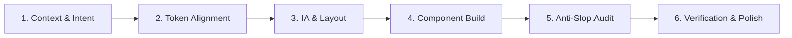

# UI/UX Design & Implementation Workflow

This document establishes the official engineering workflow for designing, building, and reviewing user interfaces in `nolen-ai-short-assistant`. It synthesizes best practices from **Impeccable** (system tokens & craft dials), **Hallmark** (anti-slop floor & honest data), **Taste-Skill** (density & editorial restraint), and **UI-UX-Pro-Max** (shadcn/ui & Tailwind architecture).

---

## Workflow Overview: The 6-Stage Lifecycle



---

## Stage 1: Context & Intent Alignment

Before writing a single line of JSX/TSX:

1. **Consult Product Specs**:
   - Read [PRODUCT.md](file:///D:/nolen-ai-short-assistant/docs/design/PRODUCT.md) to understand the screen's role in the production pipeline.
   - Reference the corresponding functional requirements in [PRD v1.0 §16.2](file:///D:/nolen-ai-short-assistant/docs/PRD/PRD_AI_Short_Film_Assistant_v1.0.md#162-ui-ia--screens-p0).
2. **Identify the Core Job**:
   - State in one sentence what decision the Producer makes on this screen (e.g., *"Approve story structure before billable generation"*, *"Review generated keyframes and reject/retry shot 3"*).
3. **Check Domain State Ownership**:
   - Determine which of the 3 orthogonal state machines are surfaced:
     - `StoryRevision` (`DRAFT` $\rightarrow$ `APPROVED`)
     - `Attempt` (`QUEUED` $\rightarrow$ `RUNNING` $\rightarrow$ `SUCCEEDED` / `FAILED`)
     - `AssetReview` (`PENDING_REVIEW` $\rightarrow$ `APPROVED` / `REJECTED`)

---

## Stage 2: Token Alignment & Design Foundation

Ensure the visual structure strictly adheres to [DESIGN.md](file:///D:/nolen-ai-short-assistant/docs/design/DESIGN.md):

1. **Surfaces**:
   - Base canvas: `bg-zinc-950` (`#09090b`).
   - Sidebars/Toolbars: `bg-zinc-900/80 backdrop-blur-md border-zinc-800`.
   - Cards/Containers: `bg-zinc-900 border border-zinc-800 rounded-lg`.
2. **Typography**:
   - Interface text: `font-sans` (`Inter` / `Geist`).
   - Metrics, Hashes, Currency, and Timecodes: `font-mono text-xs` (`Geist Mono`).
3. **Accents**:
   - Primary action (Cinematic Gold): `bg-amber-500 hover:bg-amber-600 text-black font-semibold`.
   - Budget Headroom: `text-emerald-400` / `border-emerald-600/30`.
   - Warning/Risk: `text-amber-400` / `border-amber-600/30`.
   - Overrun/Blocker: `text-rose-400` / `border-rose-600/30`.

---

## Stage 3: Information Architecture & Spatial Layout

Follow the **Three-Pane Workstation Architecture** for production workspaces:

```
+-----------------------------------------------------------------------------------------------+
| TOP BAR: Film Title | Mode (LIVE/REPLAY) | Pinned Budget Status Bar | Export Action           |
+----------------------+----------------------------------------+-------------------------------+
| LEFT PANE            | CENTER CANVAS                          | RIGHT INSPECTOR               |
| (Navigation & Tree)  | (Active Workstation)                   | (Context & Continuity)        |
|                      |                                        |                               |
| - Scene List         | - Storyboard Shot Cards                | - ShotSpec Editor Form        |
| - Shot Order Numbers | - Video Player / Keyframe Grid         | - Continuity Start/End Diff   |
| - Approval Badges    | - Regeneration History Timeline        | - Model Router Rationale      |
|                      | - Async Batch Progress Drawer          | - Itemized Attempt Ledger     |
+----------------------+----------------------------------------+-------------------------------+
| BOTTOM DOCK: Operational Heartbeat | Worker Status | Toast Notifications                      |
+-----------------------------------------------------------------------------------------------+
```

---

## Stage 4: Component Implementation Standards

1. **Component Library**:
   - Use standard **shadcn/ui** primitives installed in `clients/components/ui/` (Button, Dialog, DropdownMenu, Tabs, Tooltip, Badge, ScrollArea, Card).
   - Icons: Strictly use **Lucide React** (`lucide-react`). Uniform size `size-4` (16px) or `size-5` (20px).
2. **Currency & Financial Invariant**:
   - Always format financial numbers from integer micros (`amount_usd_micros / 1_000_000`).
   - Display full precision where necessary, e.g., `$0.250000`. Never round to zero.
3. **Optimistic Updates & Revision Safety**:
   - Mutating actions must include `expectedStoryRevisionId` or `expectedShotRevisionId`.
   - If server returns `409 VERSION_CONFLICT`, trigger a toast notice and revalidate cache without overwriting unseen changes.
4. **Asynchronous Non-Blocking States**:
   - Never render a full-screen blocking spinner while generation is running.
   - Use subtle pulse skeletons (`animate-pulse bg-zinc-800/60 rounded`) matching exact card dimensions.

---

## Stage 5: Craft & Anti-Slop Audit Checklist

Run through this checklist before submitting frontend code for review:

| Check Category | Verification Criteria | Status |
| :--- | :--- | :---: |
| **No Slop Visuals** | No purple-to-blue gradients; no glowing neon borders; no generic emojis as icons. | [ ] |
| **No Fake Data** | No hardcoded placeholder numbers (e.g., "10k+ happy users"); all numbers derive from props/DB. | [ ] |
| **State Clarity** | Story status, attempt job status, and asset review status are visually distinct. | [ ] |
| **Mode Honesty** | If in Replay mode, `REPLAY` pill is prominently displayed; no simulated costs hidden as real. | [ ] |
| **Budget Pinning** | Budget status widget remains visible on all Plan/Keyframe/Video/Export screens. | [ ] |
| **Responsive Wrap** | Workstation collapses gracefully on smaller screens (collapsible sidebars with toggle buttons). | [ ] |
| **Accessibility** | All icon-only buttons have `aria-label`; contrast ratio meets WCAG AA (4.5:1 minimum). | [ ] |

---

## Stage 6: Producer Review & Craft Polish Dials

Use the **Impeccable craft dials** during design critique:

- **`/quieter`**: If cards feel overly decorated, strip outer borders, mute secondary text to `text-zinc-500`, and increase whitespace.
- **`/bolder`**: If the visual hierarchy feels flat, strengthen Heading 1 size, emphasize primary buttons with solid `amber-500` fill, and darken card surfaces to increase depth.
- **`/distill`**: Eliminate any secondary button or metadata chip that does not directly assist the active approval decision.
- **`/typeset`**: Verify mono fonts are strictly reserved for code, timecodes, hashes, and currency micros.
