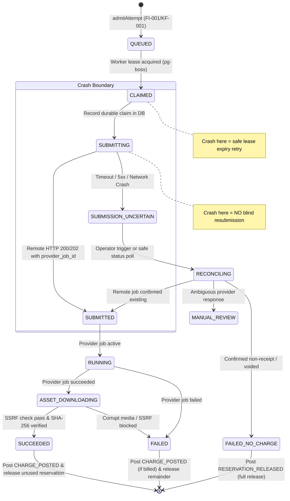

# PD-001 — Provider Dispatch, Crash Recovery & Financial Settlement (G3)

Status: DRAFT
Source: [PRD v1.0 §18, §21, §22](../../docs/PRD/PRD_AI_Short_Film_Assistant_v1.0.md)

## Goal

[DECIDED] An authenticated background worker can reliably claim queued billable generation attempts,
dispatch them to remote AI generation providers (Google Gemini, Runway Gen-4, fal.ai Kling) or local
deterministic pipelines (pan/zoom), safely handle worker crashes and uncertain network transmissions
without duplicate billing or silent capacity leakage, verify and download generated assets under strict
SSRF containment, and atomically settle reservations in the financial ledger.

## Scope

- **REQUIRED:**
  - Standardized Provider Adapter interfaces with Zod contracts in `@nolen/contracts` (`gemini-image`, `runway-video`, `fal-kling-video`).
  - Durable dispatch tracking table (`outbound_dispatches`) with states `PENDING`, `SUBMITTING`, `SUBMITTED`, `SUBMISSION_UNCERTAIN`, `SUCCEEDED`, `FAILED`.
  - Crash recovery protocol (G3-B): distinguish pre-claim crash (safe lease retry) from post-claim crash (uncertainty hold; no blind duplicate paid HTTP submission).
  - Financial hold under submission uncertainty (G3-A): retain `reservation_open_usd_micros` while remote outcome is unknown (`pending_liability <= reservation_open`).
  - Bounded outbox delivery retry (G3-C): exponential backoff with jitter and max retry ceiling for internal `pg-boss` relay; distinct from remote provider retry.
  - Safe asset ingest with SSRF protection (PRD §21): DNS resolution validation, blocking private/loopback/link-local IPv4/IPv6 addresses, size limit, and SHA-256 verification.
  - Fake adapter transport fixture for 100% deterministic, offline CI testing (G3-D).
- **PREREQUISITE:**
  - G1 Story Planning (`SP-001`): approved StoryRevisions and ShotSpecs.
  - G2 Financial Core (`FI-001`): atomic budget admission, row locks, append-only ledger events.
  - EP-03 Keyframe Approval Gate (`KF-001`): deterministic video attempt admission and asset schema.
- **DEFER:**
  - Live production credentials for Runway and fal.ai in CI (strictly restricted to fake adapters in CI; live smoke tests separately authorized).
  - Calibrated model router / contextual bandits (P1 / DEC-P04).
  - Final FFmpeg short film timeline assembly (EP-06).

### Risk Classification
Per [ENG-DEC-002](../../docs/development/ENG-DEC-002.md):
- **R0 (Critical)**:
  - Crash recovery boundaries (pre-claim vs post-claim).
  - Financial retention under `SUBMISSION_UNCERTAIN`.
  - Atomic reservation settlement (`CHARGE_POSTED`, `RESERVATION_RELEASED`).
  - SSRF security boundary for remote asset ingestion.
- **R1 (Important)**:
  - Provider adapter contract DTOs (Zod).
  - Dispatch lifecycle transitions and error envelopes.
  - Bounded exponential backoff policy for `dispatch_outbox`.
- **R2 (Flexible)**:
  - Provider status badge labels and log formatting.

## Invariants

- [DECIDED] Reserve-before-dispatch: every dispatchable attempt must already have an active budget reservation in `attempt_financial_state` (FI-001). Zero dispatch without committed reservation.
- [DECIDED] No blind resubmission (DEC-P06, G3-B): once an `outbound_dispatches` row transitions to `SUBMITTING`, network transmission may have occurred. A worker crash after this point must NEVER automatically re-execute a paid HTTP call.
- [DECIDED] Financial conservation under uncertainty (G3-A): if remote submission is uncertain, `pending_liability_usd_micros` is contained within open reservation (`pending_liability <= reservation_open`). Held capacity cannot be released or reused until verified resolution.
- [DECIDED] SSRF isolation (PRD §21): media download locators must reject RFC 1918, RFC 4193, loopback (`127.0.0.0/8`, `::1`), link-local (`169.254.0.0/16`), and non-HTTP/HTTPS protocols before initiating connection.
- [DECIDED] Content-addressed integrity: downloaded assets must be written to content-addressed storage (`keyframes/<sha256>.<ext>` or `videos/<sha256>.<ext>`) with on-disk SHA-256 verification matching database record.

### Behavioral and Architectural Models (Lightweight AMDD)

#### 1. Dispatch & Attempt Lifecycle State Machine

#### 2. Crash Recovery Sequence & Concurrency Matrix
| Crash Point | State at Recovery | Financial Treatment | Safe Automated Action | Prohibited Action |
|---|---|---|---|---|
| **Before `SUBMITTING` claim** | `QUEUED` / expired lease | `reservation_open` intact | Re-enqueue or re-claim lease | Blind double charge |
| **During `SUBMITTING` HTTP call** | `SUBMITTING` (stale lease) | Full reservation held | Transition to `SUBMISSION_UNCERTAIN` | Resending paid HTTP request |
| **After `SUBMITTED` persist** | `SUBMITTED` (`job_id` known) | Full reservation held | Status check against provider | Creating new Attempt |
| **During Asset Download** | `ASSET_DOWNLOADING` | Full reservation held | Resume download from known safe URL | Marking attempt failed without check |

#### 3. Bounded Outbox Backoff vs Provider Retry
- **Internal Relay Retry (`pg-boss` / `dispatch_outbox`)**:
  - Max retries: 5.
  - Delay formula: `min(1000 * 2^(retry_count), 30000) + random_jitter(0, 1000)ms`.
  - Terminal state: `EXHAUSTED` (remains durable, inspectable, alert emitted).
- **External Paid Provider Retry**:
  - Default: **0 automatic retries** for chargeable endpoints without explicit idempotent provider request header verification.
  - 429 Rate Limit: Bounded wait only if `Retry-After` header present and within reservation lease window; otherwise transition to `SUBMISSION_UNCERTAIN`.

## Acceptance criteria

- `PD-AT-01`: Happy path image generation -> Fake Gemini adapter returns mock image -> SSRF check passes -> SHA-256 verified -> Asset registered -> Actual charge posted -> Reservation released.
- `PD-AT-02`: Happy path video generation -> Keyframe asset reference passed -> Fake Runway adapter polls to success -> Video asset registered -> Charge settled.
- `PD-AT-03`: Crash before `SUBMITTING` claim -> Expired lease re-claimed -> Exactly one HTTP request made -> Idempotent completion.
- `PD-AT-04`: Crash during `SUBMITTING` call -> Worker restarts -> Detected stale `SUBMITTING` claim -> Transitions to `SUBMISSION_UNCERTAIN` -> Financial reservation remains held (`pending_liability <= reservation_open`).
- `PD-AT-05`: Reconciliation of `SUBMISSION_UNCERTAIN` -> Provider status lookup confirms remote job exists -> Resumes to `SUBMITTED` without second paid call.
- `PD-AT-06`: Reconciliation of `SUBMISSION_UNCERTAIN` -> Provider status lookup confirms no job exists -> Safely releases reservation with `RESERVATION_RELEASED`.
- `PD-AT-07`: SSRF attack in asset callback URL (e.g. `http://169.254.169.254/latest/meta-data` or `http://127.0.0.1:5432`) -> Ingestion blocked immediately (`SSRF_BLOCKED`) -> Media not fetched -> Attempt marked `FAILED`.
- `PD-AT-08`: Outbox relay encounters repeated transient DB failures -> Bounded backoff executes -> After 5 attempts transitions to `EXHAUSTED` without message loss.
- `PD-AT-09`: Remote provider returns 429/500 -> Billed status unknown -> Preserves financial hold, does NOT execute blind HTTP resubmission.
- `PD-AT-10`: Concurrent attempt execution and budget reservation under PG16 row locks -> Total spent + reserved never exceeds `budget_limit`.

## Open Questions / Blocked Contracts

- None. Pre-requisites G1, G2, and EP-03 (KF-001) are satisfied. Provider contracts use fake transports for CI/local verification.
