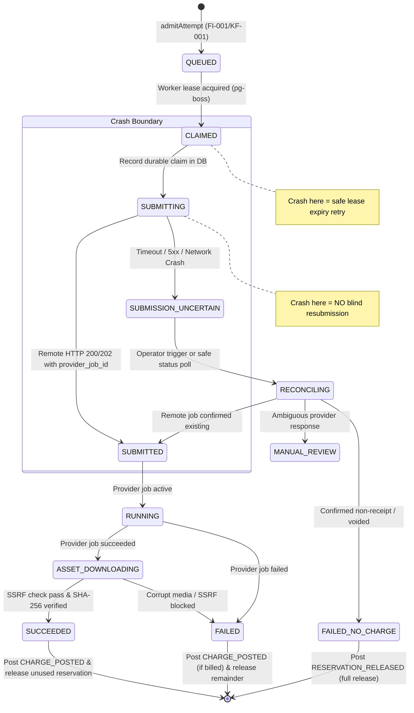

# PD-001 — Provider Dispatch, Crash Recovery & Financial Settlement (G3)

Status: DRAFT
Source: [PRD v1.0 §18, §21, §22](../../docs/PRD/PRD_AI_Short_Film_Assistant_v1.0.md), [DEC-P05, DEC-P06](../../AGENTS.md)

## Goal

[DECIDED] An authenticated background worker can reliably claim queued billable generation attempts,
dispatch them safely according to execution mode:
- **REPLAY Mode (PD-05a):** Zero financial charge, immutable request snapshot freezing, deterministic local fixture resolution with path containment, durable Asset completion with `REPLAY_FIXTURE` provenance, and resilient worker loop shutdown.
- **LIVE Mode (PD-05b):** Remote AI generation providers (Google Gemini, Runway Gen-4, fal.ai Kling) or local deterministic pipelines (pan/zoom), crash recovery without blind duplicate billing, safe asset download under SSRF containment, and atomic reservation settlement (`CHARGE_POSTED`, `RESERVATION_RELEASED`).

## Scope

- **REQUIRED:**
  - Standardized Provider Adapter interfaces with Zod contracts in `@nolen/contracts` (`gemini-image`, `runway-video`, `fal-kling-video`).
  - Durable dispatch tracking table (`outbound_dispatches`) with states `PENDING`, `SUBMITTING`, `SUBMITTED`, `SUBMISSION_UNCERTAIN`, `SUCCEEDED`, `FAILED`.
  - Crash recovery protocol (G3-B): distinguish pre-claim crash (safe lease retry) from post-claim crash (uncertainty hold; no blind duplicate paid HTTP submission).
  - Financial hold under submission uncertainty (G3-A): retain `reservation_open_usd_micros` while remote outcome is unknown (`pending_liability <= reservation_open`).
  - Bounded outbox delivery retry (G3-C): exponential backoff with jitter and max retry ceiling for internal `pg-boss` relay; distinct from remote provider retry.
  - Safe asset ingest with SSRF protection (PRD §21): DNS resolution validation, blocking private/loopback/link-local IPv4/IPv6 addresses, size limit, and SHA-256 verification.
  - Fake adapter transport fixture for 100% deterministic, offline CI testing (G3-D).
  - **PD-05a (Feature Slice):**
    - Immutable `execution_mode` on `attempts` and frozen `GenerationRequest` snapshot (`request`, `requestFingerprint`) in `dispatch_outbox.payload`.
    - Zero-reservation REPLAY admission (`reservation_usd_micros = 0`, `billing_status = 'FINAL'`, zero ledger events).
    - Overage tolerance for REPLAY admission (admit when `headroom < 0` because reservation is 0, while keeping approval gates).
    - Deterministic default fixture resolution frozen at admission.
    - Idempotent completion service writing content-addressed `Asset` with `REPLAY_FIXTURE` provenance.
    - CAS state transitions to terminal states (`SUCCEEDED`, `FAILED`) in `outbound_dispatches`.
    - Worker runtime integration with graceful shutdown and in-flight loop draining.
- **PREREQUISITE:**
  - G1 Story Planning (`SP-001`): approved StoryRevisions and ShotSpecs.
  - G2 Financial Core (`FI-001`): atomic budget admission, row locks, append-only ledger events.
  - EP-03 Keyframe Approval Gate (`KF-001`): deterministic video attempt admission and asset schema.
- **DEFER:**
  - **PD-05b:** Live remote provider credentials, remote asset downloading over HTTP, live provider billing evidence, and atomic ledger settlement (`CHARGE_POSTED`, `RESERVATION_RELEASED`). Full G3 completion gate requires PD-05b.
  - Calibrated model router / contextual bandits (P1 / DEC-P04).
  - Final FFmpeg short film timeline assembly (EP-06).

### Risk Classification
Per [ENG-DEC-002](../../docs/development/ENG-DEC-002.md):
- **R0 (Critical)**:
  - Crash recovery boundaries (pre-claim vs post-claim).
  - Financial retention under `SUBMISSION_UNCERTAIN`.
  - Mode boundary separation: zero financial ledger side-effects for REPLAY vs atomic reservation settlement for LIVE.
  - Non-reconcilable REPLAY attempts (reject `reconcileAttempt` with 409).
  - Admission under overage for REPLAY mode.
  - SSRF security boundary for remote asset ingestion.
- **R1 (Important)**:
  - Provider adapter contract DTOs (Zod) and discriminated asset locator (`REPLAY_FIXTURE` vs `REMOTE_URL`).
  - Dispatch lifecycle transitions and error envelopes.
  - Snapshot freeze of `GenerationRequest` and deterministic default `fixtureId` at admission.
  - Bounded exponential backoff policy for `dispatch_outbox`.
  - Worker runtime registration, timer cleanup, and graceful shutdown.
- **R2 (Flexible)**:
  - Provider status badge labels and log formatting.

## Invariants

- [DECIDED] Reserve-before-dispatch (LIVE): every LIVE dispatchable attempt must already have an active budget reservation in `attempt_financial_state` (FI-001). Zero dispatch without committed reservation.
- [DECIDED] Zero-charge REPLAY (DEC-P05): REPLAY attempts execute local fixtures with `reservation_usd_micros = 0`, `attempt_financial_state` (`billing_status = 'FINAL'`, `reservation_open = 0`, `realized = 0`, `pending_liability = 0`), creating zero `cost_ledger_events` and zero budget mutation.
- [DECIDED] Explicit mode boundary & Non-reconcilable REPLAY: `execution_mode` ('LIVE' | 'REPLAY') is immutable on `attempts` and frozen in outbox snapshot. Attempting to call `reconcileAttempt` on a REPLAY attempt must throw `409 REPLAY_ATTEMPT_NON_RECONCILABLE` to prevent retroactive financial correction on a zero-charge attempt.
- [DECIDED] REPLAY admission under film overage: when a film has `headroomUsdMicros < 0` (or `committed > budget_limit`), REPLAY admission succeeds because reservation is 0 micros. However, structural integrity (`StoryRevision` approved state, `ShotRevision` membership, and keyframe approval gating) is strictly enforced.
- [DECIDED] Deterministic default fixture frozen at admission: if client omits `fixtureId` in REPLAY mode, the server resolves the deterministic default fixture ID by `(provider, kind, aspectRatio)` and freezes `{ fixturePackVersion, fixtureId }` into the `dispatch_outbox.payload` snapshot. Worker never performs dynamic late fixture resolution.
- [DECIDED] No blind resubmission (DEC-P06, G3-B): once an `outbound_dispatches` row transitions to `SUBMITTING`, network transmission may have occurred. A worker crash after this point must NEVER automatically re-execute a paid HTTP call.
- [DECIDED] Financial conservation under uncertainty (G3-A): if remote submission is uncertain, `pending_liability_usd_micros` is contained within open reservation (`pending_liability <= reservation_open`). Held capacity cannot be released or reused until verified resolution.
- [DECIDED] SSRF isolation (PRD §21): media download locators must reject RFC 1918, RFC 4193, loopback (`127.0.0.0/8`, `::1`), link-local (`169.254.0.0/16`), and non-HTTP/HTTPS protocols before initiating connection.
- [DECIDED] Content-addressed integrity: downloaded assets must be written to content-addressed storage (`keyframes/<sha256>.<ext>` or `videos/<sha256>.<ext>`) with on-disk SHA-256 verification matching database record.
- [DECIDED] Fixture path containment: resolver validates path containment using `path.relative(realRoot, realTarget)` to block lexical traversal, absolute paths, and sibling prefix directory escapes.
- [DECIDED] Idempotent Asset completion & CAS transitions: completion uses `ON CONFLICT (attempt_id) DO NOTHING` on `assets` for recovery of existing assets, strictly verifies provenance (`REPLAY_FIXTURE`) and fixture identity in both inserted and conflict paths, verifies financial state `FINAL/0/0/0` and 0 ledger events inside transaction, and CAS transitions `outbound_dispatches` (`NOT_STARTED|SUBMITTING|SUBMITTED` -> `SUCCEEDED`) and `dispatch_outbox` (`WORKER_CONFIRMED`) with `RETURNING`.
- [DECIDED] Worker graceful shutdown & drain timeout: worker maintains a single shared `InFlightTracker` with rejection safety (`void promise.catch().finally()`) injected into all queue handlers and `WorkerShutdownCoordinator`; starts a 10s shutdown timeout timer immediately before awaiting runners and tracker drain; if in-flight tasks exceed the 10s timeout, sets `process.exitCode = 1` and waits for active tasks to settle before stopping `pg-boss`, avoiding process-kill or connection severance during active database transactions, and propagates the coordinator exit code to `exitFn`.
- [DECIDED] Mode-prefixed queue routing, replay isolation & deadlock prevention: attempts are routed at admission by mode and kind (`replay:generation:dispatch`, `replay:tts:dispatch`, `replay:assembly:dispatch` vs `live:*`); replay worker exclusively consumes `replay:*` queues, leaving `live:*` jobs and budget reservations untouched; kind is checked pre-flight outside transaction to eliminate nested transaction deadlocks; unsupported kinds in REPLAY transition `QUEUED`/`RUNNING` to `FAILED` with CAS while strictly preserving existing terminal states (`CANCELED`, `FAILED`, `SUCCEEDED`).
- [DECIDED] Strict job identity: worker enforces 1-to-1 match between `job.id` and `attemptId` without substring or colon bypasses.

### Behavioral and Architectural Models (Lightweight AMDD)

#### 1. Dispatch & Attempt Lifecycle State Machine

#### 2. Crash Recovery Sequence & Concurrency Matrix
| Crash Point | State at Recovery | Financial Treatment | Safe Automated Action | Prohibited Action |
|---|---|---|---|---|
| **Before `SUBMITTING` claim** | `QUEUED` / expired lease | `reservation_open` intact | Re-enqueue or re-claim lease | Blind double charge |
| **During `SUBMITTING` HTTP call** | `SUBMITTING` (stale lease) | Full reservation held | Transition to `SUBMISSION_UNCERTAIN` | Resending paid HTTP request |
| **After `SUBMITTED` persist** | `SUBMITTED` (`job_id` known) | Full reservation held | Status check against provider | Creating new Attempt |
| **During Asset Download** | `ASSET_DOWNLOADING` | Full reservation held | Resume download from known safe URL | Marking attempt failed without check |

#### 3. Bounded Outbox Backoff vs Provider Retry
- **Internal Relay Retry (`pg-boss` / `dispatch_outbox`)**:
  - Max retries: 5.
  - Delay formula: `min(1000 * 2^(retry_count), 30000) + random_jitter(0, 1000)ms`.
  - Terminal state: `EXHAUSTED` (remains durable, inspectable, alert emitted).
- **External Paid Provider Retry**:
  - Default: **0 automatic retries** for chargeable endpoints without explicit idempotent provider request header verification.
  - 429 Rate Limit: Bounded wait only if `Retry-After` header present and within reservation lease window; otherwise transition to `SUBMISSION_UNCERTAIN`.

## Acceptance criteria

### PD-05a (REPLAY Mode & Durable Completion):
- `PD-AT-01a`: REPLAY image generation -> Resolves local Gemini fixture -> Content-addressed storage write -> SHA-256 verified -> Asset registered with provenance `REPLAY_FIXTURE` -> Zero reservation, zero ledger event, financial audit matches.
- `PD-AT-02a`: REPLAY video generation -> Keyframe asset reference passed -> Resolves local Runway video fixture -> Video asset registered with `REPLAY_FIXTURE` provenance -> Zero reservation, zero ledger event.
- `PD-AT-03`: Crash before `SUBMITTING` claim -> Expired lease re-claimed -> Exactly one HTTP request made -> Idempotent completion.
- `PD-AT-04`: Crash during `SUBMITTING` call -> Worker restarts -> Detected stale `SUBMITTING` claim -> Transitions to `SUBMISSION_UNCERTAIN` -> Financial reservation remains held (`pending_liability <= reservation_open`).
- `PD-AT-05`: Reconciliation of `SUBMISSION_UNCERTAIN` -> Provider status lookup confirms remote job exists -> Resumes to `SUBMITTED` without second paid call.
- `PD-AT-06`: Reconciliation of `SUBMISSION_UNCERTAIN` -> Provider status lookup confirms no job exists -> Safely releases reservation with `RESERVATION_RELEASED`.
- `PD-AT-07`: SSRF attack in asset callback URL (e.g. `http://169.254.169.254/latest/meta-data` or `http://127.0.0.1:5432`) -> Ingestion blocked immediately (`SSRF_BLOCKED`) -> Media not fetched -> Attempt marked `FAILED`.
- `PD-AT-08`: Outbox relay encounters repeated transient DB failures -> Bounded backoff executes -> After 5 attempts transitions to `EXHAUSTED` without message loss.
- `PD-AT-09`: Remote provider returns 429/500 -> Billed status unknown -> Preserves financial hold, does NOT execute blind HTTP resubmission.
- `PD-AT-10`: Concurrent attempt execution and budget reservation under PG16 row locks -> Total spent + reserved never exceeds `budget_limit`.
- `PD-AT-11`: Explicit mode boundary & REPLAY non-reconcilable -> Calling `reconcileAttempt` on a REPLAY attempt throws 409 `REPLAY_ATTEMPT_NON_RECONCILABLE`.
- `PD-AT-12`: REPLAY admission under film overage -> Admitted with 0 reservation when `headroomUsdMicros < 0`; still rejects unapproved StoryRevision or missing keyframe.
- `PD-AT-13`: Deterministic default fixture frozen at admission -> Omitted `fixtureId` resolved to default and frozen in snapshot/payload; changing default later does not affect queued attempt.
- `PD-AT-14`: Worker graceful shutdown -> Clears loop timers via `clearTimeout` and awaits in-flight relay pass before stopping `pg-boss`.

### PD-05b (Deferred to LIVE Provider Integration):
- `PD-AT-01b`: LIVE image generation -> Real Gemini API -> Remote media download -> SSRF check passes -> SHA-256 verified -> Asset registered -> Actual charge posted -> Reservation released.
- `PD-AT-02b`: LIVE video generation -> Keyframe asset reference passed -> Real Runway API polls to success -> Remote media download -> Video asset registered -> Charge settled.

## Open Questions / Blocked Contracts

- Full G3 completion gate is partitioned: PD-05a delivers the complete REPLAY vertical slice; PD-05b delivers LIVE provider remote download, real billing settlement, and G3 final signoff.
